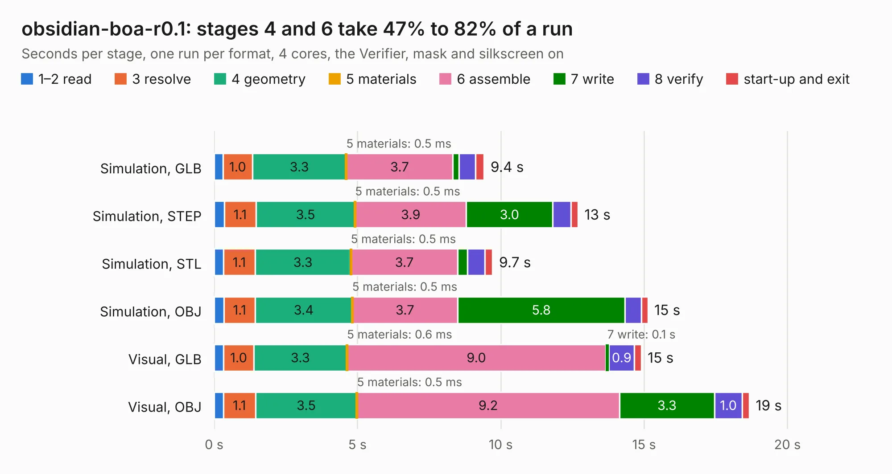

# 1191. obsidian-boa-r0.1

Board 1,191 of the 3,138 of [Corpus Testing](../Corpus-Testing.md), on [Corpus Page 12](../CorpusTestingPages/Corpus-Testing-12.md#1191-obsidian-boa-r01).

| Mode and format | 1–2 read | 3 resolve | 4 geometry | 5 materials | 6 assemble | 7 write | 8 verify | start-up and exit | Total |
|---|---:|---:|---:|---:|---:|---:|---:|---:|---:|
| Simulation, GLB | 0.3 | 1.0 | 3.3 | 0.5&nbsp;ms | 3.7 | 0.2 | 0.6 | 0.3 | 9.4 |
| Simulation, STEP | 0.4 | 1.1 | 3.5 | 0.5&nbsp;ms | 3.9 | 3.0 | 0.6 | 0.2 | 12.7 |
| Simulation, STL | 0.3 | 1.1 | 3.3 | 0.5&nbsp;ms | 3.7 | 0.3 | 0.6 | 0.3 | 9.7 |
| Simulation, OBJ | 0.3 | 1.1 | 3.4 | 0.5&nbsp;ms | 3.7 | 5.8 | 0.6 | 0.2 | 15.1 |
| Visual, GLB | 0.3 | 1.0 | 3.3 | 0.6&nbsp;ms | 9.0 | 0.1 | 0.9 | 0.2 | 14.9 |
| Visual, OBJ | 0.3 | 1.1 | 3.5 | 0.5&nbsp;ms | 9.2 | 3.3 | 1.0 | 0.2 | 18.7 |

<table align="center"><tr><td valign="top">

| Board | Repo: [gregdavill/obsidian-boa](https://github.com/gregdavill/obsidian-boa) Board: `obsidian-boa-r0.1.kicad_pcb` |
|---|---|
| Folder | hw / obsidian-boa-r0.1 |
| Complexity | 364&nbsp;/&nbsp;1000 (size&nbsp;239, features&nbsp;125) |
| KESE&nbsp;features | through vias, slotted holes, custom pads, rounded, trapezoid or chamfered pads, filled zones, copper drawings, curved board outline, stack-up, dielectric εr and tanδ, mask and silkscreen colours |
| Tested | 9th November 2026 |
| Copper&nbsp;layers | 4 |
| File&nbsp;format | KiCad 6 (20201002) |
| Parts,&nbsp;tracks,&nbsp;vias | 83, 975, 113 |
| Triangles,&nbsp;simulation | 1,191,616 in 87 parts |
| Verifier | PASS in all six runs |

</td><td valign="top">

<table>
<tr><th>File type</th><th>File size</th><th>Peak memory used</th></tr>
<tr><th colspan="3" align="left">Simulation</th></tr>
<tr><td>GLB</td><td align="right">40&nbsp;MB</td><td align="right">452&nbsp;MB</td></tr>
<tr><td>STEP</td><td align="right">180&nbsp;MB</td><td align="right">539&nbsp;MB</td></tr>
<tr><td>STL</td><td align="right">60&nbsp;MB</td><td align="right">450&nbsp;MB</td></tr>
<tr><td>OBJ</td><td align="right">121&nbsp;MB</td><td align="right">820&nbsp;MB</td></tr>
<tr><th colspan="3" align="left">Visual</th></tr>
<tr><td>GLB</td><td align="right">23&nbsp;MB</td><td align="right">644&nbsp;MB</td></tr>
<tr><td>OBJ</td><td align="right">71&nbsp;MB</td><td align="right">642&nbsp;MB</td></tr>
</table>

</td></tr></table>

| Previous | Next |
|:---|---:|
| [1190. syzygy-txr-breakout](b1190b_advent-calendar-of-circuits-2020_syzygy-txr-breakout.md) | [1192. FreshTwinkie](b1192b_PD-sniffer_FreshTwinkie.md) |
