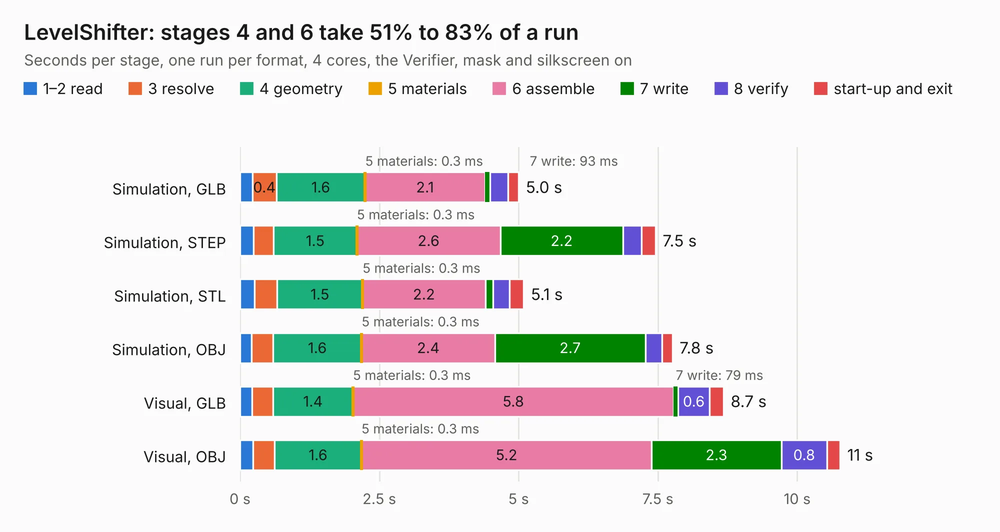

# 1192. LevelShifter

Board 1,192 of the 3,121 of [Corpus Testing](../Corpus-Testing.md), on [Corpus Page 12](../CorpusTestingPages/Corpus-Testing-12.md#1192-levelshifter).

| Mode and format | 1–2 read | 3 resolve | 4 geometry | 5 materials | 6 assemble | 7 write | 8 verify | start-up and exit | Total |
|---|---:|---:|---:|---:|---:|---:|---:|---:|---:|
| Simulation, GLB | 0.2 | 0.4 | 1.6 | 0.3&nbsp;ms | 2.1 | 93&nbsp;ms | 0.3 | 0.2 | 5.0 |
| Simulation, STEP | 0.2 | 0.4 | 1.5 | 0.3&nbsp;ms | 2.6 | 2.2 | 0.3 | 0.3 | 7.5 |
| Simulation, STL | 0.3 | 0.4 | 1.5 | 0.3&nbsp;ms | 2.2 | 0.1 | 0.3 | 0.2 | 5.1 |
| Simulation, OBJ | 0.2 | 0.4 | 1.6 | 0.3&nbsp;ms | 2.4 | 2.7 | 0.3 | 0.2 | 7.8 |
| Visual, GLB | 0.2 | 0.4 | 1.4 | 0.3&nbsp;ms | 5.8 | 79&nbsp;ms | 0.6 | 0.2 | 8.7 |
| Visual, OBJ | 0.2 | 0.4 | 1.6 | 0.3&nbsp;ms | 5.2 | 2.3 | 0.8 | 0.2 | 10.8 |

<table align="center"><tr><td valign="top">

| Board | Repo: [gusmanb/logicanalyzer](https://github.com/gusmanb/logicanalyzer) Board: `LevelShifter.kicad_pcb` |
|---|---|
| Folder | Electronics / LogicAnalyzer / LevelShifter |
| Complexity | 224&nbsp;/&nbsp;1000 (size&nbsp;164, features&nbsp;60) |
| KESE&nbsp;features | through vias, rounded, trapezoid or chamfered pads, arc tracks, filled zones |
| Tested | 9th November 2026 |
| Copper&nbsp;layers | 2 |
| File&nbsp;format | KiCad 6 (20211014) |
| Parts,&nbsp;tracks,&nbsp;vias | 21, 986, 10 |
| Triangles,&nbsp;simulation | 659,382 in 76 parts |
| Verifier | PASS in all six runs |

</td><td valign="top">

<table>
<tr><th>File type</th><th>File size</th><th>Peak memory used</th></tr>
<tr><th colspan="3" align="left">Simulation</th></tr>
<tr><td>GLB</td><td align="right">22&nbsp;MB</td><td align="right">370&nbsp;MB</td></tr>
<tr><td>STEP</td><td align="right">114&nbsp;MB</td><td align="right">426&nbsp;MB</td></tr>
<tr><td>STL</td><td align="right">33&nbsp;MB</td><td align="right">346&nbsp;MB</td></tr>
<tr><td>OBJ</td><td align="right">66&nbsp;MB</td><td align="right">472&nbsp;MB</td></tr>
<tr><th colspan="3" align="left">Visual</th></tr>
<tr><td>GLB</td><td align="right">18&nbsp;MB</td><td align="right">512&nbsp;MB</td></tr>
<tr><td>OBJ</td><td align="right">54&nbsp;MB</td><td align="right">526&nbsp;MB</td></tr>
</table>

</td></tr></table>

| Previous | Next |
|:---|---:|
| [1191. kimchi_micro](b1191b_kimchi-micro_kimchi-micro.md) | [1193. LogicAnalyzer](b1193b_logicanalyzer_LogicAnalyzer.md) |
