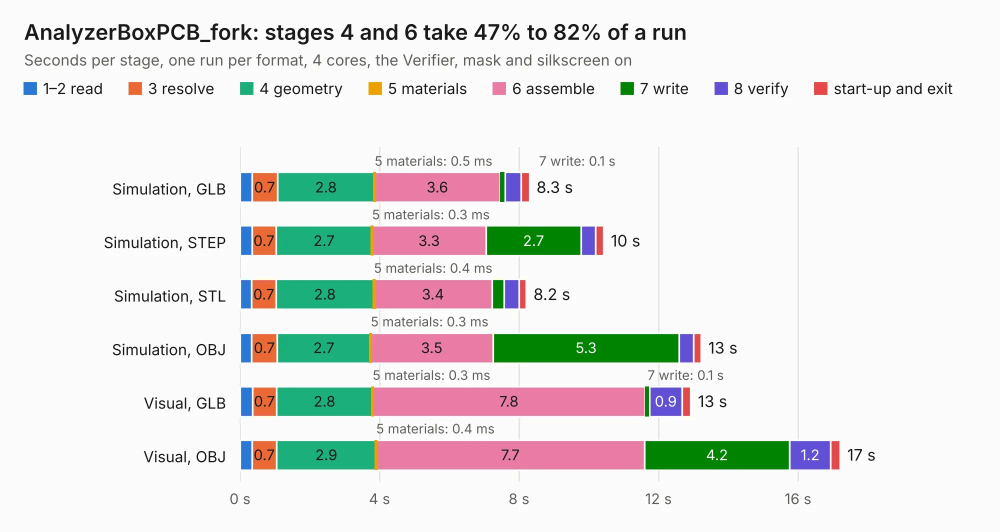

# 1193. AnalyzerBoxPCB_fork

Board 1,193 of the 3,119 of [Corpus Testing](../Corpus-Testing.md), on [Corpus Page 12](../CorpusTestingPages/Corpus-Testing-12.md#1193-analyzerboxpcb_fork).

| Mode and format | 1–2 read | 3 resolve | 4 geometry | 5 materials | 6 assemble | 7 write | 8 verify | start-up and exit | Total |
|---|---:|---:|---:|---:|---:|---:|---:|---:|---:|
| Simulation, GLB | 0.3 | 0.7 | 2.8 | 0.5&nbsp;ms | 3.6 | 0.1 | 0.5 | 0.2 | 8.3 |
| Simulation, STEP | 0.3 | 0.7 | 2.7 | 0.3&nbsp;ms | 3.3 | 2.7 | 0.4 | 0.2 | 10.4 |
| Simulation, STL | 0.3 | 0.7 | 2.8 | 0.4&nbsp;ms | 3.4 | 0.3 | 0.4 | 0.2 | 8.2 |
| Simulation, OBJ | 0.3 | 0.7 | 2.7 | 0.3&nbsp;ms | 3.5 | 5.3 | 0.4 | 0.2 | 13.2 |
| Visual, GLB | 0.4 | 0.7 | 2.8 | 0.3&nbsp;ms | 7.8 | 0.1 | 0.9 | 0.3 | 12.9 |
| Visual, OBJ | 0.3 | 0.7 | 2.9 | 0.4&nbsp;ms | 7.7 | 4.2 | 1.2 | 0.3 | 17.2 |

<table align="center"><tr><td valign="top">

| Board | Repo: [gusmanb/logicanalyzer](https://github.com/gusmanb/logicanalyzer) Board: `AnalyzerBoxPCB_fork.kicad_pcb` |
|---|---|
| Folder | Electronics / LogicAnalyzer / LogicAnalyzer_JasonYANG170 / KiCad 8 |
| Complexity | 250&nbsp;/&nbsp;1000 (size&nbsp;190, features&nbsp;60) |
| KESE&nbsp;features | through vias, arc tracks, filled zones, curved board outline |
| Tested | 9th November 2026 |
| Copper&nbsp;layers | 4 |
| File&nbsp;format | KiCad 8 (20240108) |
| Parts,&nbsp;tracks,&nbsp;vias | 54, 796, 63 |
| Triangles,&nbsp;simulation | 935,662 in 67 parts |
| Verifier | PASS in all six runs |

</td><td valign="top">

<table>
<tr><th>File type</th><th>File size</th><th>Peak memory used</th></tr>
<tr><th colspan="3" align="left">Simulation</th></tr>
<tr><td>GLB</td><td align="right">32&nbsp;MB</td><td align="right">492&nbsp;MB</td></tr>
<tr><td>STEP</td><td align="right">145&nbsp;MB</td><td align="right">515&nbsp;MB</td></tr>
<tr><td>STL</td><td align="right">47&nbsp;MB</td><td align="right">485&nbsp;MB</td></tr>
<tr><td>OBJ</td><td align="right">94&nbsp;MB</td><td align="right">662&nbsp;MB</td></tr>
<tr><th colspan="3" align="left">Visual</th></tr>
<tr><td>GLB</td><td align="right">25&nbsp;MB</td><td align="right">582&nbsp;MB</td></tr>
<tr><td>OBJ</td><td align="right">75&nbsp;MB</td><td align="right">620&nbsp;MB</td></tr>
</table>

</td></tr></table>

| Previous | Next |
|:---|---:|
| [1192. LogicAnalyzer](b1192b_logicanalyzer_LogicAnalyzer.md) | [1194. jitx-design](b1194b_logicanalyzer_jitx-design.md) |
