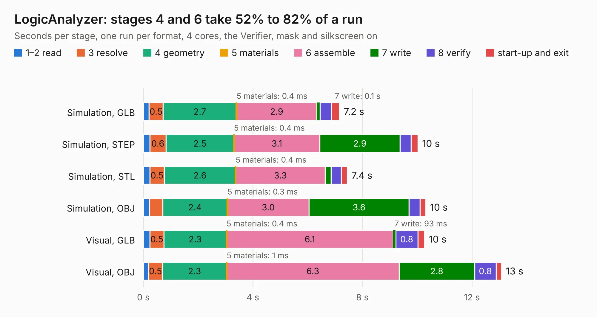

# 1194. LogicAnalyzer

Board 1,194 of the 3,130 of [Corpus Testing](../Corpus-Testing.md), on [Corpus Page 12](../CorpusTestingPages/Corpus-Testing-12.md#1194-logicanalyzer).

| Mode and format | 1–2 read | 3 resolve | 4 geometry | 5 materials | 6 assemble | 7 write | 8 verify | start-up and exit | Total |
|---|---:|---:|---:|---:|---:|---:|---:|---:|---:|
| Simulation, GLB | 0.2 | 0.5 | 2.7 | 0.4&nbsp;ms | 2.9 | 0.1 | 0.4 | 0.3 | 7.2 |
| Simulation, STEP | 0.2 | 0.6 | 2.5 | 0.4&nbsp;ms | 3.1 | 2.9 | 0.4 | 0.2 | 10.0 |
| Simulation, STL | 0.2 | 0.5 | 2.6 | 0.4&nbsp;ms | 3.3 | 0.2 | 0.4 | 0.2 | 7.4 |
| Simulation, OBJ | 0.2 | 0.5 | 2.4 | 0.3&nbsp;ms | 3.0 | 3.6 | 0.4 | 0.2 | 10.3 |
| Visual, GLB | 0.2 | 0.5 | 2.3 | 0.4&nbsp;ms | 6.1 | 93&nbsp;ms | 0.8 | 0.2 | 10.3 |
| Visual, OBJ | 0.2 | 0.5 | 2.3 | 1&nbsp;ms | 6.3 | 2.8 | 0.8 | 0.2 | 13.1 |

<table align="center"><tr><td valign="top">

| Board | Repo: [gusmanb/logicanalyzer](https://github.com/gusmanb/logicanalyzer) Board: `LogicAnalyzer.kicad_pcb` |
|---|---|
| Folder | Electronics / LogicAnalyzer / LogicAnalyzer |
| Complexity | 228&nbsp;/&nbsp;1000 (size&nbsp;158, features&nbsp;70) |
| KESE&nbsp;features | through vias, rounded, trapezoid or chamfered pads, drill offsets, arc tracks, filled zones |
| Tested | 9th November 2026 |
| Copper&nbsp;layers | 2 |
| File&nbsp;format | KiCad 6 (20211014) |
| Parts,&nbsp;tracks,&nbsp;vias | 10, 1,119, 1 |
| Triangles,&nbsp;simulation | 881,842 in 50 parts |
| Verifier | PASS in all six runs |

</td><td valign="top">

<table>
<tr><th>File type</th><th>File size</th><th>Peak memory used</th></tr>
<tr><th colspan="3" align="left">Simulation</th></tr>
<tr><td>GLB</td><td align="right">29&nbsp;MB</td><td align="right">423&nbsp;MB</td></tr>
<tr><td>STEP</td><td align="right">165&nbsp;MB</td><td align="right">502&nbsp;MB</td></tr>
<tr><td>STL</td><td align="right">44&nbsp;MB</td><td align="right">436&nbsp;MB</td></tr>
<tr><td>OBJ</td><td align="right">88&nbsp;MB</td><td align="right">598&nbsp;MB</td></tr>
<tr><th colspan="3" align="left">Visual</th></tr>
<tr><td>GLB</td><td align="right">24&nbsp;MB</td><td align="right">651&nbsp;MB</td></tr>
<tr><td>OBJ</td><td align="right">72&nbsp;MB</td><td align="right">649&nbsp;MB</td></tr>
</table>

</td></tr></table>

| Previous | Next |
|:---|---:|
| [1193. LevelShifter](b1193b_logicanalyzer_LevelShifter.md) | [1195. AnalyzerBoxPCB_fork](b1195b_logicanalyzer_AnalyzerBoxPCB-fork.md) |
