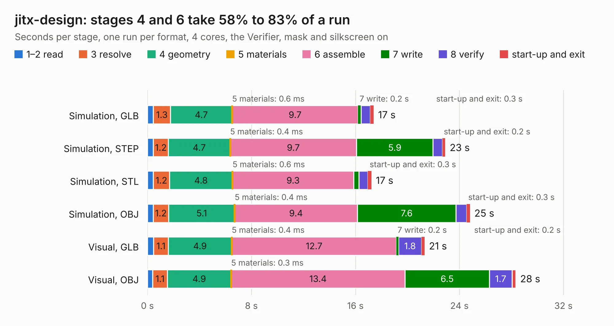

# 1195. jitx-design

Board 1,195 of the 3,122 of [Corpus Testing](../Corpus-Testing.md), on [Corpus Page 12](../CorpusTestingPages/Corpus-Testing-12.md#1195-jitx-design).

| Mode and format | 1–2 read | 3 resolve | 4 geometry | 5 materials | 6 assemble | 7 write | 8 verify | start-up and exit | Total |
|---|---:|---:|---:|---:|---:|---:|---:|---:|---:|
| Simulation, GLB | 0.4 | 1.3 | 4.7 | 0.6&nbsp;ms | 9.7 | 0.2 | 0.7 | 0.3 | 17.4 |
| Simulation, STEP | 0.5 | 1.2 | 4.7 | 0.4&nbsp;ms | 9.7 | 5.9 | 0.7 | 0.2 | 22.9 |
| Simulation, STL | 0.5 | 1.2 | 4.8 | 0.6&nbsp;ms | 9.3 | 0.4 | 0.7 | 0.3 | 17.2 |
| Simulation, OBJ | 0.4 | 1.2 | 5.1 | 0.4&nbsp;ms | 9.4 | 7.6 | 0.8 | 0.3 | 24.8 |
| Visual, GLB | 0.5 | 1.1 | 4.9 | 0.4&nbsp;ms | 12.7 | 0.2 | 1.8 | 0.2 | 21.3 |
| Visual, OBJ | 0.4 | 1.1 | 4.9 | 0.3&nbsp;ms | 13.4 | 6.5 | 1.7 | 0.3 | 28.3 |

<table align="center"><tr><td valign="top">

| Board | Repo: [gusmanb/logicanalyzer](https://github.com/gusmanb/logicanalyzer) Board: `jitx-design.kicad_pcb` |
|---|---|
| Folder | Electronics / LogicAnalyzer / LogicAnalyzerV2 / designs / jitx-design / kicad |
| Complexity | 308&nbsp;/&nbsp;1000 (size&nbsp;193, features&nbsp;115) |
| KESE&nbsp;features | through vias, slotted holes, arc tracks, filled zones, copper drawings, TrueType text, stack-up, dielectric εr and tanδ |
| Tested | 9th November 2026 |
| Copper&nbsp;layers | 4 |
| File&nbsp;format | KiCad 8 (20240108) |
| Parts,&nbsp;tracks,&nbsp;vias | 26, 1,778, 50 |
| Triangles,&nbsp;simulation | 1,448,730 in 69 parts |
| Verifier | PASS in all six runs |

</td><td valign="top">

<table>
<tr><th>File type</th><th>File size</th><th>Peak memory used</th></tr>
<tr><th colspan="3" align="left">Simulation</th></tr>
<tr><td>GLB</td><td align="right">49&nbsp;MB</td><td align="right">665&nbsp;MB</td></tr>
<tr><td>STEP</td><td align="right">274&nbsp;MB</td><td align="right">710&nbsp;MB</td></tr>
<tr><td>STL</td><td align="right">72&nbsp;MB</td><td align="right">670&nbsp;MB</td></tr>
<tr><td>OBJ</td><td align="right">150&nbsp;MB</td><td align="right">961&nbsp;MB</td></tr>
<tr><th colspan="3" align="left">Visual</th></tr>
<tr><td>GLB</td><td align="right">41&nbsp;MB</td><td align="right">694&nbsp;MB</td></tr>
<tr><td>OBJ</td><td align="right">123&nbsp;MB</td><td align="right">881&nbsp;MB</td></tr>
</table>

</td></tr></table>

| Previous | Next |
|:---|---:|
| [1194. AnalyzerBoxPCB_fork](b1194b_logicanalyzer_AnalyzerBoxPCB-fork.md) | [1196. StackLink](b1196b_logicanalyzer_StackLink.md) |
