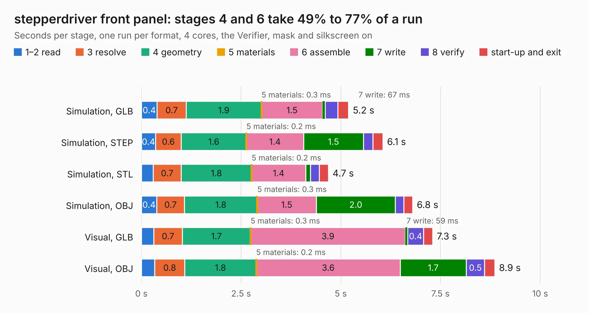

# 1197. stepperdriver front panel

Board 1,197 of the 3,109 of [Corpus Testing](../Corpus-Testing.md), on [Corpus Page 12](../CorpusTestingPages/Corpus-Testing-12.md#1197-stepperdriver-front-panel).

| Mode and format | 1–2 read | 3 resolve | 4 geometry | 5 materials | 6 assemble | 7 write | 8 verify | start-up and exit | Total |
|---|---:|---:|---:|---:|---:|---:|---:|---:|---:|
| Simulation, GLB | 0.4 | 0.7 | 1.9 | 0.3&nbsp;ms | 1.5 | 67&nbsp;ms | 0.3 | 0.3 | 5.2 |
| Simulation, STEP | 0.4 | 0.6 | 1.6 | 0.2&nbsp;ms | 1.4 | 1.5 | 0.2 | 0.2 | 6.1 |
| Simulation, STL | 0.3 | 0.7 | 1.8 | 0.2&nbsp;ms | 1.4 | 0.1 | 0.2 | 0.2 | 4.7 |
| Simulation, OBJ | 0.4 | 0.7 | 1.8 | 0.3&nbsp;ms | 1.5 | 2.0 | 0.2 | 0.2 | 6.8 |
| Visual, GLB | 0.3 | 0.7 | 1.7 | 0.3&nbsp;ms | 3.9 | 59&nbsp;ms | 0.4 | 0.2 | 7.3 |
| Visual, OBJ | 0.3 | 0.8 | 1.8 | 0.2&nbsp;ms | 3.6 | 1.7 | 0.5 | 0.3 | 8.9 |

<table align="center"><tr><td valign="top">

| Board | Repo: [harp-tech/device.stepperdriver](https://github.com/harp-tech/device.stepperdriver) Board: `stepperdriver front panel.kicad_pcb` |
|---|---|
| Folder | Hardware / PCB / stepper driver front panel |
| Complexity | 239&nbsp;/&nbsp;1000 (size&nbsp;149, features&nbsp;90) |
| KESE&nbsp;features | through vias, rounded, trapezoid or chamfered pads, filled zones, curved board outline, stack-up, dielectric εr and tanδ, mask and silkscreen colours |
| Tested | 9th November 2026 |
| Copper&nbsp;layers | 2 |
| File&nbsp;format | KiCad 9 (20241229) |
| Parts,&nbsp;tracks,&nbsp;vias | 22, 219, 57 |
| Triangles,&nbsp;simulation | 410,638 in 37 parts |
| Note | panel |
| Verifier | PASS in all six runs |

</td><td valign="top">

<table>
<tr><th>File type</th><th>File size</th><th>Peak memory used</th></tr>
<tr><th colspan="3" align="left">Simulation</th></tr>
<tr><td>GLB</td><td align="right">14&nbsp;MB</td><td align="right">291&nbsp;MB</td></tr>
<tr><td>STEP</td><td align="right">73&nbsp;MB</td><td align="right">326&nbsp;MB</td></tr>
<tr><td>STL</td><td align="right">21&nbsp;MB</td><td align="right">290&nbsp;MB</td></tr>
<tr><td>OBJ</td><td align="right">42&nbsp;MB</td><td align="right">345&nbsp;MB</td></tr>
<tr><th colspan="3" align="left">Visual</th></tr>
<tr><td>GLB</td><td align="right">11&nbsp;MB</td><td align="right">326&nbsp;MB</td></tr>
<tr><td>OBJ</td><td align="right">34&nbsp;MB</td><td align="right">329&nbsp;MB</td></tr>
</table>

</td></tr></table>

| Previous | Next |
|:---|---:|
| [1196. Easyduino_STM32F103](b1196b_Easyduino_Easyduino-STM32F103.md) | [1198. stepper driver rear panel](b1198b_device-stepperdriver_stepper-driver-rear-panel.md) |
