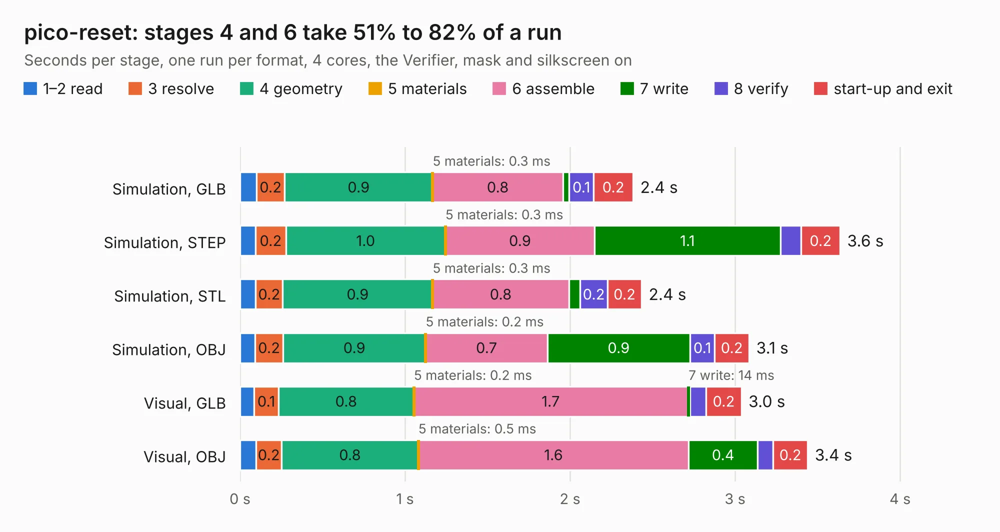

# 1197. pico-reset

Board 1,197 of the 3,119 of [Corpus Testing](../Corpus-Testing.md), on [Corpus Page 12](../CorpusTestingPages/Corpus-Testing-12.md#1197-pico-reset).

| Mode and format | 1–2 read | 3 resolve | 4 geometry | 5 materials | 6 assemble | 7 write | 8 verify | start-up and exit | Total |
|---|---:|---:|---:|---:|---:|---:|---:|---:|---:|
| Simulation, GLB | 0.1 | 0.2 | 0.9 | 0.3&nbsp;ms | 0.8 | 38&nbsp;ms | 0.1 | 0.2 | 2.4 |
| Simulation, STEP | 94&nbsp;ms | 0.2 | 1.0 | 0.3&nbsp;ms | 0.9 | 1.1 | 0.1 | 0.2 | 3.6 |
| Simulation, STL | 95&nbsp;ms | 0.2 | 0.9 | 0.3&nbsp;ms | 0.8 | 68&nbsp;ms | 0.2 | 0.2 | 2.4 |
| Simulation, OBJ | 91&nbsp;ms | 0.2 | 0.9 | 0.2&nbsp;ms | 0.7 | 0.9 | 0.1 | 0.2 | 3.1 |
| Visual, GLB | 85&nbsp;ms | 0.1 | 0.8 | 0.2&nbsp;ms | 1.7 | 14&nbsp;ms | 99&nbsp;ms | 0.2 | 3.0 |
| Visual, OBJ | 97&nbsp;ms | 0.2 | 0.8 | 0.5&nbsp;ms | 1.6 | 0.4 | 93&nbsp;ms | 0.2 | 3.4 |

<table align="center"><tr><td valign="top">

| Board | Repo: [hackclub/sprig](https://github.com/hackclub/sprig) Board: `pico-reset.kicad_pcb` |
|---|---|
| Folder | sprig-hax / hardware / DebugShimPCB |
| Complexity | 82&nbsp;/&nbsp;1000 (size&nbsp;82, features&nbsp;0) |
| Tested | 9th November 2026 |
| Copper&nbsp;layers | 2 |
| File&nbsp;format | KiCad 8 (20240108) |
| Parts,&nbsp;tracks,&nbsp;vias | 3, 21, 0 |
| Triangles,&nbsp;simulation | 162,188 in 52 parts |
| Verifier | PASS in all six runs |

</td><td valign="top">

<table>
<tr><th>File type</th><th>File size</th><th>Peak memory used</th></tr>
<tr><th colspan="3" align="left">Simulation</th></tr>
<tr><td>GLB</td><td align="right">5.1&nbsp;MB</td><td align="right">194&nbsp;MB</td></tr>
<tr><td>STEP</td><td align="right">22&nbsp;MB</td><td align="right">213&nbsp;MB</td></tr>
<tr><td>STL</td><td align="right">8.1&nbsp;MB</td><td align="right">194&nbsp;MB</td></tr>
<tr><td>OBJ</td><td align="right">16&nbsp;MB</td><td align="right">194&nbsp;MB</td></tr>
<tr><th colspan="3" align="left">Visual</th></tr>
<tr><td>GLB</td><td align="right">2.7&nbsp;MB</td><td align="right">158&nbsp;MB</td></tr>
<tr><td>OBJ</td><td align="right">7.6&nbsp;MB</td><td align="right">159&nbsp;MB</td></tr>
</table>

</td></tr></table>

| Previous | Next |
|:---|---:|
| [1196. sprig_console](b1196b_sprig_hardware-mainboard-PCB-kicad_sprig-console.md) | [1198. sprig_console](b1198b_sprig_sprig-hax-hardware-SprigHaxPCB-kicad_sprig-console.md) |
