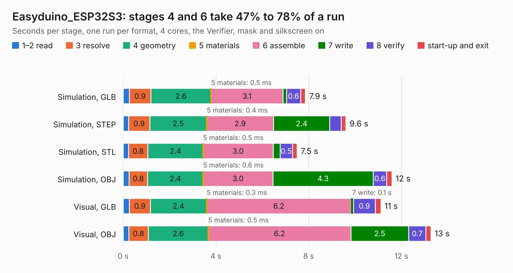

# 1200. Easyduino_ESP32S3

Board 1,200 of the 3,116 of [Corpus Testing](../Corpus-Testing.md), on [Corpus Page 12](../CorpusTestingPages/Corpus-Testing-12.md#1200-easyduino_esp32s3).

| Mode and format | 1–2 read | 3 resolve | 4 geometry | 5 materials | 6 assemble | 7 write | 8 verify | start-up and exit | Total |
|---|---:|---:|---:|---:|---:|---:|---:|---:|---:|
| Simulation, GLB | 0.3 | 0.9 | 2.6 | 0.5&nbsp;ms | 3.1 | 0.2 | 0.6 | 0.2 | 7.9 |
| Simulation, STEP | 0.2 | 0.9 | 2.5 | 0.4&nbsp;ms | 2.9 | 2.4 | 0.5 | 0.2 | 9.6 |
| Simulation, STL | 0.2 | 0.8 | 2.4 | 0.5&nbsp;ms | 3.0 | 0.3 | 0.5 | 0.2 | 7.5 |
| Simulation, OBJ | 0.3 | 0.8 | 2.4 | 0.6&nbsp;ms | 3.0 | 4.3 | 0.6 | 0.2 | 11.6 |
| Visual, GLB | 0.3 | 0.9 | 2.4 | 0.3&nbsp;ms | 6.2 | 0.1 | 0.9 | 0.2 | 11.1 |
| Visual, OBJ | 0.2 | 0.8 | 2.6 | 0.5&nbsp;ms | 6.2 | 2.5 | 0.7 | 0.2 | 13.3 |

<table align="center"><tr><td valign="top">

| Board | Repo: [Hanqaqa/Easyduino](https://github.com/Hanqaqa/Easyduino) Board: `Easyduino_ESP32S3.kicad_pcb` |
|---|---|
| Folder | ESP32S3 |
| Complexity | 312&nbsp;/&nbsp;1000 (size&nbsp;227, features&nbsp;85) |
| KESE&nbsp;features | through vias, slotted holes, rounded, trapezoid or chamfered pads, filled zones, stack-up, dielectric εr and tanδ |
| Tested | 9th November 2026 |
| Copper&nbsp;layers | 4 |
| File&nbsp;format | KiCad 10 (20260206) |
| Parts,&nbsp;tracks,&nbsp;vias | 35, 703, 137 |
| Triangles,&nbsp;simulation | 980,336 in 89 parts |
| Verifier | PASS in all six runs |

</td><td valign="top">

<table>
<tr><th>File type</th><th>File size</th><th>Peak memory used</th></tr>
<tr><th colspan="3" align="left">Simulation</th></tr>
<tr><td>GLB</td><td align="right">33&nbsp;MB</td><td align="right">420&nbsp;MB</td></tr>
<tr><td>STEP</td><td align="right">135&nbsp;MB</td><td align="right">519&nbsp;MB</td></tr>
<tr><td>STL</td><td align="right">49&nbsp;MB</td><td align="right">409&nbsp;MB</td></tr>
<tr><td>OBJ</td><td align="right">99&nbsp;MB</td><td align="right">696&nbsp;MB</td></tr>
<tr><th colspan="3" align="left">Visual</th></tr>
<tr><td>GLB</td><td align="right">19&nbsp;MB</td><td align="right">536&nbsp;MB</td></tr>
<tr><td>OBJ</td><td align="right">58&nbsp;MB</td><td align="right">509&nbsp;MB</td></tr>
</table>

</td></tr></table>

| Previous | Next |
|:---|---:|
| [1199. Easyduino_ESP32](b1199b_Easyduino_Easyduino-ESP32.md) | [1201. Easyduino_RP2040](b1201b_Easyduino_Easyduino-RP2040.md) |
