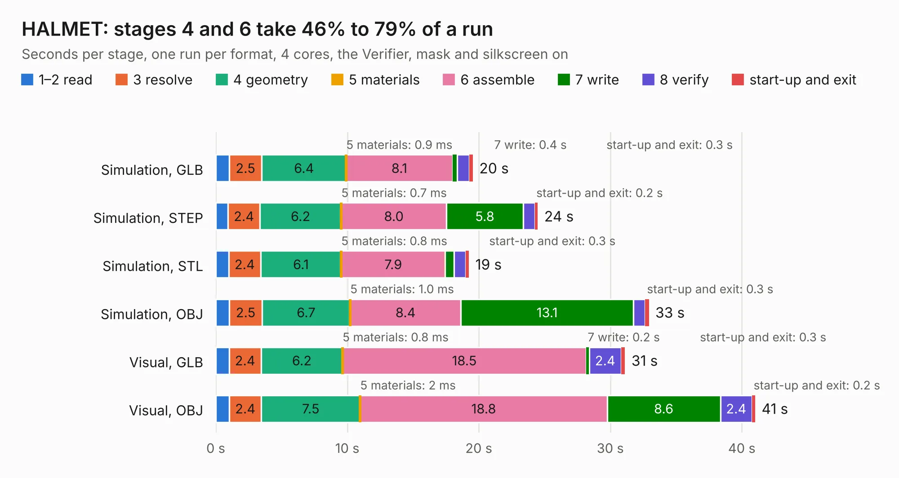

# 1200. HALMET

Board 1,200 of the 3,106 of [Corpus Testing](../Corpus-Testing.md), on [Corpus Page 12](../CorpusTestingPages/Corpus-Testing-12.md#1200-halmet).

| Mode and format | 1–2 read | 3 resolve | 4 geometry | 5 materials | 6 assemble | 7 write | 8 verify | start-up and exit | Total |
|---|---:|---:|---:|---:|---:|---:|---:|---:|---:|
| Simulation, GLB | 1.0 | 2.5 | 6.4 | 0.9&nbsp;ms | 8.1 | 0.4 | 0.9 | 0.3 | 19.5 |
| Simulation, STEP | 0.9 | 2.4 | 6.2 | 0.7&nbsp;ms | 8.0 | 5.8 | 0.9 | 0.2 | 24.5 |
| Simulation, STL | 1.0 | 2.4 | 6.1 | 0.8&nbsp;ms | 7.9 | 0.7 | 0.9 | 0.3 | 19.2 |
| Simulation, OBJ | 1.0 | 2.5 | 6.7 | 1.0&nbsp;ms | 8.4 | 13.1 | 0.9 | 0.3 | 32.9 |
| Visual, GLB | 1.0 | 2.4 | 6.2 | 0.8&nbsp;ms | 18.5 | 0.2 | 2.4 | 0.3 | 31.1 |
| Visual, OBJ | 1.0 | 2.4 | 7.5 | 2&nbsp;ms | 18.8 | 8.6 | 2.4 | 0.2 | 41.0 |

<table align="center"><tr><td valign="top">

| Board | Repo: [hatlabs/halmet-hardware](https://github.com/hatlabs/halmet-hardware) Board: `HALMET.kicad_pcb` |
|---|---|
| Complexity | 369&nbsp;/&nbsp;1000 (size&nbsp;219, features&nbsp;150) |
| KESE&nbsp;features | through vias, slotted holes, custom pads, rounded, trapezoid or chamfered pads, filled zones, copper drawings, curved board outline, knockout text, TrueType text, stack-up, dielectric εr and tanδ |
| Tested | 9th November 2026 |
| Copper&nbsp;layers | 4 |
| File&nbsp;format | KiCad 9 (20241229) |
| Parts,&nbsp;tracks,&nbsp;vias | 215, 1,395, 333 |
| Triangles,&nbsp;simulation | 2,383,058 in 156 parts |
| Verifier | PASS in all six runs |

</td><td valign="top">

<table>
<tr><th>File type</th><th>File size</th><th>Peak memory used</th></tr>
<tr><th colspan="3" align="left">Simulation</th></tr>
<tr><td>GLB</td><td align="right">80&nbsp;MB</td><td align="right">816&nbsp;MB</td></tr>
<tr><td>STEP</td><td align="right">325&nbsp;MB</td><td align="right">972&nbsp;MB</td></tr>
<tr><td>STL</td><td align="right">119&nbsp;MB</td><td align="right">800&nbsp;MB</td></tr>
<tr><td>OBJ</td><td align="right">249&nbsp;MB</td><td align="right">1.6&nbsp;GB</td></tr>
<tr><th colspan="3" align="left">Visual</th></tr>
<tr><td>GLB</td><td align="right">53&nbsp;MB</td><td align="right">1.1&nbsp;GB</td></tr>
<tr><td>OBJ</td><td align="right">164&nbsp;MB</td><td align="right">1.2&nbsp;GB</td></tr>
</table>

</td></tr></table>

| Previous | Next |
|:---|---:|
| [1199. stepper driver](b1199b_device-stepperdriver_stepper-driver.md) | [1201. HALPI2](b1201b_halpi2-hardware_HALPI2.md) |
