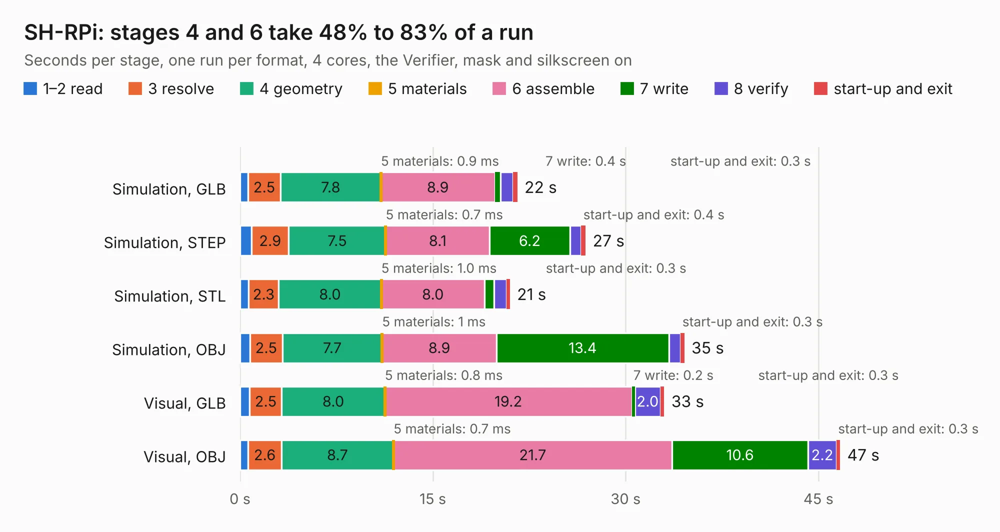

# 1200. SH-RPi

Board 1,200 of the 3,103 of [Corpus Testing](../Corpus-Testing.md), on [Corpus Page 12](../CorpusTestingPages/Corpus-Testing-12.md#1200-sh-rpi).

| Mode and format | 1–2 read | 3 resolve | 4 geometry | 5 materials | 6 assemble | 7 write | 8 verify | start-up and exit | Total |
|---|---:|---:|---:|---:|---:|---:|---:|---:|---:|
| Simulation, GLB | 0.6 | 2.5 | 7.8 | 0.9&nbsp;ms | 8.9 | 0.4 | 1.0 | 0.3 | 21.6 |
| Simulation, STEP | 0.9 | 2.9 | 7.5 | 0.7&nbsp;ms | 8.1 | 6.2 | 0.9 | 0.4 | 26.9 |
| Simulation, STL | 0.7 | 2.3 | 8.0 | 1.0&nbsp;ms | 8.0 | 0.7 | 1.0 | 0.3 | 21.0 |
| Simulation, OBJ | 0.8 | 2.5 | 7.7 | 1&nbsp;ms | 8.9 | 13.4 | 0.9 | 0.3 | 34.6 |
| Visual, GLB | 0.8 | 2.5 | 8.0 | 0.8&nbsp;ms | 19.2 | 0.2 | 2.0 | 0.3 | 33.0 |
| Visual, OBJ | 0.6 | 2.6 | 8.7 | 0.7&nbsp;ms | 21.7 | 10.6 | 2.2 | 0.3 | 46.7 |

<table align="center"><tr><td valign="top">

| Board | Repo: [hatlabs/sh-rpi-hardware](https://github.com/hatlabs/sh-rpi-hardware) Board: `SH-RPi.kicad_pcb` |
|---|---|
| Complexity | 343&nbsp;/&nbsp;1000 (size&nbsp;213, features&nbsp;130) |
| KESE&nbsp;features | through vias, custom pads, rounded, trapezoid or chamfered pads, filled zones, copper drawings, curved board outline, stack-up, dielectric εr and tanδ, copper finish, mask and silkscreen colours |
| Tested | 9th November 2026 |
| Copper&nbsp;layers | 4 |
| File&nbsp;format | KiCad 8 (20240108) |
| Parts,&nbsp;tracks,&nbsp;vias | 153, 925, 364 |
| Triangles,&nbsp;simulation | 2,241,942 in 132 parts |
| Verifier | PASS in all six runs |

</td><td valign="top">

<table>
<tr><th>File type</th><th>File size</th><th>Peak memory used</th></tr>
<tr><th colspan="3" align="left">Simulation</th></tr>
<tr><td>GLB</td><td align="right">75&nbsp;MB</td><td align="right">719&nbsp;MB</td></tr>
<tr><td>STEP</td><td align="right">275&nbsp;MB</td><td align="right">955&nbsp;MB</td></tr>
<tr><td>STL</td><td align="right">112&nbsp;MB</td><td align="right">743&nbsp;MB</td></tr>
<tr><td>OBJ</td><td align="right">234&nbsp;MB</td><td align="right">1.5&nbsp;GB</td></tr>
<tr><th colspan="3" align="left">Visual</th></tr>
<tr><td>GLB</td><td align="right">50&nbsp;MB</td><td align="right">926&nbsp;MB</td></tr>
<tr><td>OBJ</td><td align="right">155&nbsp;MB</td><td align="right">1.1&nbsp;GB</td></tr>
</table>

</td></tr></table>

| Previous | Next |
|:---|---:|
| [1199. HALSER](b1199b_halser-hardware_HALSER.md) | [1201. motor-controller-hw](b1201b_motor-controller-2018_motor-controller-hw.md) |
