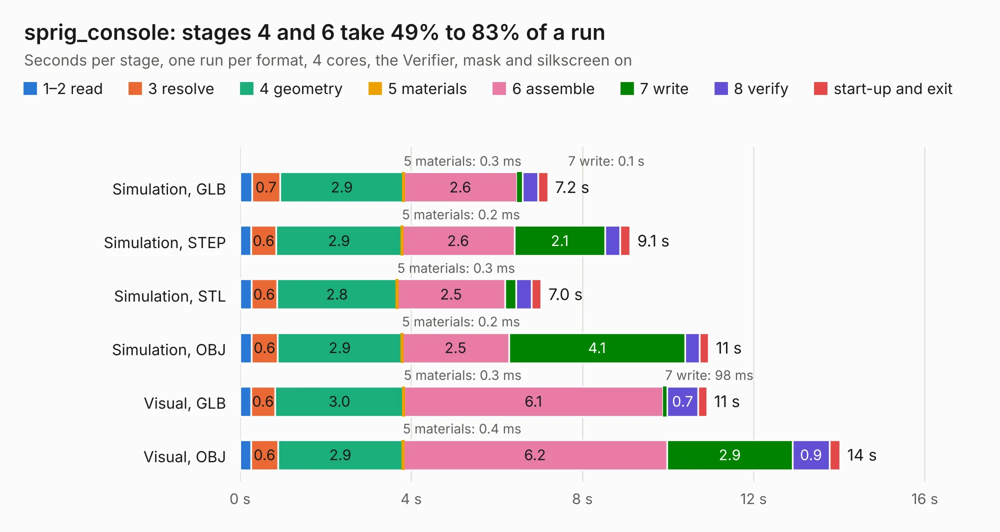

# 1200. sprig_console

Board 1,200 of the 3,138 of [Corpus Testing](../Corpus-Testing.md), on [Corpus Page 12](../CorpusTestingPages/Corpus-Testing-12.md#1200-sprig_console).

| Mode and format | 1–2 read | 3 resolve | 4 geometry | 5 materials | 6 assemble | 7 write | 8 verify | start-up and exit | Total |
|---|---:|---:|---:|---:|---:|---:|---:|---:|---:|
| Simulation, GLB | 0.3 | 0.7 | 2.9 | 0.3&nbsp;ms | 2.6 | 0.1 | 0.4 | 0.2 | 7.2 |
| Simulation, STEP | 0.3 | 0.6 | 2.9 | 0.2&nbsp;ms | 2.6 | 2.1 | 0.3 | 0.2 | 9.1 |
| Simulation, STL | 0.3 | 0.6 | 2.8 | 0.3&nbsp;ms | 2.5 | 0.3 | 0.4 | 0.2 | 7.0 |
| Simulation, OBJ | 0.3 | 0.6 | 2.9 | 0.2&nbsp;ms | 2.5 | 4.1 | 0.3 | 0.2 | 11.0 |
| Visual, GLB | 0.3 | 0.6 | 3.0 | 0.3&nbsp;ms | 6.1 | 98&nbsp;ms | 0.7 | 0.2 | 10.9 |
| Visual, OBJ | 0.3 | 0.6 | 2.9 | 0.4&nbsp;ms | 6.2 | 2.9 | 0.9 | 0.2 | 14.0 |

<table align="center"><tr><td valign="top">

| Board | Repo: [hackclub/sprig](https://github.com/hackclub/sprig) Board: `sprig_console.kicad_pcb` |
|---|---|
| Folder | hardware / mainboard_PCB / kicad |
| Complexity | 231&nbsp;/&nbsp;1000 (size&nbsp;146, features&nbsp;85) |
| KESE&nbsp;features | through vias, rounded, trapezoid or chamfered pads, filled zones, curved board outline, stack-up, dielectric εr and tanδ |
| Tested | 9th November 2026 |
| Copper&nbsp;layers | 2 |
| File&nbsp;format | KiCad 8 (20240108) |
| Parts,&nbsp;tracks,&nbsp;vias | 25, 254, 19 |
| Triangles,&nbsp;simulation | 808,388 in 55 parts |
| Verifier | PASS in all six runs |

</td><td valign="top">

<table>
<tr><th>File type</th><th>File size</th><th>Peak memory used</th></tr>
<tr><th colspan="3" align="left">Simulation</th></tr>
<tr><td>GLB</td><td align="right">28&nbsp;MB</td><td align="right">409&nbsp;MB</td></tr>
<tr><td>STEP</td><td align="right">137&nbsp;MB</td><td align="right">435&nbsp;MB</td></tr>
<tr><td>STL</td><td align="right">40&nbsp;MB</td><td align="right">408&nbsp;MB</td></tr>
<tr><td>OBJ</td><td align="right">82&nbsp;MB</td><td align="right">590&nbsp;MB</td></tr>
<tr><th colspan="3" align="left">Visual</th></tr>
<tr><td>GLB</td><td align="right">19&nbsp;MB</td><td align="right">502&nbsp;MB</td></tr>
<tr><td>OBJ</td><td align="right">58&nbsp;MB</td><td align="right">472&nbsp;MB</td></tr>
</table>

</td></tr></table>

| Previous | Next |
|:---|---:|
| [1199. StackLink](b1199b_logicanalyzer_StackLink.md) | [1201. pico-reset](b1201b_sprig_pico-reset.md) |
