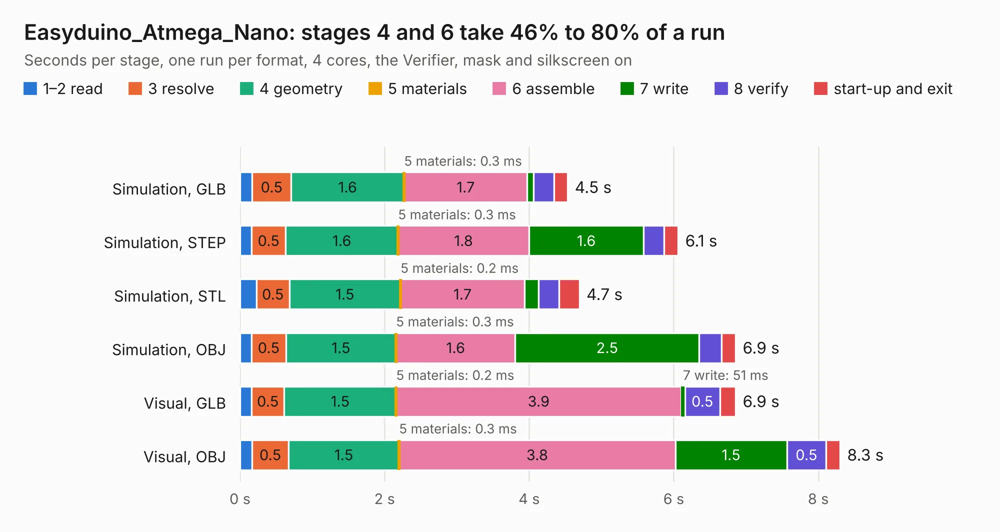

# 1201. Easyduino_Atmega_Nano

Board 1,201 of the 3,122 of [Corpus Testing](../Corpus-Testing.md), on [Corpus Page 12](../CorpusTestingPages/Corpus-Testing-12.md#1201-easyduino_atmega_nano).

| Mode and format | 1–2 read | 3 resolve | 4 geometry | 5 materials | 6 assemble | 7 write | 8 verify | start-up and exit | Total |
|---|---:|---:|---:|---:|---:|---:|---:|---:|---:|
| Simulation, GLB | 0.2 | 0.5 | 1.6 | 0.3&nbsp;ms | 1.7 | 87&nbsp;ms | 0.3 | 0.2 | 4.5 |
| Simulation, STEP | 0.2 | 0.5 | 1.6 | 0.3&nbsp;ms | 1.8 | 1.6 | 0.3 | 0.2 | 6.1 |
| Simulation, STL | 0.2 | 0.5 | 1.5 | 0.2&nbsp;ms | 1.7 | 0.2 | 0.3 | 0.3 | 4.7 |
| Simulation, OBJ | 0.2 | 0.5 | 1.5 | 0.3&nbsp;ms | 1.6 | 2.5 | 0.3 | 0.2 | 6.9 |
| Visual, GLB | 0.2 | 0.5 | 1.5 | 0.2&nbsp;ms | 3.9 | 51&nbsp;ms | 0.5 | 0.2 | 6.9 |
| Visual, OBJ | 0.2 | 0.5 | 1.5 | 0.3&nbsp;ms | 3.8 | 1.5 | 0.5 | 0.2 | 8.3 |

<table align="center"><tr><td valign="top">

| Board | Repo: [Hanqaqa/Easyduino](https://github.com/Hanqaqa/Easyduino) Board: `Easyduino_Atmega_Nano.kicad_pcb` |
|---|---|
| Folder | Atmega328p Arduino Nano |
| Complexity | 304&nbsp;/&nbsp;1000 (size&nbsp;219, features&nbsp;85) |
| KESE&nbsp;features | through vias, slotted holes, rounded, trapezoid or chamfered pads, filled zones, stack-up, dielectric εr and tanδ |
| Tested | 9th November 2026 |
| Copper&nbsp;layers | 4 |
| File&nbsp;format | KiCad 10 (20260206) |
| Parts,&nbsp;tracks,&nbsp;vias | 31, 332, 57 |
| Triangles,&nbsp;simulation | 632,874 in 75 parts |
| Verifier | PASS in all six runs |

</td><td valign="top">

<table>
<tr><th>File type</th><th>File size</th><th>Peak memory used</th></tr>
<tr><th colspan="3" align="left">Simulation</th></tr>
<tr><td>GLB</td><td align="right">21&nbsp;MB</td><td align="right">312&nbsp;MB</td></tr>
<tr><td>STEP</td><td align="right">78&nbsp;MB</td><td align="right">369&nbsp;MB</td></tr>
<tr><td>STL</td><td align="right">32&nbsp;MB</td><td align="right">318&nbsp;MB</td></tr>
<tr><td>OBJ</td><td align="right">63&nbsp;MB</td><td align="right">462&nbsp;MB</td></tr>
<tr><th colspan="3" align="left">Visual</th></tr>
<tr><td>GLB</td><td align="right">13&nbsp;MB</td><td align="right">366&nbsp;MB</td></tr>
<tr><td>OBJ</td><td align="right">39&nbsp;MB</td><td align="right">363&nbsp;MB</td></tr>
</table>

</td></tr></table>

| Previous | Next |
|:---|---:|
| [1200. ZU64DR_RFSOC_A5](b1200b_zu64dr-rfsoc-kicad_ZU64DR-RFSOC-A5.md) | [1202. Easyduino_Atmega](b1202b_Easyduino_Easyduino-Atmega.md) |
