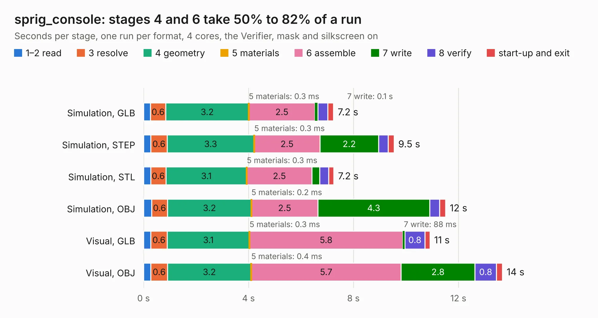

# 1201. sprig_console

Board 1,201 of the 3,132 of [Corpus Testing](../Corpus-Testing.md), on [Corpus Page 12](../CorpusTestingPages/Corpus-Testing-12.md#1201-sprig_console).

| Mode and format | 1–2 read | 3 resolve | 4 geometry | 5 materials | 6 assemble | 7 write | 8 verify | start-up and exit | Total |
|---|---:|---:|---:|---:|---:|---:|---:|---:|---:|
| Simulation, GLB | 0.3 | 0.6 | 3.2 | 0.3&nbsp;ms | 2.5 | 0.1 | 0.4 | 0.2 | 7.2 |
| Simulation, STEP | 0.3 | 0.6 | 3.3 | 0.3&nbsp;ms | 2.5 | 2.2 | 0.4 | 0.2 | 9.5 |
| Simulation, STL | 0.3 | 0.6 | 3.1 | 0.3&nbsp;ms | 2.5 | 0.3 | 0.4 | 0.2 | 7.2 |
| Simulation, OBJ | 0.3 | 0.6 | 3.2 | 0.2&nbsp;ms | 2.5 | 4.3 | 0.4 | 0.2 | 11.5 |
| Visual, GLB | 0.3 | 0.6 | 3.1 | 0.3&nbsp;ms | 5.8 | 88&nbsp;ms | 0.8 | 0.2 | 10.9 |
| Visual, OBJ | 0.3 | 0.6 | 3.2 | 0.4&nbsp;ms | 5.7 | 2.8 | 0.8 | 0.2 | 13.7 |

<table align="center"><tr><td valign="top">

| Board | Repo: [hackclub/sprig](https://github.com/hackclub/sprig) Board: `sprig_console.kicad_pcb` |
|---|---|
| Folder | sprig-hax / hardware / SprigHaxPCB / kicad |
| Complexity | 230&nbsp;/&nbsp;1000 (size&nbsp;145, features&nbsp;85) |
| KESE&nbsp;features | through vias, rounded, trapezoid or chamfered pads, filled zones, curved board outline, stack-up, dielectric εr and tanδ |
| Tested | 9th November 2026 |
| Copper&nbsp;layers | 2 |
| File&nbsp;format | KiCad 7 (20221018) |
| Parts,&nbsp;tracks,&nbsp;vias | 25, 242, 16 |
| Triangles,&nbsp;simulation | 816,372 in 55 parts |
| Verifier | PASS in all six runs |

</td><td valign="top">

<table>
<tr><th>File type</th><th>File size</th><th>Peak memory used</th></tr>
<tr><th colspan="3" align="left">Simulation</th></tr>
<tr><td>GLB</td><td align="right">28&nbsp;MB</td><td align="right">382&nbsp;MB</td></tr>
<tr><td>STEP</td><td align="right">144&nbsp;MB</td><td align="right">463&nbsp;MB</td></tr>
<tr><td>STL</td><td align="right">41&nbsp;MB</td><td align="right">399&nbsp;MB</td></tr>
<tr><td>OBJ</td><td align="right">83&nbsp;MB</td><td align="right">597&nbsp;MB</td></tr>
<tr><th colspan="3" align="left">Visual</th></tr>
<tr><td>GLB</td><td align="right">19&nbsp;MB</td><td align="right">439&nbsp;MB</td></tr>
<tr><td>OBJ</td><td align="right">58&nbsp;MB</td><td align="right">460&nbsp;MB</td></tr>
</table>

</td></tr></table>

| Previous | Next |
|:---|---:|
| [1200. pico-reset](b1200b_sprig_pico-reset.md) | [1202. ZU64DR_RFSOC_A5](b1202b_zu64dr-rfsoc-kicad_ZU64DR-RFSOC-A5.md) |
