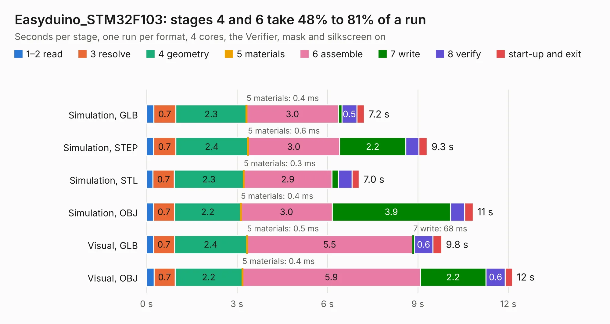

# 1203. Easyduino_STM32F103

Board 1,203 of the 3,117 of [Corpus Testing](../Corpus-Testing.md), on [Corpus Page 12](../CorpusTestingPages/Corpus-Testing-12.md#1203-easyduino_stm32f103).

| Mode and format | 1–2 read | 3 resolve | 4 geometry | 5 materials | 6 assemble | 7 write | 8 verify | start-up and exit | Total |
|---|---:|---:|---:|---:|---:|---:|---:|---:|---:|
| Simulation, GLB | 0.2 | 0.7 | 2.3 | 0.4&nbsp;ms | 3.0 | 0.1 | 0.5 | 0.2 | 7.2 |
| Simulation, STEP | 0.2 | 0.7 | 2.4 | 0.6&nbsp;ms | 3.0 | 2.2 | 0.4 | 0.3 | 9.3 |
| Simulation, STL | 0.2 | 0.7 | 2.3 | 0.3&nbsp;ms | 2.9 | 0.2 | 0.5 | 0.2 | 7.0 |
| Simulation, OBJ | 0.2 | 0.7 | 2.2 | 0.4&nbsp;ms | 3.0 | 3.9 | 0.5 | 0.3 | 10.8 |
| Visual, GLB | 0.2 | 0.7 | 2.4 | 0.5&nbsp;ms | 5.5 | 68&nbsp;ms | 0.6 | 0.3 | 9.8 |
| Visual, OBJ | 0.3 | 0.7 | 2.2 | 0.4&nbsp;ms | 5.9 | 2.2 | 0.6 | 0.2 | 12.1 |

<table align="center"><tr><td valign="top">

| Board | Repo: [Hanqaqa/Easyduino](https://github.com/Hanqaqa/Easyduino) Board: `Easyduino_STM32F103.kicad_pcb` |
|---|---|
| Folder | STM32F103 Bluepill |
| Complexity | 313&nbsp;/&nbsp;1000 (size&nbsp;218, features&nbsp;95) |
| KESE&nbsp;features | through vias, slotted holes, rounded, trapezoid or chamfered pads, filled zones, curved board outline, stack-up, dielectric εr and tanδ |
| Tested | 9th November 2026 |
| Copper&nbsp;layers | 4 |
| File&nbsp;format | KiCad 10 (20260206) |
| Parts,&nbsp;tracks,&nbsp;vias | 30, 484, 75 |
| Triangles,&nbsp;simulation | 780,722 in 62 parts |
| Verifier | PASS in all six runs |

</td><td valign="top">

<table>
<tr><th>File type</th><th>File size</th><th>Peak memory used</th></tr>
<tr><th colspan="3" align="left">Simulation</th></tr>
<tr><td>GLB</td><td align="right">26&nbsp;MB</td><td align="right">355&nbsp;MB</td></tr>
<tr><td>STEP</td><td align="right">93&nbsp;MB</td><td align="right">435&nbsp;MB</td></tr>
<tr><td>STL</td><td align="right">39&nbsp;MB</td><td align="right">355&nbsp;MB</td></tr>
<tr><td>OBJ</td><td align="right">78&nbsp;MB</td><td align="right">586&nbsp;MB</td></tr>
<tr><th colspan="3" align="left">Visual</th></tr>
<tr><td>GLB</td><td align="right">16&nbsp;MB</td><td align="right">388&nbsp;MB</td></tr>
<tr><td>OBJ</td><td align="right">48&nbsp;MB</td><td align="right">472&nbsp;MB</td></tr>
</table>

</td></tr></table>

| Previous | Next |
|:---|---:|
| [1202. Easyduino_RP2040](b1202b_Easyduino_Easyduino-RP2040.md) | [1204. stepperdriver front panel](b1204b_device-stepperdriver_stepperdriver-front-panel.md) |
