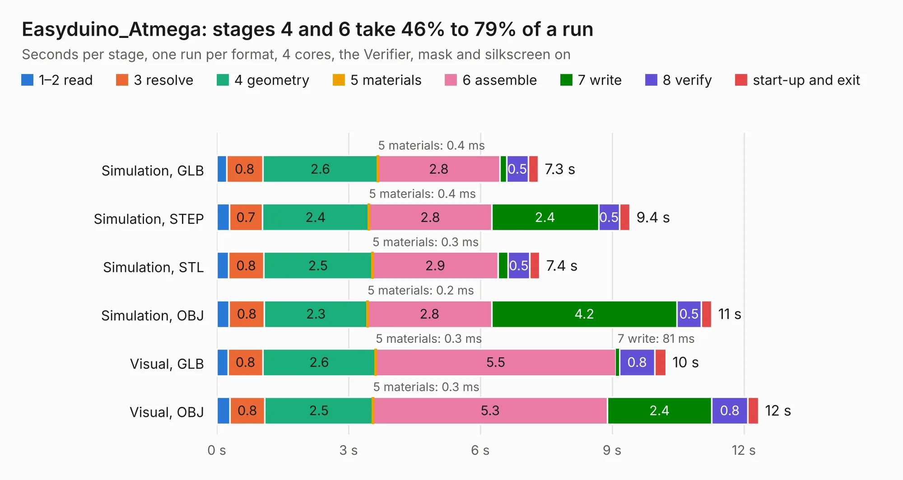

# 1205. Easyduino_Atmega

Board 1,205 of the 3,138 of [Corpus Testing](../Corpus-Testing.md), on [Corpus Page 12](../CorpusTestingPages/Corpus-Testing-12.md#1205-easyduino_atmega).

| Mode and format | 1–2 read | 3 resolve | 4 geometry | 5 materials | 6 assemble | 7 write | 8 verify | start-up and exit | Total |
|---|---:|---:|---:|---:|---:|---:|---:|---:|---:|
| Simulation, GLB | 0.2 | 0.8 | 2.6 | 0.4&nbsp;ms | 2.8 | 0.2 | 0.5 | 0.2 | 7.3 |
| Simulation, STEP | 0.3 | 0.7 | 2.4 | 0.4&nbsp;ms | 2.8 | 2.4 | 0.5 | 0.2 | 9.4 |
| Simulation, STL | 0.3 | 0.8 | 2.5 | 0.3&nbsp;ms | 2.9 | 0.2 | 0.5 | 0.2 | 7.4 |
| Simulation, OBJ | 0.3 | 0.8 | 2.3 | 0.2&nbsp;ms | 2.8 | 4.2 | 0.5 | 0.2 | 11.3 |
| Visual, GLB | 0.3 | 0.8 | 2.6 | 0.3&nbsp;ms | 5.5 | 81&nbsp;ms | 0.8 | 0.3 | 10.2 |
| Visual, OBJ | 0.3 | 0.8 | 2.5 | 0.3&nbsp;ms | 5.3 | 2.4 | 0.8 | 0.2 | 12.3 |

<table align="center"><tr><td valign="top">

| Board | Repo: [Hanqaqa/Easyduino](https://github.com/Hanqaqa/Easyduino) Board: `Easyduino_Atmega.kicad_pcb` |
|---|---|
| Folder | Atmega328p Arduino Uno |
| Complexity | 320&nbsp;/&nbsp;1000 (size&nbsp;220, features&nbsp;100) |
| KESE&nbsp;features | through vias, slotted holes, rounded, trapezoid or chamfered pads, filled zones, knockout text, stack-up, dielectric εr and tanδ |
| Tested | 9th November 2026 |
| Copper&nbsp;layers | 4 |
| File&nbsp;format | KiCad 10 (20260206) |
| Parts,&nbsp;tracks,&nbsp;vias | 36, 391, 106 |
| Triangles,&nbsp;simulation | 859,494 in 68 parts |
| Verifier | PASS in all six runs |

</td><td valign="top">

<table>
<tr><th>File type</th><th>File size</th><th>Peak memory used</th></tr>
<tr><th colspan="3" align="left">Simulation</th></tr>
<tr><td>GLB</td><td align="right">29&nbsp;MB</td><td align="right">388&nbsp;MB</td></tr>
<tr><td>STEP</td><td align="right">99&nbsp;MB</td><td align="right">470&nbsp;MB</td></tr>
<tr><td>STL</td><td align="right">43&nbsp;MB</td><td align="right">382&nbsp;MB</td></tr>
<tr><td>OBJ</td><td align="right">86&nbsp;MB</td><td align="right">622&nbsp;MB</td></tr>
<tr><th colspan="3" align="left">Visual</th></tr>
<tr><td>GLB</td><td align="right">17&nbsp;MB</td><td align="right">498&nbsp;MB</td></tr>
<tr><td>OBJ</td><td align="right">52&nbsp;MB</td><td align="right">458&nbsp;MB</td></tr>
</table>

</td></tr></table>

| Previous | Next |
|:---|---:|
| [1204. Easyduino_Atmega_Nano](b1204b_Easyduino_Easyduino-Atmega-Nano.md) | [1206. Easyduino_ESP32](b1206b_Easyduino_Easyduino-ESP32.md) |
