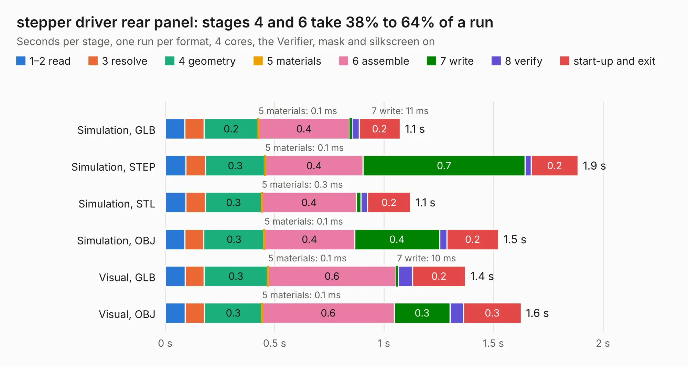

# 1205. stepper driver rear panel

Board 1,205 of the 3,117 of [Corpus Testing](../Corpus-Testing.md), on [Corpus Page 12](../CorpusTestingPages/Corpus-Testing-12.md#1205-stepper-driver-rear-panel).

| Mode and format | 1–2 read | 3 resolve | 4 geometry | 5 materials | 6 assemble | 7 write | 8 verify | start-up and exit | Total |
|---|---:|---:|---:|---:|---:|---:|---:|---:|---:|
| Simulation, GLB | 90&nbsp;ms | 88&nbsp;ms | 0.2 | 0.1&nbsp;ms | 0.4 | 11&nbsp;ms | 32&nbsp;ms | 0.2 | 1.1 |
| Simulation, STEP | 95&nbsp;ms | 89&nbsp;ms | 0.3 | 0.1&nbsp;ms | 0.4 | 0.7 | 28&nbsp;ms | 0.2 | 1.9 |
| Simulation, STL | 95&nbsp;ms | 89&nbsp;ms | 0.3 | 0.3&nbsp;ms | 0.4 | 20&nbsp;ms | 31&nbsp;ms | 0.2 | 1.1 |
| Simulation, OBJ | 90&nbsp;ms | 87&nbsp;ms | 0.3 | 0.1&nbsp;ms | 0.4 | 0.4 | 33&nbsp;ms | 0.2 | 1.5 |
| Visual, GLB | 92&nbsp;ms | 86&nbsp;ms | 0.3 | 0.1&nbsp;ms | 0.6 | 10&nbsp;ms | 65&nbsp;ms | 0.2 | 1.4 |
| Visual, OBJ | 91&nbsp;ms | 89&nbsp;ms | 0.3 | 0.1&nbsp;ms | 0.6 | 0.3 | 62&nbsp;ms | 0.3 | 1.6 |

<table align="center"><tr><td valign="top">

| Board | Repo: [harp-tech/device.stepperdriver](https://github.com/harp-tech/device.stepperdriver) Board: `stepper driver rear panel.kicad_pcb` |
|---|---|
| Folder | Hardware / PCB / stepper driver rear panel |
| Complexity | 156&nbsp;/&nbsp;1000 (size&nbsp;66, features&nbsp;90) |
| KESE&nbsp;features | through vias, rounded, trapezoid or chamfered pads, filled zones, curved board outline, stack-up, dielectric εr and tanδ, mask and silkscreen colours |
| Tested | 9th November 2026 |
| Copper&nbsp;layers | 2 |
| File&nbsp;format | KiCad 9 (20241229) |
| Parts,&nbsp;tracks,&nbsp;vias | 1, 0, 4 |
| Triangles,&nbsp;simulation | 61,040 in 12 parts |
| Note | panel |
| Verifier | PASS in all six runs |

</td><td valign="top">

<table>
<tr><th>File type</th><th>File size</th><th>Peak memory used</th></tr>
<tr><th colspan="3" align="left">Simulation</th></tr>
<tr><td>GLB</td><td align="right">2.1&nbsp;MB</td><td align="right">72&nbsp;MB</td></tr>
<tr><td>STEP</td><td align="right">8.5&nbsp;MB</td><td align="right">177&nbsp;MB</td></tr>
<tr><td>STL</td><td align="right">3.1&nbsp;MB</td><td align="right">74&nbsp;MB</td></tr>
<tr><td>OBJ</td><td align="right">5.9&nbsp;MB</td><td align="right">85&nbsp;MB</td></tr>
<tr><th colspan="3" align="left">Visual</th></tr>
<tr><td>GLB</td><td align="right">1.6&nbsp;MB</td><td align="right">109&nbsp;MB</td></tr>
<tr><td>OBJ</td><td align="right">4.5&nbsp;MB</td><td align="right">109&nbsp;MB</td></tr>
</table>

</td></tr></table>

| Previous | Next |
|:---|---:|
| [1204. stepperdriver front panel](b1204b_device-stepperdriver_stepperdriver-front-panel.md) | [1206. stepper driver](b1206b_device-stepperdriver_stepper-driver.md) |
