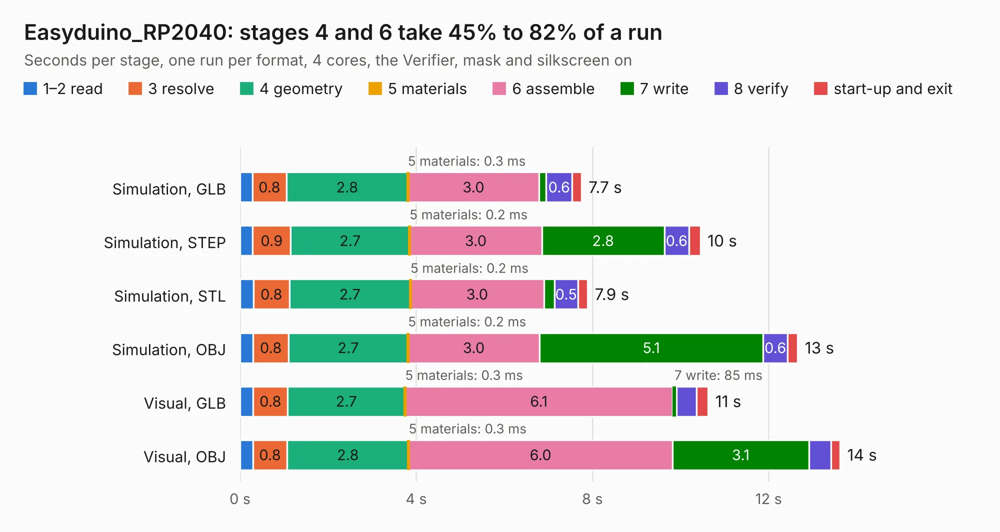

# 1206. Easyduino_RP2040

Board 1,206 of the 3,129 of [Corpus Testing](../Corpus-Testing.md), on [Corpus Page 12](../CorpusTestingPages/Corpus-Testing-12.md#1206-easyduino_rp2040).

| Mode and format | 1–2 read | 3 resolve | 4 geometry | 5 materials | 6 assemble | 7 write | 8 verify | start-up and exit | Total |
|---|---:|---:|---:|---:|---:|---:|---:|---:|---:|
| Simulation, GLB | 0.3 | 0.8 | 2.8 | 0.3&nbsp;ms | 3.0 | 0.2 | 0.6 | 0.2 | 7.7 |
| Simulation, STEP | 0.3 | 0.9 | 2.7 | 0.2&nbsp;ms | 3.0 | 2.8 | 0.6 | 0.3 | 10.4 |
| Simulation, STL | 0.3 | 0.8 | 2.7 | 0.2&nbsp;ms | 3.0 | 0.2 | 0.5 | 0.2 | 7.9 |
| Simulation, OBJ | 0.3 | 0.8 | 2.7 | 0.2&nbsp;ms | 3.0 | 5.1 | 0.6 | 0.2 | 12.7 |
| Visual, GLB | 0.3 | 0.8 | 2.7 | 0.3&nbsp;ms | 6.1 | 85&nbsp;ms | 0.5 | 0.3 | 10.6 |
| Visual, OBJ | 0.3 | 0.8 | 2.8 | 0.3&nbsp;ms | 6.0 | 3.1 | 0.5 | 0.2 | 13.6 |

<table align="center"><tr><td valign="top">

| Board | Repo: [Hanqaqa/Easyduino](https://github.com/Hanqaqa/Easyduino) Board: `Easyduino_RP2040.kicad_pcb` |
|---|---|
| Folder | Raspberry Pi Pico 2040 |
| Complexity | 325&nbsp;/&nbsp;1000 (size&nbsp;225, features&nbsp;100) |
| KESE&nbsp;features | through vias, slotted holes, rounded, trapezoid or chamfered pads, filled zones, curved board outline, stack-up, dielectric εr and tanδ, mask and silkscreen colours |
| Tested | 9th November 2026 |
| Copper&nbsp;layers | 4 |
| File&nbsp;format | KiCad 10 (20260206) |
| Parts,&nbsp;tracks,&nbsp;vias | 47, 570, 88 |
| Triangles,&nbsp;simulation | 947,692 in 74 parts |
| Verifier | PASS in all six runs |

</td><td valign="top">

<table>
<tr><th>File type</th><th>File size</th><th>Peak memory used</th></tr>
<tr><th colspan="3" align="left">Simulation</th></tr>
<tr><td>GLB</td><td align="right">32&nbsp;MB</td><td align="right">399&nbsp;MB</td></tr>
<tr><td>STEP</td><td align="right">133&nbsp;MB</td><td align="right">493&nbsp;MB</td></tr>
<tr><td>STL</td><td align="right">47&nbsp;MB</td><td align="right">399&nbsp;MB</td></tr>
<tr><td>OBJ</td><td align="right">95&nbsp;MB</td><td align="right">702&nbsp;MB</td></tr>
<tr><th colspan="3" align="left">Visual</th></tr>
<tr><td>GLB</td><td align="right">20&nbsp;MB</td><td align="right">492&nbsp;MB</td></tr>
<tr><td>OBJ</td><td align="right">61&nbsp;MB</td><td align="right">515&nbsp;MB</td></tr>
</table>

</td></tr></table>

| Previous | Next |
|:---|---:|
| [1205. Easyduino_ESP32S3](b1205b_Easyduino_Easyduino-ESP32S3.md) | [1207. Easyduino_STM32F103](b1207b_Easyduino_Easyduino-STM32F103.md) |
