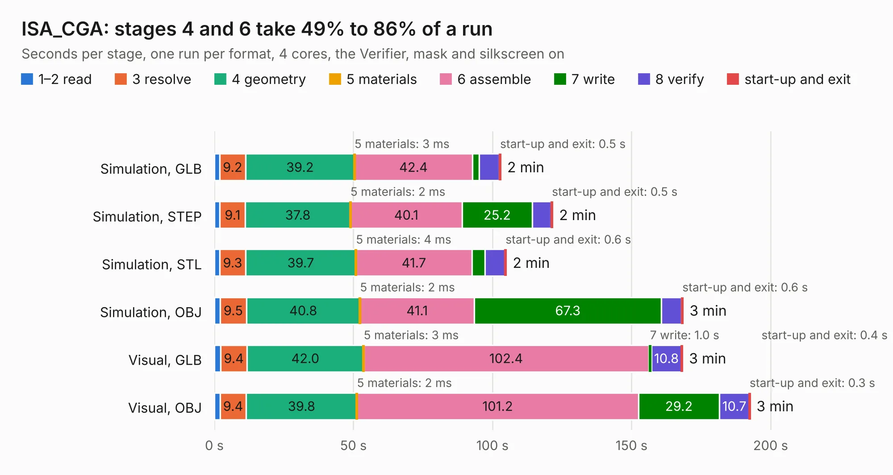

# 1208. ISA_CGA

Board 1,208 of the 3,110 of [Corpus Testing](../Corpus-Testing.md), on [Corpus Page 12](../CorpusTestingPages/Corpus-Testing-12.md#1208-isa_cga).

| Mode and format | 1–2 read | 3 resolve | 4 geometry | 5 materials | 6 assemble | 7 write | 8 verify | start-up and exit | Total |
|---|---:|---:|---:|---:|---:|---:|---:|---:|---:|
| Simulation, GLB | 1.9 | 9.2 | 39.2 | 3&nbsp;ms | 42.4 | 2.4 | 7.3 | 0.5 | 103.0 |
| Simulation, STEP | 2.0 | 9.1 | 37.8 | 2&nbsp;ms | 40.1 | 25.2 | 6.8 | 0.5 | 121.7 |
| Simulation, STL | 1.9 | 9.3 | 39.7 | 4&nbsp;ms | 41.7 | 4.8 | 7.1 | 0.6 | 105.0 |
| Simulation, OBJ | 2.0 | 9.5 | 40.8 | 2&nbsp;ms | 41.1 | 67.3 | 7.2 | 0.6 | 168.6 |
| Visual, GLB | 2.3 | 9.4 | 42.0 | 3&nbsp;ms | 102.4 | 1.0 | 10.8 | 0.4 | 168.4 |
| Visual, OBJ | 2.0 | 9.4 | 39.8 | 2&nbsp;ms | 101.2 | 29.2 | 10.7 | 0.3 | 192.6 |

<table align="center"><tr><td valign="top">

| Board | Repo: [hkzlab/CGA_Redux](https://github.com/hkzlab/CGA_Redux) Board: `ISA_CGA.kicad_pcb` |
|---|---|
| Complexity | 307&nbsp;/&nbsp;1000 (size&nbsp;237, features&nbsp;70) |
| KESE&nbsp;features | through vias, custom pads, filled zones, copper drawings, curved board outline |
| Tested | 9th November 2026 |
| Copper&nbsp;layers | 4 |
| File&nbsp;format | KiCad 7 (20221018) |
| Parts,&nbsp;tracks,&nbsp;vias | 170, 7,503, 328 |
| Triangles,&nbsp;simulation | 11,388,894 in 316 parts |
| Verifier | PASS in all six runs |

</td><td valign="top">

<table>
<tr><th>File type</th><th>File size</th><th>Peak memory used</th></tr>
<tr><th colspan="3" align="left">Simulation</th></tr>
<tr><td>GLB</td><td align="right">387&nbsp;MB</td><td align="right">2.5&nbsp;GB</td></tr>
<tr><td>STEP</td><td align="right">1.5&nbsp;GB</td><td align="right">3.5&nbsp;GB</td></tr>
<tr><td>STL</td><td align="right">569&nbsp;MB</td><td align="right">2.4&nbsp;GB</td></tr>
<tr><td>OBJ</td><td align="right">1.2&nbsp;GB</td><td align="right">7.1&nbsp;GB</td></tr>
<tr><th colspan="3" align="left">Visual</th></tr>
<tr><td>GLB</td><td align="right">196&nbsp;MB</td><td align="right">3.2&nbsp;GB</td></tr>
<tr><td>OBJ</td><td align="right">634&nbsp;MB</td><td align="right">4.0&nbsp;GB</td></tr>
</table>

</td></tr></table>

| Previous | Next |
|:---|---:|
| [1207. voltage-regulator-module](b1207b_motor-controller-2018_voltage-regulator-module.md) | [1209. ISA_ES1868](b1209b_ES1868-ISA8_ISA-ES1868.md) |
