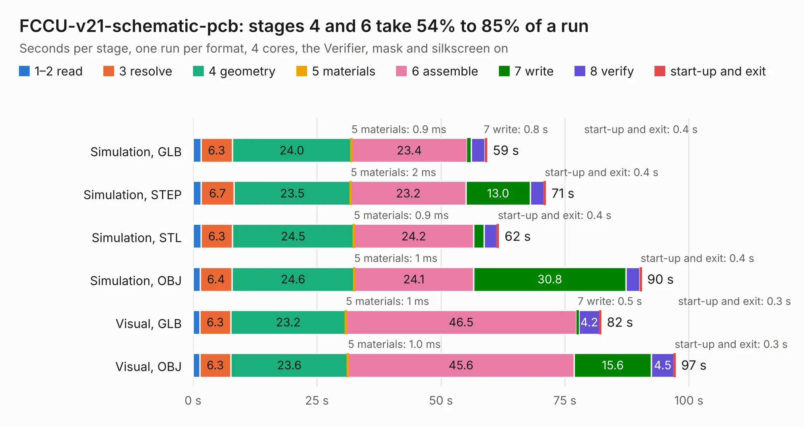

# 1209. FCCU-v21-schematic-pcb

Board 1,209 of the 3,103 of [Corpus Testing](../Corpus-Testing.md), on [Corpus Page 12](../CorpusTestingPages/Corpus-Testing-12.md#1209-fccu-v21-schematic-pcb).

| Mode and format | 1–2 read | 3 resolve | 4 geometry | 5 materials | 6 assemble | 7 write | 8 verify | start-up and exit | Total |
|---|---:|---:|---:|---:|---:|---:|---:|---:|---:|
| Simulation, GLB | 1.6 | 6.3 | 24.0 | 0.9&nbsp;ms | 23.4 | 0.8 | 2.8 | 0.4 | 59.3 |
| Simulation, STEP | 1.6 | 6.7 | 23.5 | 2&nbsp;ms | 23.2 | 13.0 | 2.7 | 0.4 | 71.1 |
| Simulation, STL | 1.7 | 6.3 | 24.5 | 0.9&nbsp;ms | 24.2 | 2.1 | 2.6 | 0.4 | 61.7 |
| Simulation, OBJ | 1.4 | 6.4 | 24.6 | 1&nbsp;ms | 24.1 | 30.8 | 2.7 | 0.4 | 90.5 |
| Visual, GLB | 1.4 | 6.3 | 23.2 | 1&nbsp;ms | 46.5 | 0.5 | 4.2 | 0.3 | 82.3 |
| Visual, OBJ | 1.4 | 6.3 | 23.6 | 1.0&nbsp;ms | 45.6 | 15.6 | 4.5 | 0.3 | 97.3 |

<table align="center"><tr><td valign="top">

| Board | Repo: [hydrogreenpollub/fuel_cell_control_unit_pcb_fccu_v2_1](https://github.com/hydrogreenpollub/fuel_cell_control_unit_pcb_fccu_v2_1) Board: `FCCU-v21-schematic-pcb.kicad_pcb` |
|---|---|
| Complexity | 404&nbsp;/&nbsp;1000 (size&nbsp;274, features&nbsp;130) |
| KESE&nbsp;features | through vias, padstacks, rounded, trapezoid or chamfered pads, drill offsets, filled zones, TrueType text, stack-up, dielectric εr and tanδ |
| Tested | 9th November 2026 |
| Copper&nbsp;layers | 4 |
| File&nbsp;format | KiCad 10 (20260206) |
| Parts,&nbsp;tracks,&nbsp;vias | 258, 3,794, 507 |
| Triangles,&nbsp;simulation | 4,809,760 in 228 parts |
| Verifier | PASS in all six runs |

</td><td valign="top">

<table>
<tr><th>File type</th><th>File size</th><th>Peak memory used</th></tr>
<tr><th colspan="3" align="left">Simulation</th></tr>
<tr><td>GLB</td><td align="right">165&nbsp;MB</td><td align="right">1.2&nbsp;GB</td></tr>
<tr><td>STEP</td><td align="right">677&nbsp;MB</td><td align="right">1.7&nbsp;GB</td></tr>
<tr><td>STL</td><td align="right">241&nbsp;MB</td><td align="right">1.2&nbsp;GB</td></tr>
<tr><td>OBJ</td><td align="right">511&nbsp;MB</td><td align="right">3.1&nbsp;GB</td></tr>
<tr><th colspan="3" align="left">Visual</th></tr>
<tr><td>GLB</td><td align="right">90&nbsp;MB</td><td align="right">1.6&nbsp;GB</td></tr>
<tr><td>OBJ</td><td align="right">280&nbsp;MB</td><td align="right">1.9&nbsp;GB</td></tr>
</table>

</td></tr></table>

| Previous | Next |
|:---|---:|
| [1208. FCCU-v2-schematic-pcb](b1208b_fuel-cell-control-unit-pcb-fccu-v2-1_FCCU-v2-schematic-pcb.md) | [1210. Daughterboard](b1210b_Amiga-3000-Daughterboard_Daughterboard.md) |
