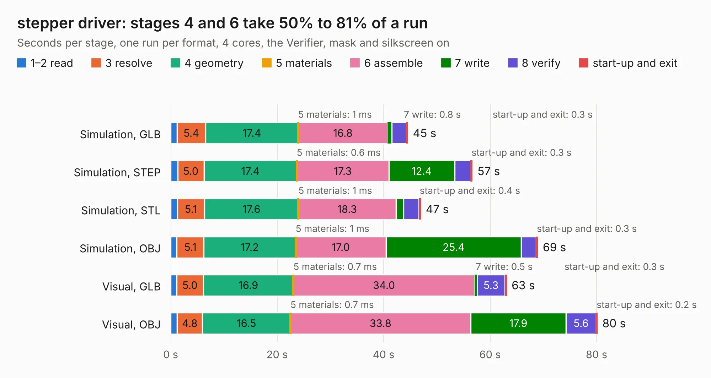

# 1211. stepper driver

Board 1,211 of the 3,131 of [Corpus Testing](../Corpus-Testing.md), on [Corpus Page 12](../CorpusTestingPages/Corpus-Testing-12.md#1211-stepper-driver).

| Mode and format | 1–2 read | 3 resolve | 4 geometry | 5 materials | 6 assemble | 7 write | 8 verify | start-up and exit | Total |
|---|---:|---:|---:|---:|---:|---:|---:|---:|---:|
| Simulation, GLB | 1.2 | 5.4 | 17.4 | 1&nbsp;ms | 16.8 | 0.8 | 2.7 | 0.3 | 44.5 |
| Simulation, STEP | 1.3 | 5.0 | 17.4 | 0.6&nbsp;ms | 17.3 | 12.4 | 3.0 | 0.3 | 56.7 |
| Simulation, STL | 1.2 | 5.1 | 17.6 | 1&nbsp;ms | 18.3 | 1.4 | 2.9 | 0.4 | 47.0 |
| Simulation, OBJ | 1.2 | 5.1 | 17.2 | 1&nbsp;ms | 17.0 | 25.4 | 2.8 | 0.3 | 68.9 |
| Visual, GLB | 1.1 | 5.0 | 16.9 | 0.7&nbsp;ms | 34.0 | 0.5 | 5.3 | 0.3 | 63.1 |
| Visual, OBJ | 1.2 | 4.8 | 16.5 | 0.7&nbsp;ms | 33.8 | 17.9 | 5.6 | 0.2 | 80.1 |

<table align="center"><tr><td valign="top">

| Board | Repo: [harp-tech/device.stepperdriver](https://github.com/harp-tech/device.stepperdriver) Board: `stepper driver.kicad_pcb` |
|---|---|
| Folder | Hardware / PCB / stepper driver |
| Complexity | 408&nbsp;/&nbsp;1000 (size&nbsp;283, features&nbsp;125) |
| KESE&nbsp;features | through vias, slotted holes, custom pads, rounded, trapezoid or chamfered pads, arc tracks, filled zones, copper drawings, stack-up, dielectric εr and tanδ |
| Tested | 9th November 2026 |
| Copper&nbsp;layers | 4 |
| File&nbsp;format | KiCad 9 (20241229) |
| Parts,&nbsp;tracks,&nbsp;vias | 207, 2,022, 900 |
| Triangles,&nbsp;simulation | 4,340,758 in 241 parts |
| Verifier | PASS in all six runs |

</td><td valign="top">

<table>
<tr><th>File type</th><th>File size</th><th>Peak memory used</th></tr>
<tr><th colspan="3" align="left">Simulation</th></tr>
<tr><td>GLB</td><td align="right">144&nbsp;MB</td><td align="right">1.3&nbsp;GB</td></tr>
<tr><td>STEP</td><td align="right">566&nbsp;MB</td><td align="right">1.9&nbsp;GB</td></tr>
<tr><td>STL</td><td align="right">217&nbsp;MB</td><td align="right">1.4&nbsp;GB</td></tr>
<tr><td>OBJ</td><td align="right">457&nbsp;MB</td><td align="right">2.7&nbsp;GB</td></tr>
<tr><th colspan="3" align="left">Visual</th></tr>
<tr><td>GLB</td><td align="right">100&nbsp;MB</td><td align="right">1.7&nbsp;GB</td></tr>
<tr><td>OBJ</td><td align="right">320&nbsp;MB</td><td align="right">2.1&nbsp;GB</td></tr>
</table>

</td></tr></table>

| Previous | Next |
|:---|---:|
| [1210. stepper driver rear panel](b1210b_device-stepperdriver_stepper-driver-rear-panel.md) | [1212. HALMET](b1212b_halmet-hardware_HALMET.md) |
