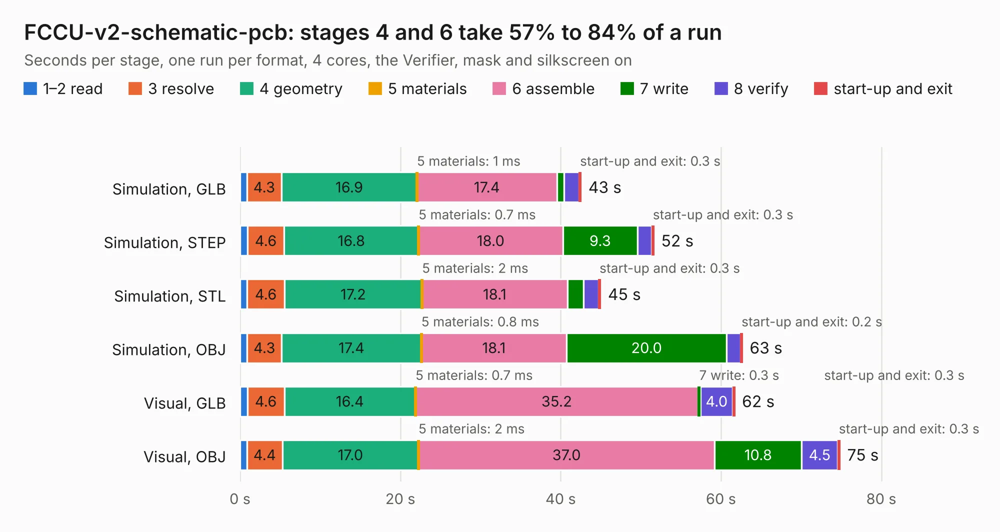

# 1211. FCCU-v2-schematic-pcb

Board 1,211 of the 3,107 of [Corpus Testing](../Corpus-Testing.md), on [Corpus Page 12](../CorpusTestingPages/Corpus-Testing-12.md#1211-fccu-v2-schematic-pcb).

| Mode and format | 1–2 read | 3 resolve | 4 geometry | 5 materials | 6 assemble | 7 write | 8 verify | start-up and exit | Total |
|---|---:|---:|---:|---:|---:|---:|---:|---:|---:|
| Simulation, GLB | 0.8 | 4.3 | 16.9 | 1&nbsp;ms | 17.4 | 0.9 | 1.8 | 0.3 | 42.6 |
| Simulation, STEP | 0.9 | 4.6 | 16.8 | 0.7&nbsp;ms | 18.0 | 9.3 | 1.8 | 0.3 | 51.6 |
| Simulation, STL | 0.9 | 4.6 | 17.2 | 2&nbsp;ms | 18.1 | 2.0 | 1.9 | 0.3 | 45.0 |
| Simulation, OBJ | 0.9 | 4.3 | 17.4 | 0.8&nbsp;ms | 18.1 | 20.0 | 1.7 | 0.2 | 62.7 |
| Visual, GLB | 0.9 | 4.6 | 16.4 | 0.7&nbsp;ms | 35.2 | 0.3 | 4.0 | 0.3 | 61.7 |
| Visual, OBJ | 0.9 | 4.4 | 17.0 | 2&nbsp;ms | 37.0 | 10.8 | 4.5 | 0.3 | 74.8 |

<table align="center"><tr><td valign="top">

| Board | Repo: [hydrogreenpollub/fuel_cell_control_unit_pcb_fccu_v2_1](https://github.com/hydrogreenpollub/fuel_cell_control_unit_pcb_fccu_v2_1) Board: `FCCU-v2-schematic-pcb.kicad_pcb` |
|---|---|
| Complexity | 400&nbsp;/&nbsp;1000 (size&nbsp;270, features&nbsp;130) |
| KESE&nbsp;features | through vias, padstacks, rounded, trapezoid or chamfered pads, drill offsets, filled zones, TrueType text, stack-up, dielectric εr and tanδ |
| Tested | 9th November 2026 |
| Copper&nbsp;layers | 4 |
| File&nbsp;format | KiCad 10 (20260206) |
| Parts,&nbsp;tracks,&nbsp;vias | 207, 3,324, 532 |
| Triangles,&nbsp;simulation | 4,737,866 in 182 parts |
| Verifier | PASS in all six runs |

</td><td valign="top">

<table>
<tr><th>File type</th><th>File size</th><th>Peak memory used</th></tr>
<tr><th colspan="3" align="left">Simulation</th></tr>
<tr><td>GLB</td><td align="right">161&nbsp;MB</td><td align="right">1.4&nbsp;GB</td></tr>
<tr><td>STEP</td><td align="right">635&nbsp;MB</td><td align="right">1.7&nbsp;GB</td></tr>
<tr><td>STL</td><td align="right">237&nbsp;MB</td><td align="right">1.4&nbsp;GB</td></tr>
<tr><td>OBJ</td><td align="right">501&nbsp;MB</td><td align="right">3.0&nbsp;GB</td></tr>
<tr><th colspan="3" align="left">Visual</th></tr>
<tr><td>GLB</td><td align="right">86&nbsp;MB</td><td align="right">1.6&nbsp;GB</td></tr>
<tr><td>OBJ</td><td align="right">268&nbsp;MB</td><td align="right">1.8&nbsp;GB</td></tr>
</table>

</td></tr></table>

| Previous | Next |
|:---|---:|
| [1210. allwinner-h3](b1210b_allwinner-h3-ddr3-16x1-kicad_allwinner-h3.md) | [1212. FCCU-v21-schematic-pcb](b1212b_fuel-cell-control-unit-pcb-fccu-v2-1_FCCU-v21-schematic-pcb.md) |
