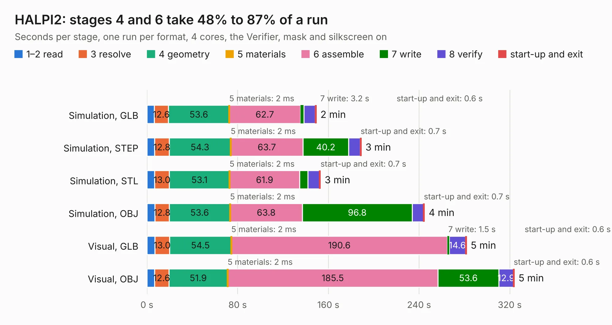

# 1212. HALPI2

Board 1,212 of the 3,124 of [Corpus Testing](../Corpus-Testing.md), on [Corpus Page 12](../CorpusTestingPages/Corpus-Testing-12.md#1212-halpi2).

| Mode and format | 1–2 read | 3 resolve | 4 geometry | 5 materials | 6 assemble | 7 write | 8 verify | start-up and exit | Total |
|---|---:|---:|---:|---:|---:|---:|---:|---:|---:|
| Simulation, GLB | 6.4 | 12.6 | 53.6 | 2&nbsp;ms | 62.7 | 3.2 | 10.0 | 0.6 | 149.2 |
| Simulation, STEP | 6.8 | 12.8 | 54.3 | 2&nbsp;ms | 63.7 | 40.2 | 10.4 | 0.7 | 188.9 |
| Simulation, STL | 6.8 | 13.0 | 53.1 | 2&nbsp;ms | 61.9 | 7.1 | 10.4 | 0.7 | 152.9 |
| Simulation, OBJ | 6.9 | 12.8 | 53.6 | 2&nbsp;ms | 63.8 | 96.8 | 10.0 | 0.7 | 244.6 |
| Visual, GLB | 7.0 | 13.0 | 54.5 | 2&nbsp;ms | 190.6 | 1.5 | 14.6 | 0.6 | 281.7 |
| Visual, OBJ | 6.7 | 12.6 | 51.9 | 2&nbsp;ms | 185.5 | 53.6 | 12.9 | 0.6 | 323.8 |

<table align="center"><tr><td valign="top">

| Board | Repo: [hatlabs/halpi2-hardware](https://github.com/hatlabs/halpi2-hardware) Board: `HALPI2.kicad_pcb` |
|---|---|
| Complexity | 495&nbsp;/&nbsp;1000 (size&nbsp;310, features&nbsp;185) |
| KESE&nbsp;features | through vias, slotted holes, custom pads, rounded, trapezoid or chamfered pads, arc tracks, filled zones, copper drawings, curved board outline, knockout text, TrueType text, stack-up, dielectric εr and tanδ, copper finish, mask and silkscreen colours |
| Tested | 9th November 2026 |
| Copper&nbsp;layers | 6 |
| File&nbsp;format | KiCad 10 (20260206) |
| Parts,&nbsp;tracks,&nbsp;vias | 552, 5,434, 1,660 |
| Triangles,&nbsp;simulation | 14,008,076 in 554 parts |
| Verifier | PASS in all six runs |

</td><td valign="top">

<table>
<tr><th>File type</th><th>File size</th><th>Peak memory used</th></tr>
<tr><th colspan="3" align="left">Simulation</th></tr>
<tr><td>GLB</td><td align="right">464&nbsp;MB</td><td align="right">3.5&nbsp;GB</td></tr>
<tr><td>STEP</td><td align="right">2.1&nbsp;GB</td><td align="right">4.7&nbsp;GB</td></tr>
<tr><td>STL</td><td align="right">700&nbsp;MB</td><td align="right">3.6&nbsp;GB</td></tr>
<tr><td>OBJ</td><td align="right">1.5&nbsp;GB</td><td align="right">8.8&nbsp;GB</td></tr>
<tr><th colspan="3" align="left">Visual</th></tr>
<tr><td>GLB</td><td align="right">283&nbsp;MB</td><td align="right">4.7&nbsp;GB</td></tr>
<tr><td>OBJ</td><td align="right">929&nbsp;MB</td><td align="right">6.1&nbsp;GB</td></tr>
</table>

</td></tr></table>

| Previous | Next |
|:---|---:|
| [1211. HALMET](b1211b_halmet-hardware_HALMET.md) | [1213. HALSER](b1213b_halser-hardware_HALSER.md) |
