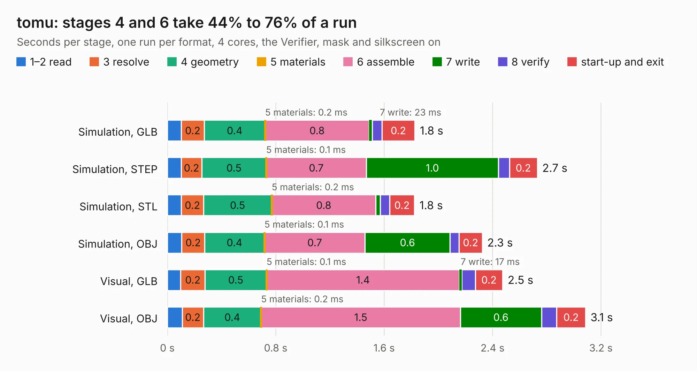

# 1214. tomu

Board 1,214 of the 3,100 of [Corpus Testing](../Corpus-Testing.md), on [Corpus Page 12](../CorpusTestingPages/Corpus-Testing-12.md#1214-tomu).

| Mode and format | 1–2 read | 3 resolve | 4 geometry | 5 materials | 6 assemble | 7 write | 8 verify | start-up and exit | Total |
|---|---:|---:|---:|---:|---:|---:|---:|---:|---:|
| Simulation, GLB | 0.1 | 0.2 | 0.4 | 0.2&nbsp;ms | 0.8 | 23&nbsp;ms | 72&nbsp;ms | 0.2 | 1.8 |
| Simulation, STEP | 0.1 | 0.2 | 0.5 | 0.1&nbsp;ms | 0.7 | 1.0 | 81&nbsp;ms | 0.2 | 2.7 |
| Simulation, STL | 0.1 | 0.2 | 0.5 | 0.2&nbsp;ms | 0.8 | 32&nbsp;ms | 70&nbsp;ms | 0.2 | 1.8 |
| Simulation, OBJ | 0.1 | 0.2 | 0.4 | 0.1&nbsp;ms | 0.7 | 0.6 | 66&nbsp;ms | 0.2 | 2.3 |
| Visual, GLB | 99&nbsp;ms | 0.2 | 0.5 | 0.1&nbsp;ms | 1.4 | 17&nbsp;ms | 99&nbsp;ms | 0.2 | 2.5 |
| Visual, OBJ | 0.1 | 0.2 | 0.4 | 0.2&nbsp;ms | 1.5 | 0.6 | 0.1 | 0.2 | 3.1 |

<table align="center"><tr><td valign="top">

| Board | Repo: [im-tomu/tomu-hardware](https://github.com/im-tomu/tomu-hardware) Board: `tomu.kicad_pcb` |
|---|---|
| Folder | releases / v0.2 / gerbers |
| Complexity | 210&nbsp;/&nbsp;1000 (size&nbsp;135, features&nbsp;75) |
| KESE&nbsp;features | through vias, slotted holes, rounded, trapezoid or chamfered pads, filled zones, copper text, curved board outline |
| Tested | 9th November 2026 |
| Copper&nbsp;layers | 2 |
| File&nbsp;format | KiCad 4 (4) |
| Parts,&nbsp;tracks,&nbsp;vias | 15, 176, 13 |
| Triangles,&nbsp;simulation | 121,252 in 34 parts |
| Verifier | PASS in all six runs |

</td><td valign="top">

<table>
<tr><th>File type</th><th>File size</th><th>Peak memory used</th></tr>
<tr><th colspan="3" align="left">Simulation</th></tr>
<tr><td>GLB</td><td align="right">4.3&nbsp;MB</td><td align="right">194&nbsp;MB</td></tr>
<tr><td>STEP</td><td align="right">24&nbsp;MB</td><td align="right">203&nbsp;MB</td></tr>
<tr><td>STL</td><td align="right">6.1&nbsp;MB</td><td align="right">193&nbsp;MB</td></tr>
<tr><td>OBJ</td><td align="right">12&nbsp;MB</td><td align="right">192&nbsp;MB</td></tr>
<tr><th colspan="3" align="left">Visual</th></tr>
<tr><td>GLB</td><td align="right">3.5&nbsp;MB</td><td align="right">162&nbsp;MB</td></tr>
<tr><td>OBJ</td><td align="right">9.7&nbsp;MB</td><td align="right">162&nbsp;MB</td></tr>
</table>

</td></tr></table>

| Previous | Next |
|:---|---:|
| [1213. tomu](b1213b_tomu-hardware_releases-v0-1-gerbers_tomu.md) | [1215. tomu](b1215b_tomu-hardware_releases-v0-3-gerber_tomu.md) |
