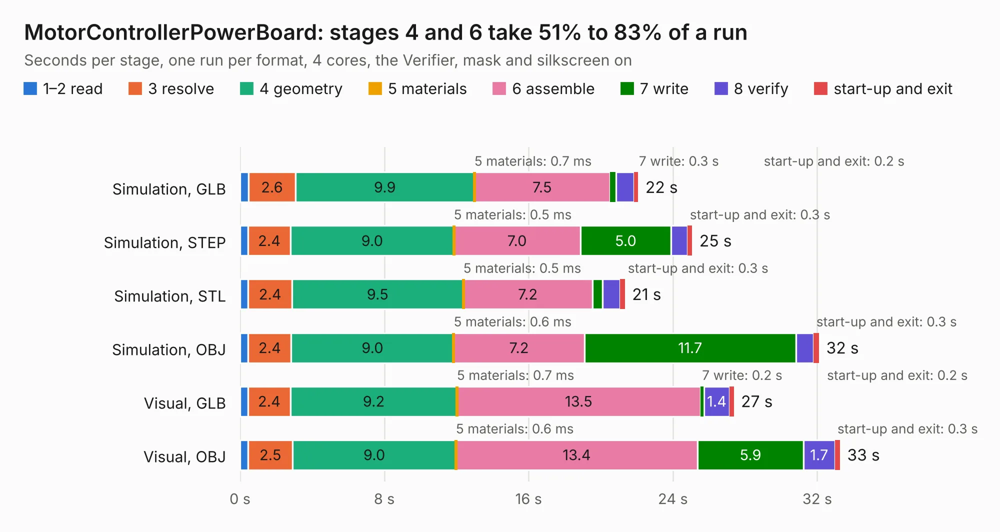

# 1215. MotorControllerPowerBoard

Board 1,215 of the 3,122 of [Corpus Testing](../Corpus-Testing.md), on [Corpus Page 12](../CorpusTestingPages/Corpus-Testing-12.md#1215-motorcontrollerpowerboard).

| Mode and format | 1–2 read | 3 resolve | 4 geometry | 5 materials | 6 assemble | 7 write | 8 verify | start-up and exit | Total |
|---|---:|---:|---:|---:|---:|---:|---:|---:|---:|
| Simulation, GLB | 0.5 | 2.6 | 9.9 | 0.7&nbsp;ms | 7.5 | 0.3 | 1.0 | 0.2 | 22.1 |
| Simulation, STEP | 0.4 | 2.4 | 9.0 | 0.5&nbsp;ms | 7.0 | 5.0 | 0.9 | 0.3 | 25.1 |
| Simulation, STL | 0.5 | 2.4 | 9.5 | 0.5&nbsp;ms | 7.2 | 0.6 | 1.0 | 0.3 | 21.3 |
| Simulation, OBJ | 0.5 | 2.4 | 9.0 | 0.6&nbsp;ms | 7.2 | 11.7 | 1.0 | 0.3 | 32.1 |
| Visual, GLB | 0.4 | 2.4 | 9.2 | 0.7&nbsp;ms | 13.5 | 0.2 | 1.4 | 0.2 | 27.4 |
| Visual, OBJ | 0.4 | 2.5 | 9.0 | 0.6&nbsp;ms | 13.4 | 5.9 | 1.7 | 0.3 | 33.3 |

<table align="center"><tr><td valign="top">

| Board | Repo: [heev/motor-controller-2018](https://github.com/heev/motor-controller-2018) Board: `MotorControllerPowerBoard.kicad_pcb` |
|---|---|
| Folder | MotorControllerPowerBoardRev2 / MotorControllerPowerBoard |
| Complexity | 271&nbsp;/&nbsp;1000 (size&nbsp;201, features&nbsp;70) |
| KESE&nbsp;features | through vias, custom pads, rounded, trapezoid or chamfered pads, filled zones, copper drawings |
| Tested | 9th November 2026 |
| Copper&nbsp;layers | 4 |
| File&nbsp;format | KiCad 5 (20171130) |
| Parts,&nbsp;tracks,&nbsp;vias | 131, 747, 108 |
| Triangles,&nbsp;simulation | 2,114,558 in 108 parts |
| Verifier | PASS in all six runs |

</td><td valign="top">

<table>
<tr><th>File type</th><th>File size</th><th>Peak memory used</th></tr>
<tr><th colspan="3" align="left">Simulation</th></tr>
<tr><td>GLB</td><td align="right">72&nbsp;MB</td><td align="right">652&nbsp;MB</td></tr>
<tr><td>STEP</td><td align="right">303&nbsp;MB</td><td align="right">793&nbsp;MB</td></tr>
<tr><td>STL</td><td align="right">106&nbsp;MB</td><td align="right">635&nbsp;MB</td></tr>
<tr><td>OBJ</td><td align="right">222&nbsp;MB</td><td align="right">1.4&nbsp;GB</td></tr>
<tr><th colspan="3" align="left">Visual</th></tr>
<tr><td>GLB</td><td align="right">38&nbsp;MB</td><td align="right">764&nbsp;MB</td></tr>
<tr><td>OBJ</td><td align="right">115&nbsp;MB</td><td align="right">836&nbsp;MB</td></tr>
</table>

</td></tr></table>

| Previous | Next |
|:---|---:|
| [1214. motor-controller-hw](b1214b_motor-controller-2018_motor-controller-hw.md) | [1216. voltage-regulator-module](b1216b_motor-controller-2018_voltage-regulator-module.md) |
