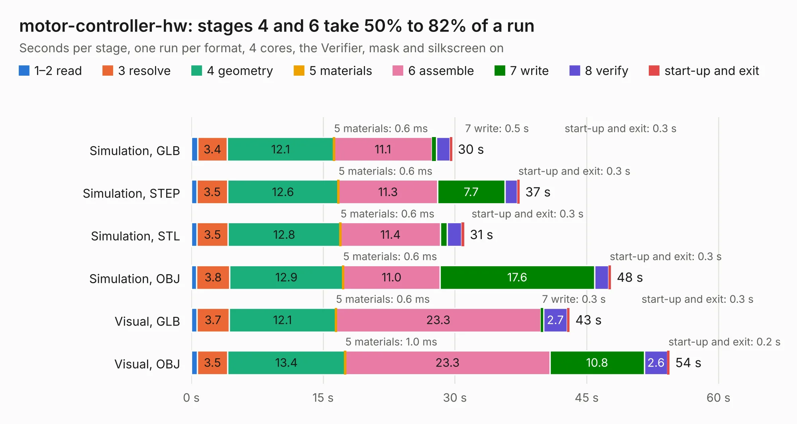

# 1215. motor-controller-hw

Board 1,215 of the 3,129 of [Corpus Testing](../Corpus-Testing.md), on [Corpus Page 12](../CorpusTestingPages/Corpus-Testing-12.md#1215-motor-controller-hw).

| Mode and format | 1–2 read | 3 resolve | 4 geometry | 5 materials | 6 assemble | 7 write | 8 verify | start-up and exit | Total |
|---|---:|---:|---:|---:|---:|---:|---:|---:|---:|
| Simulation, GLB | 0.7 | 3.4 | 12.1 | 0.6&nbsp;ms | 11.1 | 0.5 | 1.5 | 0.3 | 29.7 |
| Simulation, STEP | 0.6 | 3.5 | 12.6 | 0.6&nbsp;ms | 11.3 | 7.7 | 1.4 | 0.3 | 37.4 |
| Simulation, STL | 0.6 | 3.5 | 12.8 | 0.6&nbsp;ms | 11.4 | 0.8 | 1.6 | 0.3 | 31.1 |
| Simulation, OBJ | 0.6 | 3.8 | 12.9 | 0.6&nbsp;ms | 11.0 | 17.6 | 1.6 | 0.3 | 47.8 |
| Visual, GLB | 0.6 | 3.7 | 12.1 | 0.6&nbsp;ms | 23.3 | 0.3 | 2.7 | 0.3 | 43.1 |
| Visual, OBJ | 0.7 | 3.5 | 13.4 | 1.0&nbsp;ms | 23.3 | 10.8 | 2.6 | 0.2 | 54.4 |

<table align="center"><tr><td valign="top">

| Board | Repo: [heev/motor-controller-2018](https://github.com/heev/motor-controller-2018) Board: `motor-controller-hw.kicad_pcb` |
|---|---|
| Folder | motor-controller-hw |
| Complexity | 318&nbsp;/&nbsp;1000 (size&nbsp;263, features&nbsp;55) |
| KESE&nbsp;features | through vias, slotted holes, rounded, trapezoid or chamfered pads, filled zones |
| Tested | 9th November 2026 |
| Copper&nbsp;layers | 4 |
| File&nbsp;format | KiCad 5 (20171130) |
| Parts,&nbsp;tracks,&nbsp;vias | 156, 1,989, 192 |
| Triangles,&nbsp;simulation | 3,029,272 in 206 parts |
| Verifier | PASS in all six runs |

</td><td valign="top">

<table>
<tr><th>File type</th><th>File size</th><th>Peak memory used</th></tr>
<tr><th colspan="3" align="left">Simulation</th></tr>
<tr><td>GLB</td><td align="right">106&nbsp;MB</td><td align="right">1.0&nbsp;GB</td></tr>
<tr><td>STEP</td><td align="right">513&nbsp;MB</td><td align="right">1.1&nbsp;GB</td></tr>
<tr><td>STL</td><td align="right">151&nbsp;MB</td><td align="right">933&nbsp;MB</td></tr>
<tr><td>OBJ</td><td align="right">327&nbsp;MB</td><td align="right">2.0&nbsp;GB</td></tr>
<tr><th colspan="3" align="left">Visual</th></tr>
<tr><td>GLB</td><td align="right">65&nbsp;MB</td><td align="right">1.2&nbsp;GB</td></tr>
<tr><td>OBJ</td><td align="right">202&nbsp;MB</td><td align="right">1.3&nbsp;GB</td></tr>
</table>

</td></tr></table>

| Previous | Next |
|:---|---:|
| [1214. SH-RPi](b1214b_sh-rpi-hardware_SH-RPi.md) | [1216. MotorControllerPowerBoard](b1216b_motor-controller-2018_MotorControllerPowerBoard.md) |
