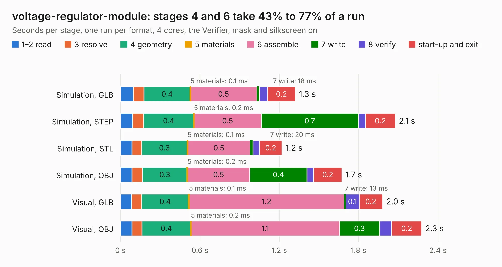

# 1218. voltage-regulator-module

Board 1,218 of the 3,132 of [Corpus Testing](../Corpus-Testing.md), on [Corpus Page 12](../CorpusTestingPages/Corpus-Testing-12.md#1218-voltage-regulator-module).

| Mode and format | 1–2 read | 3 resolve | 4 geometry | 5 materials | 6 assemble | 7 write | 8 verify | start-up and exit | Total |
|---|---:|---:|---:|---:|---:|---:|---:|---:|---:|
| Simulation, GLB | 95&nbsp;ms | 82&nbsp;ms | 0.4 | 0.1&nbsp;ms | 0.5 | 18&nbsp;ms | 64&nbsp;ms | 0.2 | 1.3 |
| Simulation, STEP | 90&nbsp;ms | 84&nbsp;ms | 0.4 | 0.2&nbsp;ms | 0.5 | 0.7 | 54&nbsp;ms | 0.2 | 2.1 |
| Simulation, STL | 85&nbsp;ms | 74&nbsp;ms | 0.3 | 0.1&nbsp;ms | 0.5 | 20&nbsp;ms | 49&nbsp;ms | 0.2 | 1.2 |
| Simulation, OBJ | 86&nbsp;ms | 79&nbsp;ms | 0.3 | 0.2&nbsp;ms | 0.5 | 0.4 | 50&nbsp;ms | 0.2 | 1.7 |
| Visual, GLB | 84&nbsp;ms | 75&nbsp;ms | 0.4 | 0.1&nbsp;ms | 1.2 | 13&nbsp;ms | 0.1 | 0.2 | 2.0 |
| Visual, OBJ | 86&nbsp;ms | 76&nbsp;ms | 0.4 | 0.2&nbsp;ms | 1.1 | 0.3 | 91&nbsp;ms | 0.2 | 2.3 |

<table align="center"><tr><td valign="top">

| Board | Repo: [heev/motor-controller-2018](https://github.com/heev/motor-controller-2018) Board: `voltage-regulator-module.kicad_pcb` |
|---|---|
| Folder | voltage-regulator-module |
| Complexity | 174&nbsp;/&nbsp;1000 (size&nbsp;129, features&nbsp;45) |
| KESE&nbsp;features | through vias, rounded, trapezoid or chamfered pads, filled zones |
| Tested | 9th November 2026 |
| Copper&nbsp;layers | 2 |
| File&nbsp;format | KiCad 5 (20171130) |
| Parts,&nbsp;tracks,&nbsp;vias | 14, 127, 10 |
| Triangles,&nbsp;simulation | 107,936 in 21 parts |
| Verifier | PASS in all six runs |

</td><td valign="top">

<table>
<tr><th>File type</th><th>File size</th><th>Peak memory used</th></tr>
<tr><th colspan="3" align="left">Simulation</th></tr>
<tr><td>GLB</td><td align="right">3.8&nbsp;MB</td><td align="right">178&nbsp;MB</td></tr>
<tr><td>STEP</td><td align="right">21&nbsp;MB</td><td align="right">189&nbsp;MB</td></tr>
<tr><td>STL</td><td align="right">5.4&nbsp;MB</td><td align="right">185&nbsp;MB</td></tr>
<tr><td>OBJ</td><td align="right">11&nbsp;MB</td><td align="right">178&nbsp;MB</td></tr>
<tr><th colspan="3" align="left">Visual</th></tr>
<tr><td>GLB</td><td align="right">2.7&nbsp;MB</td><td align="right">156&nbsp;MB</td></tr>
<tr><td>OBJ</td><td align="right">7.4&nbsp;MB</td><td align="right">157&nbsp;MB</td></tr>
</table>

</td></tr></table>

| Previous | Next |
|:---|---:|
| [1217. MotorControllerPowerBoard](b1217b_motor-controller-2018_MotorControllerPowerBoard.md) | [1219. ISA_CGA](b1219b_CGA-Redux_ISA-CGA.md) |
