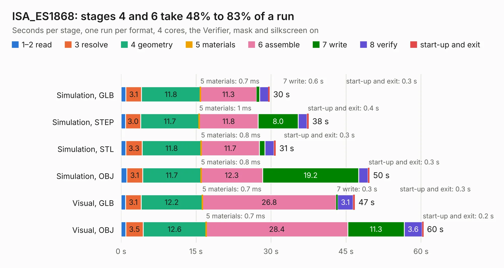

# 1219. ISA_ES1868

Board 1,219 of the 3,128 of [Corpus Testing](../Corpus-Testing.md), on [Corpus Page 12](../CorpusTestingPages/Corpus-Testing-12.md#1219-isa_es1868).

| Mode and format | 1–2 read | 3 resolve | 4 geometry | 5 materials | 6 assemble | 7 write | 8 verify | start-up and exit | Total |
|---|---:|---:|---:|---:|---:|---:|---:|---:|---:|
| Simulation, GLB | 1.0 | 3.1 | 11.8 | 0.7&nbsp;ms | 11.3 | 0.6 | 1.7 | 0.3 | 29.7 |
| Simulation, STEP | 0.9 | 3.0 | 11.7 | 1&nbsp;ms | 11.8 | 8.0 | 1.7 | 0.4 | 37.5 |
| Simulation, STL | 1.0 | 3.3 | 11.8 | 0.8&nbsp;ms | 11.7 | 1.1 | 1.9 | 0.3 | 30.9 |
| Simulation, OBJ | 1.2 | 3.1 | 11.7 | 0.8&nbsp;ms | 12.3 | 19.2 | 1.8 | 0.3 | 49.7 |
| Visual, GLB | 0.9 | 3.1 | 12.2 | 0.7&nbsp;ms | 26.8 | 0.3 | 3.1 | 0.3 | 46.8 |
| Visual, OBJ | 1.0 | 3.5 | 12.6 | 0.7&nbsp;ms | 28.4 | 11.3 | 3.6 | 0.2 | 60.5 |

<table align="center"><tr><td valign="top">

| Board | Repo: [hkzlab/ES1868_ISA8](https://github.com/hkzlab/ES1868_ISA8) Board: `ISA_ES1868.kicad_pcb` |
|---|---|
| Complexity | 329&nbsp;/&nbsp;1000 (size&nbsp;249, features&nbsp;80) |
| KESE&nbsp;features | through vias, custom pads, rounded, trapezoid or chamfered pads, filled zones, copper drawings, curved board outline |
| Tested | 9th November 2026 |
| Copper&nbsp;layers | 4 |
| File&nbsp;format | KiCad 7 (20221018) |
| Parts,&nbsp;tracks,&nbsp;vias | 119, 1,607, 85 |
| Triangles,&nbsp;simulation | 3,227,944 in 148 parts |
| Verifier | PASS in all six runs |

</td><td valign="top">

<table>
<tr><th>File type</th><th>File size</th><th>Peak memory used</th></tr>
<tr><th colspan="3" align="left">Simulation</th></tr>
<tr><td>GLB</td><td align="right">110&nbsp;MB</td><td align="right">1.1&nbsp;GB</td></tr>
<tr><td>STEP</td><td align="right">478&nbsp;MB</td><td align="right">1.3&nbsp;GB</td></tr>
<tr><td>STL</td><td align="right">161&nbsp;MB</td><td align="right">1.1&nbsp;GB</td></tr>
<tr><td>OBJ</td><td align="right">340&nbsp;MB</td><td align="right">2.1&nbsp;GB</td></tr>
<tr><th colspan="3" align="left">Visual</th></tr>
<tr><td>GLB</td><td align="right">65&nbsp;MB</td><td align="right">1.4&nbsp;GB</td></tr>
<tr><td>OBJ</td><td align="right">200&nbsp;MB</td><td align="right">1.3&nbsp;GB</td></tr>
</table>

</td></tr></table>

| Previous | Next |
|:---|---:|
| [1218. ISA_CGA](b1218b_CGA-Redux_ISA-CGA.md) | [1220. ISA_ES688](b1220b_ES688-ISA8_ISA-ES688.md) |
