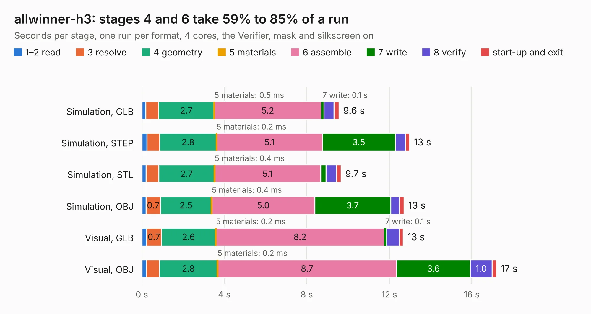

# 1219. allwinner-h3

Board 1,219 of the 3,119 of [Corpus Testing](../Corpus-Testing.md), on [Corpus Page 12](../CorpusTestingPages/Corpus-Testing-12.md#1219-allwinner-h3).

| Mode and format | 1–2 read | 3 resolve | 4 geometry | 5 materials | 6 assemble | 7 write | 8 verify | start-up and exit | Total |
|---|---:|---:|---:|---:|---:|---:|---:|---:|---:|
| Simulation, GLB | 0.2 | 0.6 | 2.7 | 0.5&nbsp;ms | 5.2 | 0.1 | 0.5 | 0.2 | 9.6 |
| Simulation, STEP | 0.2 | 0.6 | 2.8 | 0.2&nbsp;ms | 5.1 | 3.5 | 0.5 | 0.2 | 13.0 |
| Simulation, STL | 0.2 | 0.6 | 2.7 | 0.4&nbsp;ms | 5.1 | 0.3 | 0.5 | 0.2 | 9.7 |
| Simulation, OBJ | 0.2 | 0.7 | 2.5 | 0.4&nbsp;ms | 5.0 | 3.7 | 0.4 | 0.2 | 12.7 |
| Visual, GLB | 0.2 | 0.7 | 2.6 | 0.2&nbsp;ms | 8.2 | 0.1 | 0.6 | 0.2 | 12.7 |
| Visual, OBJ | 0.2 | 0.6 | 2.8 | 0.2&nbsp;ms | 8.7 | 3.6 | 1.0 | 0.2 | 17.2 |

<table align="center"><tr><td valign="top">

| Board | Repo: [hvwyl/allwinner-h3-ddr3-16x1-kicad](https://github.com/hvwyl/allwinner-h3-ddr3-16x1-kicad) Board: `allwinner-h3.kicad_pcb` |
|---|---|
| Folder | project |
| Complexity | 293&nbsp;/&nbsp;1000 (size&nbsp;223, features&nbsp;70) |
| KESE&nbsp;features | through vias, rounded, trapezoid or chamfered pads, arc tracks, stack-up, dielectric εr and tanδ |
| Tested | 9th November 2026 |
| Copper&nbsp;layers | 2 |
| File&nbsp;format | KiCad 6 (20211014) |
| Parts,&nbsp;tracks,&nbsp;vias | 20, 1,320, 119 |
| Triangles,&nbsp;simulation | 867,728 in 91 parts |
| Verifier | PASS in all six runs |

</td><td valign="top">

<table>
<tr><th>File type</th><th>File size</th><th>Peak memory used</th></tr>
<tr><th colspan="3" align="left">Simulation</th></tr>
<tr><td>GLB</td><td align="right">29&nbsp;MB</td><td align="right">506&nbsp;MB</td></tr>
<tr><td>STEP</td><td align="right">137&nbsp;MB</td><td align="right">533&nbsp;MB</td></tr>
<tr><td>STL</td><td align="right">43&nbsp;MB</td><td align="right">494&nbsp;MB</td></tr>
<tr><td>OBJ</td><td align="right">86&nbsp;MB</td><td align="right">615&nbsp;MB</td></tr>
<tr><th colspan="3" align="left">Visual</th></tr>
<tr><td>GLB</td><td align="right">25&nbsp;MB</td><td align="right">683&nbsp;MB</td></tr>
<tr><td>OBJ</td><td align="right">76&nbsp;MB</td><td align="right">678&nbsp;MB</td></tr>
</table>

</td></tr></table>

| Previous | Next |
|:---|---:|
| [1218. ISA_ES688](b1218b_ES688-ISA8_ISA-ES688.md) | [1220. FCCU-v2-schematic-pcb](b1220b_fuel-cell-control-unit-pcb-fccu-v2-1_FCCU-v2-schematic-pcb.md) |
