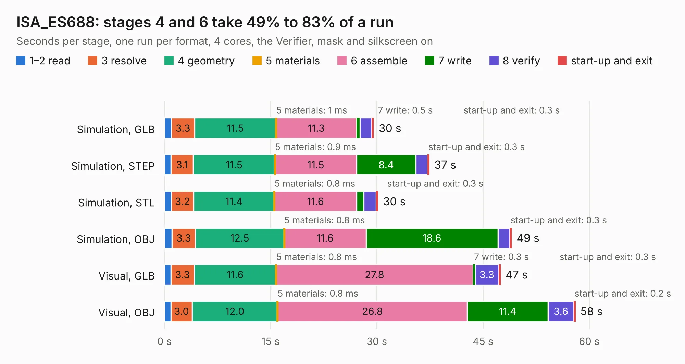

# 1220. ISA_ES688

Board 1,220 of the 3,129 of [Corpus Testing](../Corpus-Testing.md), on [Corpus Page 12](../CorpusTestingPages/Corpus-Testing-12.md#1220-isa_es688).

| Mode and format | 1–2 read | 3 resolve | 4 geometry | 5 materials | 6 assemble | 7 write | 8 verify | start-up and exit | Total |
|---|---:|---:|---:|---:|---:|---:|---:|---:|---:|
| Simulation, GLB | 1.0 | 3.3 | 11.5 | 1&nbsp;ms | 11.3 | 0.5 | 1.6 | 0.3 | 29.6 |
| Simulation, STEP | 0.9 | 3.1 | 11.5 | 0.9&nbsp;ms | 11.5 | 8.4 | 1.6 | 0.3 | 37.4 |
| Simulation, STL | 1.0 | 3.2 | 11.4 | 0.8&nbsp;ms | 11.6 | 1.0 | 1.7 | 0.3 | 30.2 |
| Simulation, OBJ | 1.1 | 3.3 | 12.5 | 0.8&nbsp;ms | 11.6 | 18.6 | 1.7 | 0.3 | 49.1 |
| Visual, GLB | 0.9 | 3.3 | 11.6 | 0.8&nbsp;ms | 27.8 | 0.3 | 3.3 | 0.3 | 47.5 |
| Visual, OBJ | 0.9 | 3.0 | 12.0 | 0.8&nbsp;ms | 26.8 | 11.4 | 3.6 | 0.2 | 58.1 |

<table align="center"><tr><td valign="top">

| Board | Repo: [hkzlab/ES688_ISA8](https://github.com/hkzlab/ES688_ISA8) Board: `ISA_ES688.kicad_pcb` |
|---|---|
| Complexity | 335&nbsp;/&nbsp;1000 (size&nbsp;255, features&nbsp;80) |
| KESE&nbsp;features | through vias, custom pads, rounded, trapezoid or chamfered pads, filled zones, copper drawings, curved board outline |
| Tested | 9th November 2026 |
| Copper&nbsp;layers | 4 |
| File&nbsp;format | KiCad 7 (20221018) |
| Parts,&nbsp;tracks,&nbsp;vias | 125, 2,157, 166 |
| Triangles,&nbsp;simulation | 3,361,666 in 167 parts |
| Verifier | PASS in all six runs |

</td><td valign="top">

<table>
<tr><th>File type</th><th>File size</th><th>Peak memory used</th></tr>
<tr><th colspan="3" align="left">Simulation</th></tr>
<tr><td>GLB</td><td align="right">115&nbsp;MB</td><td align="right">1.1&nbsp;GB</td></tr>
<tr><td>STEP</td><td align="right">512&nbsp;MB</td><td align="right">1.3&nbsp;GB</td></tr>
<tr><td>STL</td><td align="right">168&nbsp;MB</td><td align="right">1.1&nbsp;GB</td></tr>
<tr><td>OBJ</td><td align="right">355&nbsp;MB</td><td align="right">2.2&nbsp;GB</td></tr>
<tr><th colspan="3" align="left">Visual</th></tr>
<tr><td>GLB</td><td align="right">71&nbsp;MB</td><td align="right">1.4&nbsp;GB</td></tr>
<tr><td>OBJ</td><td align="right">221&nbsp;MB</td><td align="right">1.5&nbsp;GB</td></tr>
</table>

</td></tr></table>

| Previous | Next |
|:---|---:|
| [1219. ISA_ES1868](b1219b_ES1868-ISA8_ISA-ES1868.md) | [1221. allwinner-h3](b1221b_allwinner-h3-ddr3-16x1-kicad_allwinner-h3.md) |
