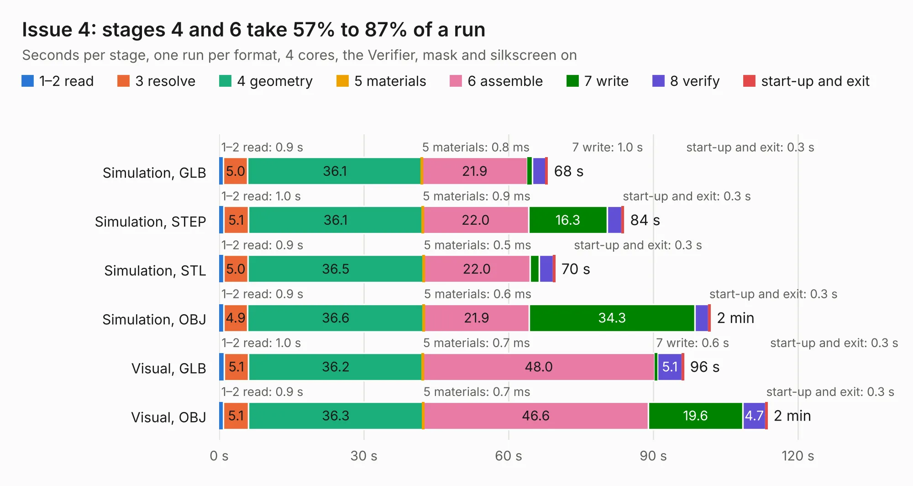

# 1220. Issue 4

Board 1,220 of the 3,116 of [Corpus Testing](../Corpus-Testing.md), on [Corpus Page 12](../CorpusTestingPages/Corpus-Testing-12.md#1220-issue-4).

| Mode and format | 1–2 read | 3 resolve | 4 geometry | 5 materials | 6 assemble | 7 write | 8 verify | start-up and exit | Total |
|---|---:|---:|---:|---:|---:|---:|---:|---:|---:|
| Simulation, GLB | 0.9 | 5.0 | 36.1 | 0.8&nbsp;ms | 21.9 | 1.0 | 2.8 | 0.3 | 68.0 |
| Simulation, STEP | 1.0 | 5.1 | 36.1 | 0.9&nbsp;ms | 22.0 | 16.3 | 3.0 | 0.3 | 83.8 |
| Simulation, STL | 0.9 | 5.0 | 36.5 | 0.5&nbsp;ms | 22.0 | 2.0 | 2.9 | 0.3 | 69.6 |
| Simulation, OBJ | 0.9 | 4.9 | 36.6 | 0.6&nbsp;ms | 21.9 | 34.3 | 2.8 | 0.3 | 101.8 |
| Visual, GLB | 1.0 | 5.1 | 36.2 | 0.7&nbsp;ms | 48.0 | 0.6 | 5.1 | 0.3 | 96.2 |
| Visual, OBJ | 0.9 | 5.1 | 36.3 | 0.7&nbsp;ms | 46.6 | 19.6 | 4.7 | 0.3 | 113.5 |

<table align="center"><tr><td valign="top">

| Board | Repo: [iansbremner/ZX-Spectrum-Issue-4B-KiCAD](https://github.com/iansbremner/ZX-Spectrum-Issue-4B-KiCAD) Board: `Issue 4.kicad_pcb` |
|---|---|
| Complexity | 283&nbsp;/&nbsp;1000 (size&nbsp;218, features&nbsp;65) |
| KESE&nbsp;features | through vias, slotted holes, rounded, trapezoid or chamfered pads, filled zones, curved board outline |
| Tested | 9th November 2026 |
| Copper&nbsp;layers | 2 |
| File&nbsp;format | KiCad 5 (20171130) |
| Parts,&nbsp;tracks,&nbsp;vias | 195, 5,111, 429 |
| Triangles,&nbsp;simulation | 6,255,428 in 166 parts |
| Verifier | PASS in all six runs |

</td><td valign="top">

<table>
<tr><th>File type</th><th>File size</th><th>Peak memory used</th></tr>
<tr><th colspan="3" align="left">Simulation</th></tr>
<tr><td>GLB</td><td align="right">215&nbsp;MB</td><td align="right">1.8&nbsp;GB</td></tr>
<tr><td>STEP</td><td align="right">1.1&nbsp;GB</td><td align="right">2.2&nbsp;GB</td></tr>
<tr><td>STL</td><td align="right">313&nbsp;MB</td><td align="right">1.8&nbsp;GB</td></tr>
<tr><td>OBJ</td><td align="right">673&nbsp;MB</td><td align="right">4.0&nbsp;GB</td></tr>
<tr><th colspan="3" align="left">Visual</th></tr>
<tr><td>GLB</td><td align="right">125&nbsp;MB</td><td align="right">2.0&nbsp;GB</td></tr>
<tr><td>OBJ</td><td align="right">397&nbsp;MB</td><td align="right">2.6&nbsp;GB</td></tr>
</table>

</td></tr></table>

| Previous | Next |
|:---|---:|
| [1219. Daughterboard](b1219b_Amiga-3000-Daughterboard_Daughterboard.md) | [1221. tomu-fpga](b1221b_fomu-hardware_archive-dvt-pcb_tomu-fpga.md) |
