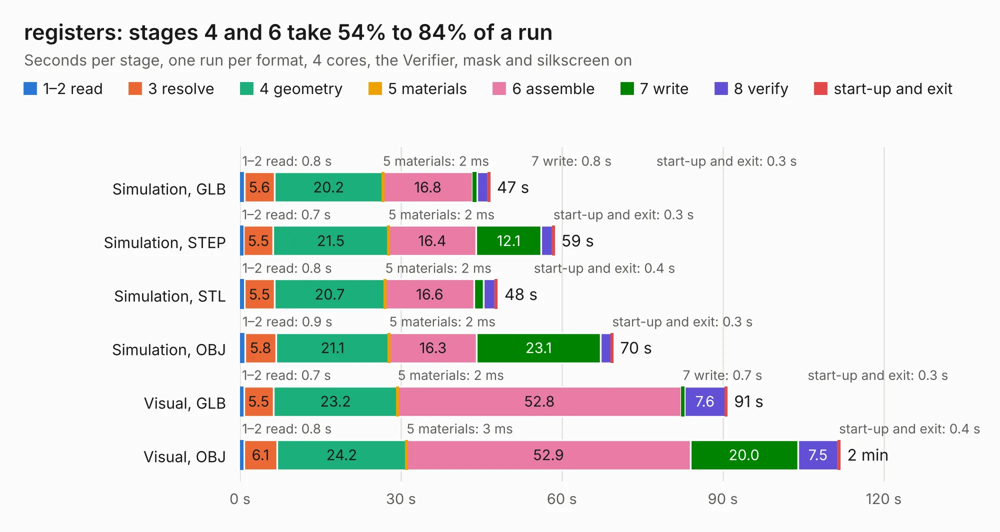

# 1221. registers

Board 1,221 of the 3,101 of [Corpus Testing](../Corpus-Testing.md), on [Corpus Page 12](../CorpusTestingPages/Corpus-Testing-12.md#1221-registers).

| Mode and format | 1–2 read | 3 resolve | 4 geometry | 5 materials | 6 assemble | 7 write | 8 verify | start-up and exit | Total |
|---|---:|---:|---:|---:|---:|---:|---:|---:|---:|
| Simulation, GLB | 0.8 | 5.6 | 20.2 | 2&nbsp;ms | 16.8 | 0.8 | 2.1 | 0.3 | 46.5 |
| Simulation, STEP | 0.7 | 5.5 | 21.5 | 2&nbsp;ms | 16.4 | 12.1 | 2.1 | 0.3 | 58.6 |
| Simulation, STL | 0.8 | 5.5 | 20.7 | 2&nbsp;ms | 16.6 | 1.7 | 2.2 | 0.4 | 47.9 |
| Simulation, OBJ | 0.9 | 5.8 | 21.1 | 2&nbsp;ms | 16.3 | 23.1 | 2.0 | 0.3 | 69.5 |
| Visual, GLB | 0.7 | 5.5 | 23.2 | 2&nbsp;ms | 52.8 | 0.7 | 7.6 | 0.3 | 90.8 |
| Visual, OBJ | 0.8 | 6.1 | 24.2 | 3&nbsp;ms | 52.9 | 20.0 | 7.5 | 0.4 | 111.8 |

<table align="center"><tr><td valign="top">

| Board | Repo: [imihajlow/ccpu](https://github.com/imihajlow/ccpu) Board: `registers.kicad_pcb` |
|---|---|
| Folder | boards / registers |
| Complexity | 278&nbsp;/&nbsp;1000 (size&nbsp;223, features&nbsp;55) |
| KESE&nbsp;features | through vias, rounded, trapezoid or chamfered pads, filled zones, copper text |
| Tested | 9th November 2026 |
| Copper&nbsp;layers | 2 |
| File&nbsp;format | KiCad 5 (20171130) |
| Parts,&nbsp;tracks,&nbsp;vias | 213, 5,186, 1,072 |
| Triangles,&nbsp;simulation | 4,822,450 in 238 parts |
| Verifier | PASS in all six runs |

</td><td valign="top">

<table>
<tr><th>File type</th><th>File size</th><th>Peak memory used</th></tr>
<tr><th colspan="3" align="left">Simulation</th></tr>
<tr><td>GLB</td><td align="right">166&nbsp;MB</td><td align="right">1.7&nbsp;GB</td></tr>
<tr><td>STEP</td><td align="right">859&nbsp;MB</td><td align="right">2.0&nbsp;GB</td></tr>
<tr><td>STL</td><td align="right">241&nbsp;MB</td><td align="right">2.0&nbsp;GB</td></tr>
<tr><td>OBJ</td><td align="right">517&nbsp;MB</td><td align="right">3.1&nbsp;GB</td></tr>
<tr><th colspan="3" align="left">Visual</th></tr>
<tr><td>GLB</td><td align="right">135&nbsp;MB</td><td align="right">2.2&nbsp;GB</td></tr>
<tr><td>OBJ</td><td align="right">434&nbsp;MB</td><td align="right">2.9&nbsp;GB</td></tr>
</table>

</td></tr></table>

| Previous | Next |
|:---|---:|
| [1220. io](b1220b_ccpu_io.md) | [1222. stack](b1222b_ccpu_stack.md) |
