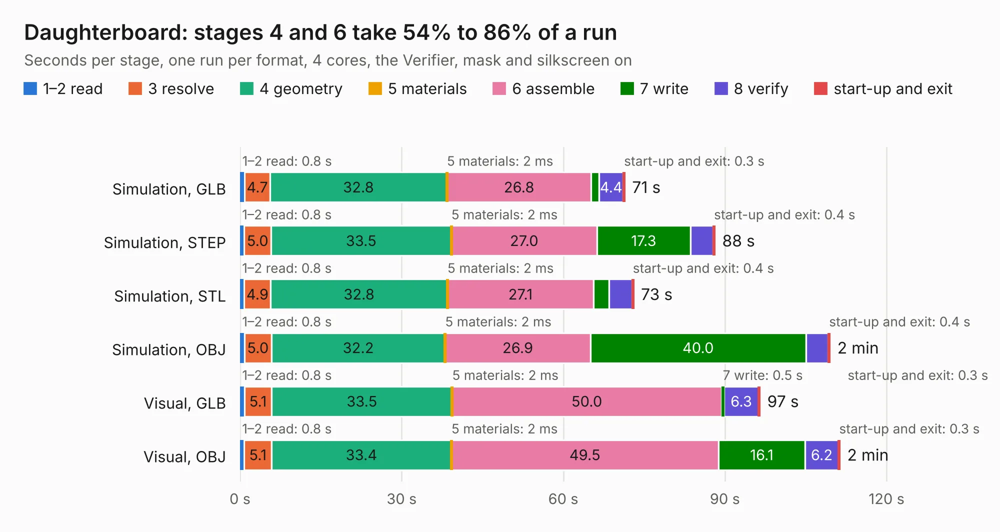

# 1225. Daughterboard

Board 1,225 of the 3,127 of [Corpus Testing](../Corpus-Testing.md), on [Corpus Page 12](../CorpusTestingPages/Corpus-Testing-12.md#1225-daughterboard).

| Mode and format | 1–2 read | 3 resolve | 4 geometry | 5 materials | 6 assemble | 7 write | 8 verify | start-up and exit | Total |
|---|---:|---:|---:|---:|---:|---:|---:|---:|---:|
| Simulation, GLB | 0.8 | 4.7 | 32.8 | 2&nbsp;ms | 26.8 | 1.5 | 4.4 | 0.3 | 71.4 |
| Simulation, STEP | 0.8 | 5.0 | 33.5 | 2&nbsp;ms | 27.0 | 17.3 | 4.2 | 0.4 | 88.2 |
| Simulation, STL | 0.8 | 4.9 | 32.8 | 2&nbsp;ms | 27.1 | 2.9 | 4.3 | 0.4 | 73.1 |
| Simulation, OBJ | 0.8 | 5.0 | 32.2 | 2&nbsp;ms | 26.9 | 40.0 | 4.1 | 0.4 | 109.5 |
| Visual, GLB | 0.8 | 5.1 | 33.5 | 2&nbsp;ms | 50.0 | 0.5 | 6.3 | 0.3 | 96.5 |
| Visual, OBJ | 0.8 | 5.1 | 33.4 | 2&nbsp;ms | 49.5 | 16.1 | 6.2 | 0.3 | 111.4 |

<table align="center"><tr><td valign="top">

| Board | Repo: [iansbremner/Amiga-3000-Daughterboard](https://github.com/iansbremner/Amiga-3000-Daughterboard) Board: `Daughterboard.kicad_pcb` |
|---|---|
| Complexity | 253&nbsp;/&nbsp;1000 (size&nbsp;218, features&nbsp;35) |
| KESE&nbsp;features | through vias, filled zones |
| Tested | 9th November 2026 |
| Copper&nbsp;layers | 4 |
| File&nbsp;format | KiCad 5 (20171130) |
| Parts,&nbsp;tracks,&nbsp;vias | 90, 3,667, 102 |
| Triangles,&nbsp;simulation | 8,425,376 in 307 parts |
| Verifier | PASS in all six runs |

</td><td valign="top">

<table>
<tr><th>File type</th><th>File size</th><th>Peak memory used</th></tr>
<tr><th colspan="3" align="left">Simulation</th></tr>
<tr><td>GLB</td><td align="right">285&nbsp;MB</td><td align="right">1.9&nbsp;GB</td></tr>
<tr><td>STEP</td><td align="right">1.2&nbsp;GB</td><td align="right">2.6&nbsp;GB</td></tr>
<tr><td>STL</td><td align="right">421&nbsp;MB</td><td align="right">1.9&nbsp;GB</td></tr>
<tr><td>OBJ</td><td align="right">908&nbsp;MB</td><td align="right">5.3&nbsp;GB</td></tr>
<tr><th colspan="3" align="left">Visual</th></tr>
<tr><td>GLB</td><td align="right">125&nbsp;MB</td><td align="right">2.3&nbsp;GB</td></tr>
<tr><td>OBJ</td><td align="right">396&nbsp;MB</td><td align="right">2.6&nbsp;GB</td></tr>
</table>

</td></tr></table>

| Previous | Next |
|:---|---:|
| [1224. Amiga 2000R6](b1224b_Amiga-2000-KiCAD_Amiga-2000R6.md) | [1226. Issue 4](b1226b_ZX-Spectrum-Issue-4B-KiCAD_Issue-4.md) |
