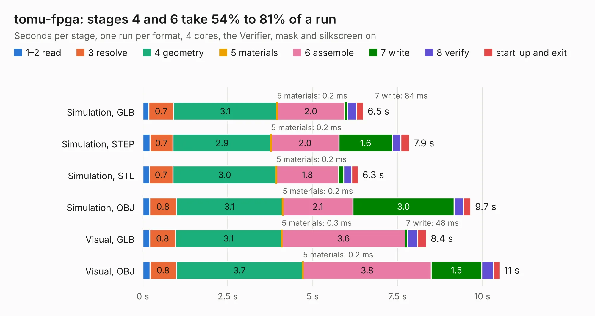

# 1225. tomu-fpga

Board 1,225 of the 3,121 of [Corpus Testing](../Corpus-Testing.md), on [Corpus Page 12](../CorpusTestingPages/Corpus-Testing-12.md#1225-tomu-fpga).

| Mode and format | 1–2 read | 3 resolve | 4 geometry | 5 materials | 6 assemble | 7 write | 8 verify | start-up and exit | Total |
|---|---:|---:|---:|---:|---:|---:|---:|---:|---:|
| Simulation, GLB | 0.2 | 0.7 | 3.1 | 0.2&nbsp;ms | 2.0 | 84&nbsp;ms | 0.3 | 0.2 | 6.5 |
| Simulation, STEP | 0.2 | 0.7 | 2.9 | 0.2&nbsp;ms | 2.0 | 1.6 | 0.2 | 0.3 | 7.9 |
| Simulation, STL | 0.2 | 0.7 | 3.0 | 0.2&nbsp;ms | 1.8 | 0.2 | 0.2 | 0.2 | 6.3 |
| Simulation, OBJ | 0.2 | 0.8 | 3.1 | 0.2&nbsp;ms | 2.1 | 3.0 | 0.3 | 0.2 | 9.7 |
| Visual, GLB | 0.2 | 0.8 | 3.1 | 0.3&nbsp;ms | 3.6 | 48&nbsp;ms | 0.3 | 0.3 | 8.4 |
| Visual, OBJ | 0.2 | 0.8 | 3.7 | 0.2&nbsp;ms | 3.8 | 1.5 | 0.3 | 0.2 | 10.5 |

<table align="center"><tr><td valign="top">

| Board | Repo: [im-tomu/fomu-hardware](https://github.com/im-tomu/fomu-hardware) Board: `tomu-fpga.kicad_pcb` |
|---|---|
| Folder | archive / dvt / pcb |
| Complexity | 347&nbsp;/&nbsp;1000 (size&nbsp;192, features&nbsp;155) |
| KESE&nbsp;features | blind and buried vias, microvias, custom pads, rounded, trapezoid or chamfered pads, filled zones, copper drawings, copper text, curved board outline |
| Tested | 9th November 2026 |
| Copper&nbsp;layers | 4 |
| File&nbsp;format | KiCad 5 (20171130) |
| Parts,&nbsp;tracks,&nbsp;vias | 41, 579, 249 |
| Triangles,&nbsp;simulation | 513,942 in 44 parts |
| Verifier | PASS in all six runs |

</td><td valign="top">

<table>
<tr><th>File type</th><th>File size</th><th>Peak memory used</th></tr>
<tr><th colspan="3" align="left">Simulation</th></tr>
<tr><td>GLB</td><td align="right">18&nbsp;MB</td><td align="right">313&nbsp;MB</td></tr>
<tr><td>STEP</td><td align="right">74&nbsp;MB</td><td align="right">348&nbsp;MB</td></tr>
<tr><td>STL</td><td align="right">26&nbsp;MB</td><td align="right">312&nbsp;MB</td></tr>
<tr><td>OBJ</td><td align="right">53&nbsp;MB</td><td align="right">408&nbsp;MB</td></tr>
<tr><th colspan="3" align="left">Visual</th></tr>
<tr><td>GLB</td><td align="right">9.8&nbsp;MB</td><td align="right">310&nbsp;MB</td></tr>
<tr><td>OBJ</td><td align="right">29&nbsp;MB</td><td align="right">307&nbsp;MB</td></tr>
</table>

</td></tr></table>

| Previous | Next |
|:---|---:|
| [1224. Issue 4](b1224b_ZX-Spectrum-Issue-4B-KiCAD_Issue-4.md) | [1226. tomu-fpga](b1226b_fomu-hardware_archive-evt-pcb_tomu-fpga.md) |
