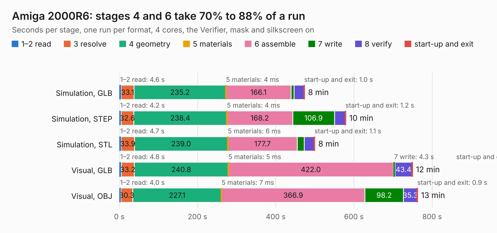

# 1226. Amiga 2000R6

Board 1,226 of the 3,138 of [Corpus Testing](../Corpus-Testing.md), on [Corpus Page 12](../CorpusTestingPages/Corpus-Testing-12.md#1226-amiga-2000r6).

| Mode and format | 1–2 read | 3 resolve | 4 geometry | 5 materials | 6 assemble | 7 write | 8 verify | start-up and exit | Total |
|---|---:|---:|---:|---:|---:|---:|---:|---:|---:|
| Simulation, GLB | 4.6 | 33.1 | 235.2 | 4&nbsp;ms | 166.1 | 8.0 | 25.6 | 1.0 | 473.6 |
| Simulation, STEP | 4.2 | 32.6 | 238.4 | 4&nbsp;ms | 168.2 | 106.9 | 27.7 | 1.2 | 579.1 |
| Simulation, STL | 4.7 | 33.9 | 239.0 | 6&nbsp;ms | 177.7 | 17.7 | 25.7 | 1.1 | 499.8 |
| Simulation, OBJ |  |  |  |  |  |  |  |  | exceeded 11 GB on a 16 GB machine (stopped there, not a KESE failure); it will be run again on a machine with more memory |
| Visual, GLB | 4.8 | 33.2 | 240.8 | 5&nbsp;ms | 422.0 | 4.3 | 43.4 | 1.0 | 749.6 |
| Visual, OBJ | 4.0 | 30.3 | 227.1 | 7&nbsp;ms | 366.9 | 98.2 | 35.3 | 0.9 | 762.7 |

<table align="center"><tr><td valign="top">

| Board | Repo: [iansbremner/Amiga-2000-KiCAD](https://github.com/iansbremner/Amiga-2000-KiCAD) Board: `Amiga 2000R6.kicad_pcb` |
|---|---|
| Complexity | 346&nbsp;/&nbsp;1000 (size&nbsp;291, features&nbsp;55) |
| KESE&nbsp;features | through vias, filled zones, copper drawings, curved board outline |
| Tested | 9th November 2026 to 10th November 2026 |
| Copper&nbsp;layers | 2 |
| File&nbsp;format | KiCad 5 (20171130) |
| Parts,&nbsp;tracks,&nbsp;vias | 543, 21,184, 1,195 |
| Triangles,&nbsp;simulation | 28,431,494 in 828 parts |
| Verifier | Simulation, OBJ: exceeded 11 GB on a 16 GB machine (stopped there, not a KESE failure); it will be run again on a machine with more memory |
| Run&nbsp;again | Visual, OBJ: failed in the corpus run, run again with the memory cap raised from 11 GB to 14.5 GB, and passed |

</td><td valign="top">

<table>
<tr><th>File type</th><th>File size</th><th>Peak memory used</th></tr>
<tr><th colspan="3" align="left">Simulation</th></tr>
<tr><td>GLB</td><td align="right">975&nbsp;MB</td><td align="right">6.2&nbsp;GB</td></tr>
<tr><td>STEP</td><td align="right">5.1&nbsp;GB</td><td align="right">8.9&nbsp;GB</td></tr>
<tr><td>STL</td><td align="right">1.4&nbsp;GB</td><td align="right">6.5&nbsp;GB</td></tr>
<tr><td>OBJ</td><td align="right">–</td><td align="right">11&nbsp;GB</td></tr>
<tr><th colspan="3" align="left">Visual</th></tr>
<tr><td>GLB</td><td align="right">548&nbsp;MB</td><td align="right">8.0&nbsp;GB</td></tr>
<tr><td>OBJ</td><td align="right">1.8&nbsp;GB</td><td align="right">11&nbsp;GB</td></tr>
</table>

</td></tr></table>

| Previous | Next |
|:---|---:|
| [1225. FCCU-v21-schematic-pcb](b1225b_fuel-cell-control-unit-pcb-fccu-v2-1_FCCU-v21-schematic-pcb.md) | [1227. Daughterboard](b1227b_Amiga-3000-Daughterboard_Daughterboard.md) |
