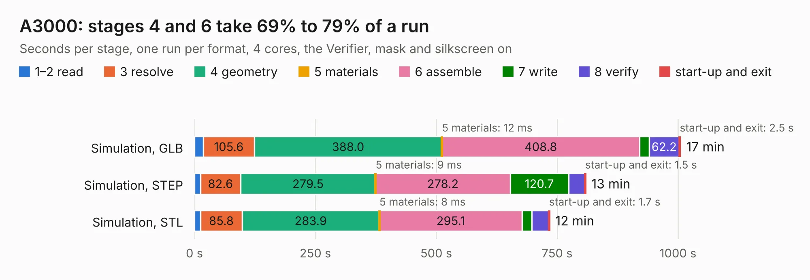

# 1228. A3000

Board 1,228 of the 3,139 of [Corpus Testing](../Corpus-Testing.md), on [Corpus Page 12](../CorpusTestingPages/Corpus-Testing-12.md#1228-a3000).

| Mode and format | 1–2 read | 3 resolve | 4 geometry | 5 materials | 6 assemble | 7 write | 8 verify | start-up and exit | Total |
|---|---:|---:|---:|---:|---:|---:|---:|---:|---:|
| Simulation, GLB | 18.2 | 105.6 | 388.0 | 12&nbsp;ms | 408.8 | 19.7 | 62.2 | 2.5 | 1005.0 |
| Simulation, STEP | 12.6 | 82.6 | 279.5 | 9&nbsp;ms | 278.2 | 120.7 | 33.8 | 1.5 | 808.9 |
| Simulation, STL | 12.8 | 85.8 | 283.9 | 8&nbsp;ms | 295.1 | 19.9 | 35.1 | 1.7 | 734.4 |
| Simulation, OBJ |  |  |  |  |  |  |  |  | exceeded 11 GB on a 16 GB machine (stopped there, not a KESE failure); it will be run again on a machine with more memory |
| Visual, GLB |  |  |  |  |  |  |  |  | exceeded 11 GB on a 16 GB machine (stopped there, not a KESE failure); it will be run again on a machine with more memory |
| Visual, OBJ |  |  |  |  |  |  |  |  | exceeded 11 GB on a 16 GB machine (stopped there, not a KESE failure); it will be run again on a machine with more memory |

<table align="center"><tr><td valign="top">

| Board | Repo: [iansbremner/ReAmiga-3000---KiCAD](https://github.com/iansbremner/ReAmiga-3000---KiCAD) Board: `A3000.kicad_pcb` |
|---|---|
| Complexity | 400&nbsp;/&nbsp;1000 (size&nbsp;335, features&nbsp;65) |
| KESE&nbsp;features | through vias, rounded, trapezoid or chamfered pads, filled zones, copper drawings, copper text |
| Tested | 9th November 2026 to 10th November 2026 |
| Copper&nbsp;layers | 4 |
| File&nbsp;format | KiCad 5 (20171130) |
| Parts,&nbsp;tracks,&nbsp;vias | 606, 33,010, 2,132 |
| Triangles,&nbsp;simulation | 53,375,936 in 1039 parts |
| Verifier | Simulation, OBJ: exceeded 11 GB on a 16 GB machine (stopped there, not a KESE failure); it will be run again on a machine with more memory Visual, GLB: exceeded 11 GB on a 16 GB machine (stopped there, not a KESE failure); it will be run again on a machine with more memory Visual, OBJ: exceeded 11 GB on a 16 GB machine (stopped there, not a KESE failure); it will be run again on a machine with more memory |
| Run&nbsp;again | Simulation, STEP; Simulation, STL: failed in the corpus run, run again with the memory cap raised from 11 GB to 14.5 GB, and passed |

</td><td valign="top">

<table>
<tr><th>File type</th><th>File size</th><th>Peak memory used</th></tr>
<tr><th colspan="3" align="left">Simulation</th></tr>
<tr><td>GLB</td><td align="right">1.8&nbsp;GB</td><td align="right">9.8&nbsp;GB</td></tr>
<tr><td>STEP</td><td align="right">8.3&nbsp;GB</td><td align="right">14&nbsp;GB</td></tr>
<tr><td>STL</td><td align="right">2.7&nbsp;GB</td><td align="right">11&nbsp;GB</td></tr>
<tr><td>OBJ</td><td align="right">–</td><td align="right">11&nbsp;GB</td></tr>
<tr><th colspan="3" align="left">Visual</th></tr>
<tr><td>GLB</td><td align="right">–</td><td align="right">11&nbsp;GB</td></tr>
<tr><td>OBJ</td><td align="right">–</td><td align="right">11&nbsp;GB</td></tr>
</table>

</td></tr></table>

| Previous | Next |
|:---|---:|
| [1227. Daughterboard](b1227b_Amiga-3000-Daughterboard_Daughterboard.md) | [1229. REAmiga3000](b1229b_ReAmiga3000-SMD-for-KICAD_REAmiga3000.md) |
