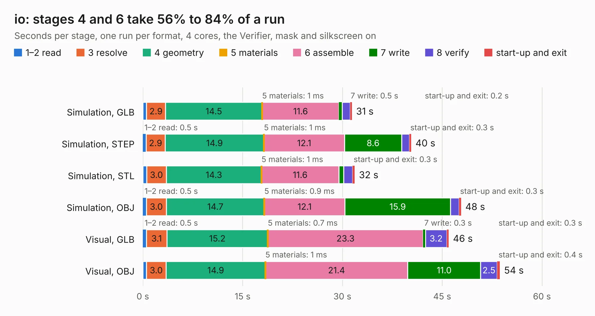

# 1228. io

Board 1,228 of the 3,112 of [Corpus Testing](../Corpus-Testing.md), on [Corpus Page 12](../CorpusTestingPages/Corpus-Testing-12.md#1228-io).

| Mode and format | 1–2 read | 3 resolve | 4 geometry | 5 materials | 6 assemble | 7 write | 8 verify | start-up and exit | Total |
|---|---:|---:|---:|---:|---:|---:|---:|---:|---:|
| Simulation, GLB | 0.6 | 2.9 | 14.5 | 1&nbsp;ms | 11.6 | 0.5 | 1.2 | 0.2 | 31.4 |
| Simulation, STEP | 0.5 | 2.9 | 14.9 | 1&nbsp;ms | 12.1 | 8.6 | 1.2 | 0.3 | 40.3 |
| Simulation, STL | 0.6 | 3.0 | 14.3 | 1&nbsp;ms | 11.6 | 0.7 | 1.3 | 0.3 | 31.9 |
| Simulation, OBJ | 0.5 | 3.0 | 14.7 | 0.9&nbsp;ms | 12.1 | 15.9 | 1.3 | 0.3 | 47.8 |
| Visual, GLB | 0.5 | 3.1 | 15.2 | 0.7&nbsp;ms | 23.3 | 0.3 | 3.2 | 0.3 | 46.0 |
| Visual, OBJ | 0.5 | 3.0 | 14.9 | 1&nbsp;ms | 21.4 | 11.0 | 2.5 | 0.4 | 53.7 |

<table align="center"><tr><td valign="top">

| Board | Repo: [imihajlow/ccpu](https://github.com/imihajlow/ccpu) Board: `io.kicad_pcb` |
|---|---|
| Folder | boards / io |
| Complexity | 306&nbsp;/&nbsp;1000 (size&nbsp;241, features&nbsp;65) |
| KESE&nbsp;features | through vias, slotted holes, rounded, trapezoid or chamfered pads, filled zones, copper text |
| Tested | 9th November 2026 |
| Copper&nbsp;layers | 2 |
| File&nbsp;format | KiCad 5 (20171130) |
| Parts,&nbsp;tracks,&nbsp;vias | 119, 1,990, 399 |
| Triangles,&nbsp;simulation | 2,577,618 in 121 parts |
| Verifier | PASS in all six runs |

</td><td valign="top">

<table>
<tr><th>File type</th><th>File size</th><th>Peak memory used</th></tr>
<tr><th colspan="3" align="left">Simulation</th></tr>
<tr><td>GLB</td><td align="right">89&nbsp;MB</td><td align="right">879&nbsp;MB</td></tr>
<tr><td>STEP</td><td align="right">447&nbsp;MB</td><td align="right">1.2&nbsp;GB</td></tr>
<tr><td>STL</td><td align="right">129&nbsp;MB</td><td align="right">832&nbsp;MB</td></tr>
<tr><td>OBJ</td><td align="right">272&nbsp;MB</td><td align="right">1.7&nbsp;GB</td></tr>
<tr><th colspan="3" align="left">Visual</th></tr>
<tr><td>GLB</td><td align="right">67&nbsp;MB</td><td align="right">1.2&nbsp;GB</td></tr>
<tr><td>OBJ</td><td align="right">208&nbsp;MB</td><td align="right">1.4&nbsp;GB</td></tr>
</table>

</td></tr></table>

| Previous | Next |
|:---|---:|
| [1227. eth](b1227b_ccpu_eth.md) | [1229. registers](b1229b_ccpu_registers.md) |
