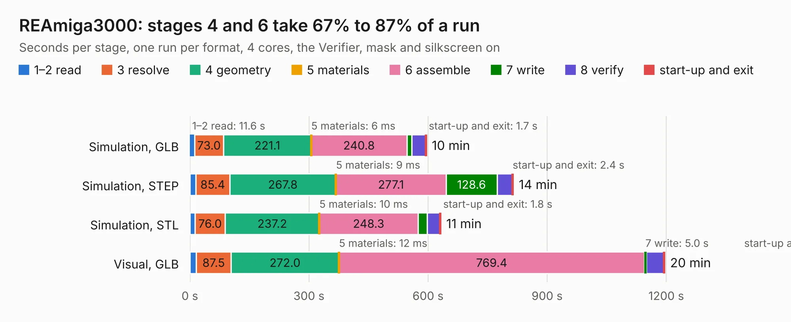

# 1229. REAmiga3000

Board 1,229 of the 3,138 of [Corpus Testing](../Corpus-Testing.md), on [Corpus Page 12](../CorpusTestingPages/Corpus-Testing-12.md#1229-reamiga3000).

| Mode and format | 1–2 read | 3 resolve | 4 geometry | 5 materials | 6 assemble | 7 write | 8 verify | start-up and exit | Total |
|---|---:|---:|---:|---:|---:|---:|---:|---:|---:|
| Simulation, GLB | 11.6 | 73.0 | 221.1 | 6&nbsp;ms | 240.8 | 12.0 | 35.0 | 1.7 | 595.2 |
| Simulation, STEP | 15.0 | 85.4 | 267.8 | 9&nbsp;ms | 277.1 | 128.6 | 38.2 | 2.4 | 814.4 |
| Simulation, STL | 12.9 | 76.0 | 237.2 | 10&nbsp;ms | 248.3 | 22.9 | 32.4 | 1.8 | 631.6 |
| Simulation, OBJ |  |  |  |  |  |  |  |  | exceeded 11 GB on a 16 GB machine (stopped there, not a KESE failure); it will be run again on a machine with more memory |
| Visual, GLB | 16.2 | 87.5 | 272.0 | 12&nbsp;ms | 769.4 | 5.0 | 44.2 | 1.2 | 1195.6 |
| Visual, OBJ |  |  |  |  |  |  |  |  | exceeded 11 GB on a 16 GB machine (stopped there, not a KESE failure); it will be run again on a machine with more memory |

<table align="center"><tr><td valign="top">

| Board | Repo: [iansbremner/ReAmiga3000-SMD-for-KICAD](https://github.com/iansbremner/ReAmiga3000-SMD-for-KICAD) Board: `REAmiga3000.kicad_pcb` |
|---|---|
| Complexity | 407&nbsp;/&nbsp;1000 (size&nbsp;332, features&nbsp;75) |
| KESE&nbsp;features | through vias, slotted holes, rounded, trapezoid or chamfered pads, filled zones, copper drawings, curved board outline |
| Tested | 9th November 2026 to 10th November 2026 |
| Copper&nbsp;layers | 4 |
| File&nbsp;format | KiCad 5 (20171130) |
| Parts,&nbsp;tracks,&nbsp;vias | 470, 30,361, 2,572 |
| Triangles,&nbsp;simulation | 44,363,034 in 1001 parts |
| Verifier | Simulation, OBJ: exceeded 11 GB on a 16 GB machine (stopped there, not a KESE failure); it will be run again on a machine with more memory Visual, OBJ: exceeded 11 GB on a 16 GB machine (stopped there, not a KESE failure); it will be run again on a machine with more memory |
| Run&nbsp;again | Simulation, STEP; Visual, GLB: failed in the corpus run, run again with the memory cap raised from 11 GB to 14.5 GB, and passed |

</td><td valign="top">

<table>
<tr><th>File type</th><th>File size</th><th>Peak memory used</th></tr>
<tr><th colspan="3" align="left">Simulation</th></tr>
<tr><td>GLB</td><td align="right">1.5&nbsp;GB</td><td align="right">8.3&nbsp;GB</td></tr>
<tr><td>STEP</td><td align="right">6.9&nbsp;GB</td><td align="right">11&nbsp;GB</td></tr>
<tr><td>STL</td><td align="right">2.2&nbsp;GB</td><td align="right">9.3&nbsp;GB</td></tr>
<tr><td>OBJ</td><td align="right">–</td><td align="right">11&nbsp;GB</td></tr>
<tr><th colspan="3" align="left">Visual</th></tr>
<tr><td>GLB</td><td align="right">854&nbsp;MB</td><td align="right">13&nbsp;GB</td></tr>
<tr><td>OBJ</td><td align="right">–</td><td align="right">11&nbsp;GB</td></tr>
</table>

</td></tr></table>

| Previous | Next |
|:---|---:|
| [1228. A3000](b1228b_ReAmiga-3000-KiCAD_A3000.md) | [1230. Issue 4](b1230b_ZX-Spectrum-Issue-4B-KiCAD_Issue-4.md) |
