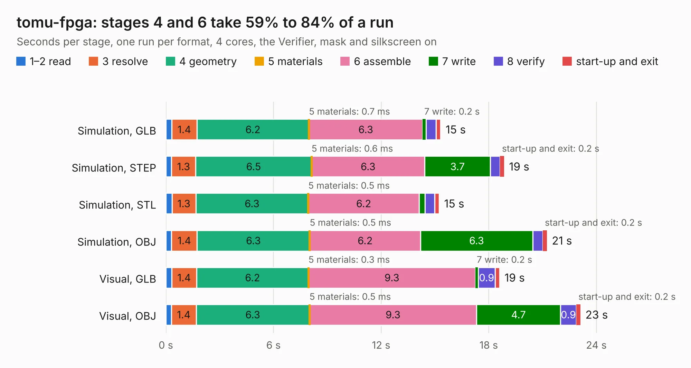

# 1229. tomu-fpga

Board 1,229 of the 3,131 of [Corpus Testing](../Corpus-Testing.md), on [Corpus Page 12](../CorpusTestingPages/Corpus-Testing-12.md#1229-tomu-fpga).

| Mode and format | 1–2 read | 3 resolve | 4 geometry | 5 materials | 6 assemble | 7 write | 8 verify | start-up and exit | Total |
|---|---:|---:|---:|---:|---:|---:|---:|---:|---:|
| Simulation, GLB | 0.3 | 1.4 | 6.2 | 0.7&nbsp;ms | 6.3 | 0.2 | 0.6 | 0.3 | 15.3 |
| Simulation, STEP | 0.3 | 1.3 | 6.5 | 0.6&nbsp;ms | 6.3 | 3.7 | 0.5 | 0.2 | 18.9 |
| Simulation, STL | 0.3 | 1.3 | 6.3 | 0.5&nbsp;ms | 6.2 | 0.3 | 0.5 | 0.3 | 15.2 |
| Simulation, OBJ | 0.3 | 1.4 | 6.3 | 0.5&nbsp;ms | 6.2 | 6.3 | 0.6 | 0.2 | 21.2 |
| Visual, GLB | 0.3 | 1.4 | 6.2 | 0.3&nbsp;ms | 9.3 | 0.2 | 0.9 | 0.2 | 18.6 |
| Visual, OBJ | 0.3 | 1.4 | 6.3 | 0.5&nbsp;ms | 9.3 | 4.7 | 0.9 | 0.2 | 23.1 |

<table align="center"><tr><td valign="top">

| Board | Repo: [im-tomu/fomu-hardware](https://github.com/im-tomu/fomu-hardware) Board: `tomu-fpga.kicad_pcb` |
|---|---|
| Folder | archive / evt / pcb |
| Complexity | 265&nbsp;/&nbsp;1000 (size&nbsp;220, features&nbsp;45) |
| KESE&nbsp;features | through vias, rounded, trapezoid or chamfered pads, filled zones |
| Tested | 9th November 2026 |
| Copper&nbsp;layers | 2 |
| File&nbsp;format | KiCad 5 (20171130) |
| Parts,&nbsp;tracks,&nbsp;vias | 62, 919, 162 |
| Triangles,&nbsp;simulation | 1,100,316 in 79 parts |
| Verifier | PASS in all six runs |

</td><td valign="top">

<table>
<tr><th>File type</th><th>File size</th><th>Peak memory used</th></tr>
<tr><th colspan="3" align="left">Simulation</th></tr>
<tr><td>GLB</td><td align="right">38&nbsp;MB</td><td align="right">474&nbsp;MB</td></tr>
<tr><td>STEP</td><td align="right">194&nbsp;MB</td><td align="right">565&nbsp;MB</td></tr>
<tr><td>STL</td><td align="right">55&nbsp;MB</td><td align="right">466&nbsp;MB</td></tr>
<tr><td>OBJ</td><td align="right">113&nbsp;MB</td><td align="right">811&nbsp;MB</td></tr>
<tr><th colspan="3" align="left">Visual</th></tr>
<tr><td>GLB</td><td align="right">27&nbsp;MB</td><td align="right">613&nbsp;MB</td></tr>
<tr><td>OBJ</td><td align="right">80&nbsp;MB</td><td align="right">616&nbsp;MB</td></tr>
</table>

</td></tr></table>

| Previous | Next |
|:---|---:|
| [1228. tomu-fpga](b1228b_fomu-hardware_archive-dvt-pcb_tomu-fpga.md) | [1230. tomu](b1230b_tomu-hardware_pcb_tomu.md) |
