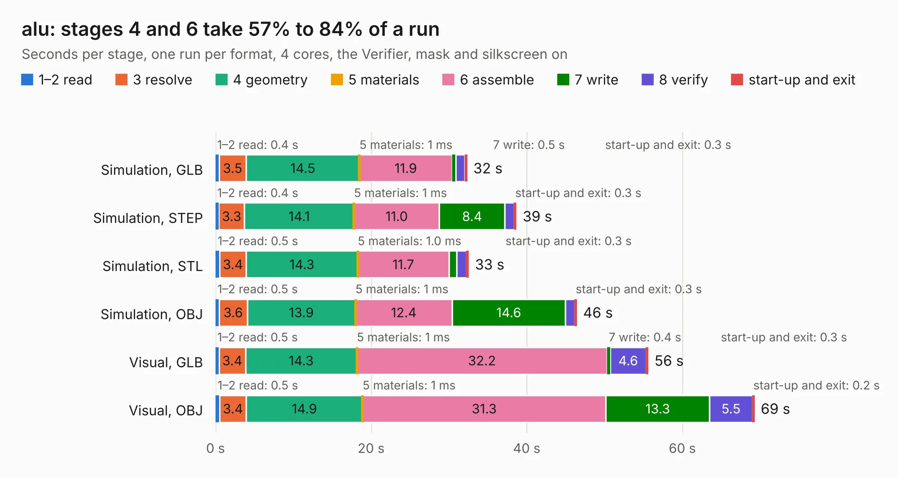

# 1230. alu

Board 1,230 of the 3,118 of [Corpus Testing](../Corpus-Testing.md), on [Corpus Page 12](../CorpusTestingPages/Corpus-Testing-12.md#1230-alu).

| Mode and format | 1–2 read | 3 resolve | 4 geometry | 5 materials | 6 assemble | 7 write | 8 verify | start-up and exit | Total |
|---|---:|---:|---:|---:|---:|---:|---:|---:|---:|
| Simulation, GLB | 0.4 | 3.5 | 14.5 | 1&nbsp;ms | 11.9 | 0.5 | 1.2 | 0.3 | 32.3 |
| Simulation, STEP | 0.4 | 3.3 | 14.1 | 1&nbsp;ms | 11.0 | 8.4 | 1.2 | 0.3 | 38.7 |
| Simulation, STL | 0.5 | 3.4 | 14.3 | 1.0&nbsp;ms | 11.7 | 1.0 | 1.3 | 0.3 | 32.5 |
| Simulation, OBJ | 0.5 | 3.6 | 13.9 | 1&nbsp;ms | 12.4 | 14.6 | 1.2 | 0.3 | 46.4 |
| Visual, GLB | 0.5 | 3.4 | 14.3 | 1&nbsp;ms | 32.2 | 0.4 | 4.6 | 0.3 | 55.6 |
| Visual, OBJ | 0.5 | 3.4 | 14.9 | 1&nbsp;ms | 31.3 | 13.3 | 5.5 | 0.2 | 69.3 |

<table align="center"><tr><td valign="top">

| Board | Repo: [imihajlow/ccpu](https://github.com/imihajlow/ccpu) Board: `alu.kicad_pcb` |
|---|---|
| Folder | boards / alu |
| Complexity | 262&nbsp;/&nbsp;1000 (size&nbsp;207, features&nbsp;55) |
| KESE&nbsp;features | through vias, rounded, trapezoid or chamfered pads, filled zones, copper text |
| Tested | 9th November 2026 |
| Copper&nbsp;layers | 2 |
| File&nbsp;format | KiCad 5 (20171130) |
| Parts,&nbsp;tracks,&nbsp;vias | 66, 4,386, 780 |
| Triangles,&nbsp;simulation | 3,122,734 in 178 parts |
| Verifier | PASS in all six runs |

</td><td valign="top">

<table>
<tr><th>File type</th><th>File size</th><th>Peak memory used</th></tr>
<tr><th colspan="3" align="left">Simulation</th></tr>
<tr><td>GLB</td><td align="right">108&nbsp;MB</td><td align="right">1.3&nbsp;GB</td></tr>
<tr><td>STEP</td><td align="right">542&nbsp;MB</td><td align="right">1.4&nbsp;GB</td></tr>
<tr><td>STL</td><td align="right">156&nbsp;MB</td><td align="right">1.3&nbsp;GB</td></tr>
<tr><td>OBJ</td><td align="right">332&nbsp;MB</td><td align="right">2.0&nbsp;GB</td></tr>
<tr><th colspan="3" align="left">Visual</th></tr>
<tr><td>GLB</td><td align="right">95&nbsp;MB</td><td align="right">1.7&nbsp;GB</td></tr>
<tr><td>OBJ</td><td align="right">300&nbsp;MB</td><td align="right">1.9&nbsp;GB</td></tr>
</table>

</td></tr></table>

| Previous | Next |
|:---|---:|
| [1229. tomu](b1229b_tomu-hardware_releases-v0-3-gerber_tomu.md) | [1231. control](b1231b_ccpu_control.md) |
