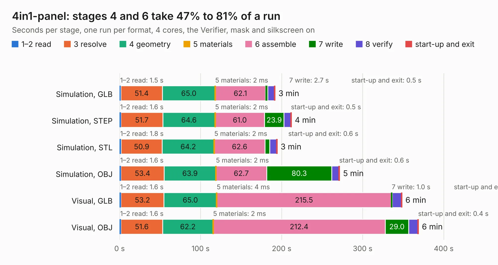

# 1230. 4in1-panel

Board 1,230 of the 3,107 of [Corpus Testing](../Corpus-Testing.md), on [Corpus Page 12](../CorpusTestingPages/Corpus-Testing-12.md#1230-4in1-panel).

| Mode and format | 1–2 read | 3 resolve | 4 geometry | 5 materials | 6 assemble | 7 write | 8 verify | start-up and exit | Total |
|---|---:|---:|---:|---:|---:|---:|---:|---:|---:|
| Simulation, GLB | 1.5 | 51.4 | 65.0 | 2&nbsp;ms | 62.1 | 2.7 | 8.3 | 0.5 | 191.7 |
| Simulation, STEP | 1.6 | 51.7 | 64.6 | 2&nbsp;ms | 61.0 | 23.9 | 8.6 | 0.5 | 211.8 |
| Simulation, STL | 1.8 | 50.9 | 64.2 | 2&nbsp;ms | 62.6 | 5.8 | 8.6 | 0.6 | 194.4 |
| Simulation, OBJ | 1.6 | 53.4 | 63.9 | 2&nbsp;ms | 62.7 | 80.3 | 8.9 | 0.6 | 271.3 |
| Visual, GLB | 1.6 | 53.2 | 65.0 | 4&nbsp;ms | 215.5 | 1.0 | 11.5 | 0.4 | 348.3 |
| Visual, OBJ | 1.6 | 51.6 | 62.2 | 2&nbsp;ms | 212.4 | 29.0 | 11.5 | 0.4 | 368.7 |

<table align="center"><tr><td valign="top">

| Board | Repo: [incutec-hw/openesc-30x30](https://github.com/incutec-hw/openesc-30x30) Board: `4in1-panel.kicad_pcb` |
|---|---|
| Folder | hardware |
| Complexity | 464&nbsp;/&nbsp;1000 (size&nbsp;259, features&nbsp;205) |
| KESE&nbsp;features | through vias, padstacks, custom pads, rounded, trapezoid or chamfered pads, drill offsets, filled zones, copper drawings, curved board outline, TrueType text, stack-up, dielectric εr and tanδ, copper finish, plated board edge |
| Tested | 9th November 2026 |
| Copper&nbsp;layers | 6 |
| File&nbsp;format | KiCad 10 (20260206) |
| Parts,&nbsp;tracks,&nbsp;vias | 388, 2,655, 2,604 |
| Triangles,&nbsp;simulation | 13,067,554 in 279 parts |
| Note | panel |
| Verifier | PASS in all six runs |

</td><td valign="top">

<table>
<tr><th>File type</th><th>File size</th><th>Peak memory used</th></tr>
<tr><th colspan="3" align="left">Simulation</th></tr>
<tr><td>GLB</td><td align="right">427&nbsp;MB</td><td align="right">2.9&nbsp;GB</td></tr>
<tr><td>STEP</td><td align="right">1.4&nbsp;GB</td><td align="right">3.8&nbsp;GB</td></tr>
<tr><td>STL</td><td align="right">653&nbsp;MB</td><td align="right">2.8&nbsp;GB</td></tr>
<tr><td>OBJ</td><td align="right">1.4&nbsp;GB</td><td align="right">8.0&nbsp;GB</td></tr>
<tr><th colspan="3" align="left">Visual</th></tr>
<tr><td>GLB</td><td align="right">196&nbsp;MB</td><td align="right">3.4&nbsp;GB</td></tr>
<tr><td>OBJ</td><td align="right">636&nbsp;MB</td><td align="right">4.2&nbsp;GB</td></tr>
</table>

</td></tr></table>

| Previous | Next |
|:---|---:|
| [1229. vga](b1229b_ccpu_vga.md) | [1231. 4in1](b1231b_openesc-30x30_4in1.md) |
