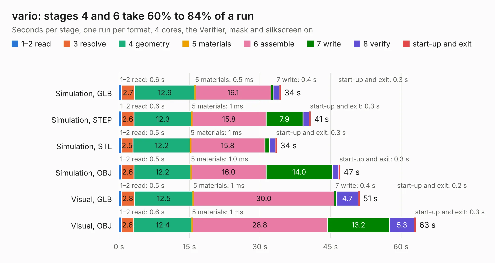

# 1231. vario

Board 1,231 of the 3,112 of [Corpus Testing](../Corpus-Testing.md), on [Corpus Page 12](../CorpusTestingPages/Corpus-Testing-12.md#1231-vario).

| Mode and format | 1–2 read | 3 resolve | 4 geometry | 5 materials | 6 assemble | 7 write | 8 verify | start-up and exit | Total |
|---|---:|---:|---:|---:|---:|---:|---:|---:|---:|
| Simulation, GLB | 0.6 | 2.7 | 12.9 | 0.5&nbsp;ms | 16.1 | 0.4 | 1.4 | 0.3 | 34.5 |
| Simulation, STEP | 0.6 | 2.6 | 12.3 | 1&nbsp;ms | 15.8 | 7.9 | 1.3 | 0.3 | 40.8 |
| Simulation, STL | 0.5 | 2.5 | 12.2 | 1&nbsp;ms | 15.8 | 1.0 | 1.3 | 0.3 | 33.6 |
| Simulation, OBJ | 0.5 | 2.6 | 12.2 | 1.0&nbsp;ms | 16.0 | 14.0 | 1.4 | 0.3 | 47.1 |
| Visual, GLB | 0.5 | 2.8 | 12.5 | 1&nbsp;ms | 30.0 | 0.4 | 4.7 | 0.2 | 51.2 |
| Visual, OBJ | 0.6 | 2.6 | 12.4 | 1&nbsp;ms | 28.8 | 13.2 | 5.3 | 0.3 | 63.2 |

<table align="center"><tr><td valign="top">

| Board | Repo: [imihajlow/ccpu](https://github.com/imihajlow/ccpu) Board: `vario.kicad_pcb` |
|---|---|
| Folder | boards / vario |
| Complexity | 263&nbsp;/&nbsp;1000 (size&nbsp;208, features&nbsp;55) |
| KESE&nbsp;features | through vias, rounded, trapezoid or chamfered pads, filled zones, copper text |
| Tested | 9th November 2026 |
| Copper&nbsp;layers | 2 |
| File&nbsp;format | KiCad 5 (20171130) |
| Parts,&nbsp;tracks,&nbsp;vias | 117, 2,905, 737 |
| Triangles,&nbsp;simulation | 3,018,872 in 181 parts |
| Verifier | PASS in all six runs |

</td><td valign="top">

<table>
<tr><th>File type</th><th>File size</th><th>Peak memory used</th></tr>
<tr><th colspan="3" align="left">Simulation</th></tr>
<tr><td>GLB</td><td align="right">105&nbsp;MB</td><td align="right">1.1&nbsp;GB</td></tr>
<tr><td>STEP</td><td align="right">485&nbsp;MB</td><td align="right">1.4&nbsp;GB</td></tr>
<tr><td>STL</td><td align="right">151&nbsp;MB</td><td align="right">1.1&nbsp;GB</td></tr>
<tr><td>OBJ</td><td align="right">322&nbsp;MB</td><td align="right">2.0&nbsp;GB</td></tr>
<tr><th colspan="3" align="left">Visual</th></tr>
<tr><td>GLB</td><td align="right">93&nbsp;MB</td><td align="right">1.5&nbsp;GB</td></tr>
<tr><td>OBJ</td><td align="right">296&nbsp;MB</td><td align="right">1.9&nbsp;GB</td></tr>
</table>

</td></tr></table>

| Previous | Next |
|:---|---:|
| [1230. stack](b1230b_ccpu_stack.md) | [1232. vga](b1232b_ccpu_vga.md) |
