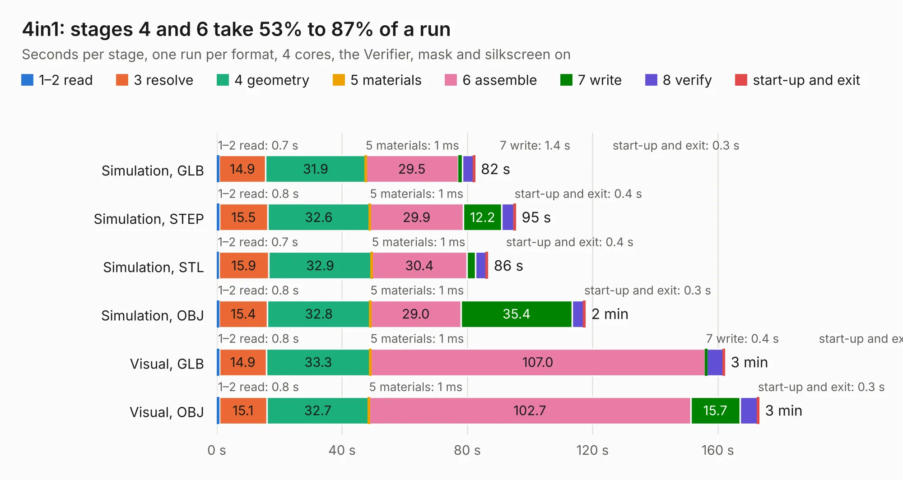

# 1231. 4in1

Board 1,231 of the 3,109 of [Corpus Testing](../Corpus-Testing.md), on [Corpus Page 12](../CorpusTestingPages/Corpus-Testing-12.md#1231-4in1).

| Mode and format | 1–2 read | 3 resolve | 4 geometry | 5 materials | 6 assemble | 7 write | 8 verify | start-up and exit | Total |
|---|---:|---:|---:|---:|---:|---:|---:|---:|---:|
| Simulation, GLB | 0.7 | 14.9 | 31.9 | 1&nbsp;ms | 29.5 | 1.4 | 3.5 | 0.3 | 82.3 |
| Simulation, STEP | 0.8 | 15.5 | 32.6 | 1&nbsp;ms | 29.9 | 12.2 | 3.9 | 0.4 | 95.3 |
| Simulation, STL | 0.7 | 15.9 | 32.9 | 1&nbsp;ms | 30.4 | 2.7 | 3.4 | 0.4 | 86.4 |
| Simulation, OBJ | 0.8 | 15.4 | 32.8 | 1&nbsp;ms | 29.0 | 35.4 | 3.8 | 0.3 | 117.5 |
| Visual, GLB | 0.8 | 14.9 | 33.3 | 1&nbsp;ms | 107.0 | 0.4 | 5.2 | 0.3 | 162.0 |
| Visual, OBJ | 0.8 | 15.1 | 32.7 | 1&nbsp;ms | 102.7 | 15.7 | 5.6 | 0.3 | 173.0 |

<table align="center"><tr><td valign="top">

| Board | Repo: [incutec-hw/openesc-30x30](https://github.com/incutec-hw/openesc-30x30) Board: `4in1.kicad_pcb` |
|---|---|
| Folder | hardware |
| Complexity | 415&nbsp;/&nbsp;1000 (size&nbsp;245, features&nbsp;170) |
| KESE&nbsp;features | through vias, padstacks, rounded, trapezoid or chamfered pads, drill offsets, filled zones, TrueType text, stack-up, dielectric εr and tanδ, copper finish, plated board edge |
| Tested | 9th November 2026 |
| Copper&nbsp;layers | 6 |
| File&nbsp;format | KiCad 10 (20260206) |
| Parts,&nbsp;tracks,&nbsp;vias | 214, 1,220, 1,702 |
| Triangles,&nbsp;simulation | 7,517,890 in 211 parts |
| Verifier | PASS in all six runs |

</td><td valign="top">

<table>
<tr><th>File type</th><th>File size</th><th>Peak memory used</th></tr>
<tr><th colspan="3" align="left">Simulation</th></tr>
<tr><td>GLB</td><td align="right">243&nbsp;MB</td><td align="right">1.6&nbsp;GB</td></tr>
<tr><td>STEP</td><td align="right">760&nbsp;MB</td><td align="right">2.2&nbsp;GB</td></tr>
<tr><td>STL</td><td align="right">376&nbsp;MB</td><td align="right">1.6&nbsp;GB</td></tr>
<tr><td>OBJ</td><td align="right">786&nbsp;MB</td><td align="right">4.6&nbsp;GB</td></tr>
<tr><th colspan="3" align="left">Visual</th></tr>
<tr><td>GLB</td><td align="right">113&nbsp;MB</td><td align="right">2.3&nbsp;GB</td></tr>
<tr><td>OBJ</td><td align="right">366&nbsp;MB</td><td align="right">2.4&nbsp;GB</td></tr>
</table>

</td></tr></table>

| Previous | Next |
|:---|---:|
| [1230. 4in1-panel](b1230b_openesc-30x30_4in1-panel.md) | [1232. H745 CM4 module](b1232b_bb3-cm4_H745-CM4-module.md) |
