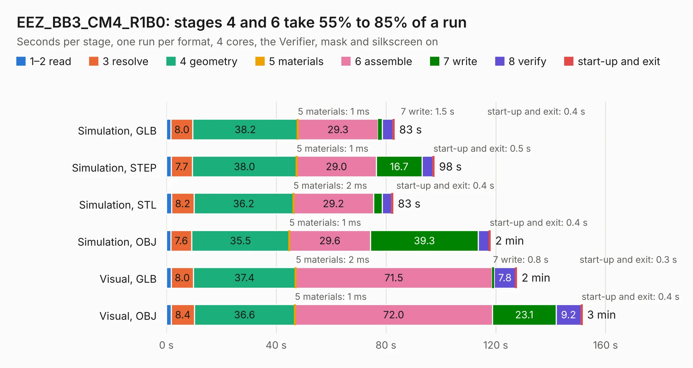

# 1233. EEZ_BB3_CM4_R1B0

Board 1,233 of the 3,106 of [Corpus Testing](../Corpus-Testing.md), on [Corpus Page 12](../CorpusTestingPages/Corpus-Testing-12.md#1233-eez_bb3_cm4_r1b0).

| Mode and format | 1–2 read | 3 resolve | 4 geometry | 5 materials | 6 assemble | 7 write | 8 verify | start-up and exit | Total |
|---|---:|---:|---:|---:|---:|---:|---:|---:|---:|
| Simulation, GLB | 1.7 | 8.0 | 38.2 | 1&nbsp;ms | 29.3 | 1.5 | 4.0 | 0.4 | 83.0 |
| Simulation, STEP | 1.7 | 7.7 | 38.0 | 1&nbsp;ms | 29.0 | 16.7 | 3.9 | 0.5 | 97.5 |
| Simulation, STL | 1.8 | 8.2 | 36.2 | 2&nbsp;ms | 29.2 | 3.2 | 3.4 | 0.4 | 82.5 |
| Simulation, OBJ | 1.6 | 7.6 | 35.5 | 1&nbsp;ms | 29.6 | 39.3 | 3.9 | 0.4 | 118.0 |
| Visual, GLB | 1.8 | 8.0 | 37.4 | 2&nbsp;ms | 71.5 | 0.8 | 7.8 | 0.3 | 127.6 |
| Visual, OBJ | 1.8 | 8.4 | 36.6 | 1&nbsp;ms | 72.0 | 23.1 | 9.2 | 0.4 | 151.5 |

<table align="center"><tr><td valign="top">

| Board | Repo: [intergalaktik/bb3-cm4](https://github.com/intergalaktik/bb3-cm4) Board: `EEZ_BB3_CM4_R1B0.kicad_pcb` |
|---|---|
| Folder | EEZ_BB3_CM4_R1B0 |
| Complexity | 376&nbsp;/&nbsp;1000 (size&nbsp;281, features&nbsp;95) |
| KESE&nbsp;features | through vias, rounded, trapezoid or chamfered pads, filled zones, copper text, curved board outline, stack-up, dielectric εr and tanδ |
| Tested | 9th November 2026 |
| Copper&nbsp;layers | 4 |
| File&nbsp;format | KiCad 6 (20211014) |
| Parts,&nbsp;tracks,&nbsp;vias | 239, 5,730, 914 |
| Triangles,&nbsp;simulation | 7,322,202 in 347 parts |
| Verifier | PASS in all six runs |

</td><td valign="top">

<table>
<tr><th>File type</th><th>File size</th><th>Peak memory used</th></tr>
<tr><th colspan="3" align="left">Simulation</th></tr>
<tr><td>GLB</td><td align="right">252&nbsp;MB</td><td align="right">2.0&nbsp;GB</td></tr>
<tr><td>STEP</td><td align="right">1.1&nbsp;GB</td><td align="right">2.5&nbsp;GB</td></tr>
<tr><td>STL</td><td align="right">366&nbsp;MB</td><td align="right">1.9&nbsp;GB</td></tr>
<tr><td>OBJ</td><td align="right">799&nbsp;MB</td><td align="right">4.7&nbsp;GB</td></tr>
<tr><th colspan="3" align="left">Visual</th></tr>
<tr><td>GLB</td><td align="right">149&nbsp;MB</td><td align="right">2.5&nbsp;GB</td></tr>
<tr><td>OBJ</td><td align="right">480&nbsp;MB</td><td align="right">3.2&nbsp;GB</td></tr>
</table>

</td></tr></table>

| Previous | Next |
|:---|---:|
| [1232. H745 CM4 module](b1232b_bb3-cm4_H745-CM4-module.md) | [1234. EEZ_DIB_BP3C_r3B3](b1234b_bb3-cm4_EEZ-BB3-CM4-R1B0_EEZ-DIB-BP3C-r3B3.md) |
