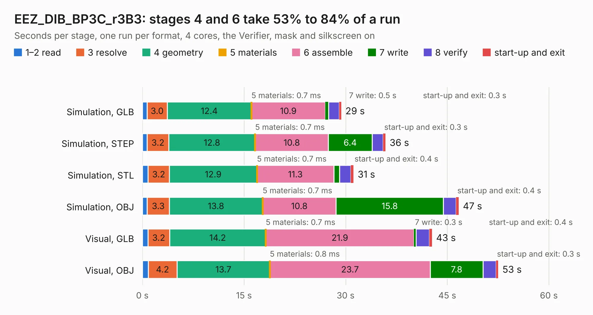

# 1235. EEZ_DIB_BP3C_r3B3

Board 1,235 of the 3,110 of [Corpus Testing](../Corpus-Testing.md), on [Corpus Page 12](../CorpusTestingPages/Corpus-Testing-12.md#1235-eez_dib_bp3c_r3b3).

| Mode and format | 1–2 read | 3 resolve | 4 geometry | 5 materials | 6 assemble | 7 write | 8 verify | start-up and exit | Total |
|---|---:|---:|---:|---:|---:|---:|---:|---:|---:|
| Simulation, GLB | 0.7 | 3.0 | 12.4 | 0.7&nbsp;ms | 10.9 | 0.5 | 1.6 | 0.3 | 29.4 |
| Simulation, STEP | 0.7 | 3.2 | 12.8 | 0.7&nbsp;ms | 10.8 | 6.4 | 1.6 | 0.3 | 35.9 |
| Simulation, STL | 0.8 | 3.2 | 12.9 | 0.7&nbsp;ms | 11.3 | 0.9 | 1.6 | 0.4 | 31.2 |
| Simulation, OBJ | 0.7 | 3.3 | 13.8 | 0.7&nbsp;ms | 10.8 | 15.8 | 1.9 | 0.4 | 46.7 |
| Visual, GLB | 0.8 | 3.2 | 14.2 | 0.7&nbsp;ms | 21.9 | 0.3 | 2.0 | 0.4 | 42.7 |
| Visual, OBJ | 0.9 | 4.2 | 13.7 | 0.8&nbsp;ms | 23.7 | 7.8 | 1.9 | 0.3 | 52.5 |

<table align="center"><tr><td valign="top">

| Board | Repo: [intergalaktik/bb3-cm4](https://github.com/intergalaktik/bb3-cm4) Board: `EEZ_DIB_BP3C_r3B3.kicad_pcb` |
|---|---|
| Folder | EEZ_BB3_CM4_R1B0 |
| Complexity | 288&nbsp;/&nbsp;1000 (size&nbsp;193, features&nbsp;95) |
| KESE&nbsp;features | through vias, rounded, trapezoid or chamfered pads, filled zones, copper text, curved board outline, stack-up, dielectric εr and tanδ |
| Tested | 9th November 2026 |
| Copper&nbsp;layers | 4 |
| File&nbsp;format | KiCad 6 (20211014) |
| Parts,&nbsp;tracks,&nbsp;vias | 55, 718, 161 |
| Triangles,&nbsp;simulation | 2,232,070 in 92 parts |
| Verifier | PASS in all six runs |

</td><td valign="top">

<table>
<tr><th>File type</th><th>File size</th><th>Peak memory used</th></tr>
<tr><th colspan="3" align="left">Simulation</th></tr>
<tr><td>GLB</td><td align="right">78&nbsp;MB</td><td align="right">652&nbsp;MB</td></tr>
<tr><td>STEP</td><td align="right">333&nbsp;MB</td><td align="right">847&nbsp;MB</td></tr>
<tr><td>STL</td><td align="right">112&nbsp;MB</td><td align="right">684&nbsp;MB</td></tr>
<tr><td>OBJ</td><td align="right">240&nbsp;MB</td><td align="right">1.5&nbsp;GB</td></tr>
<tr><th colspan="3" align="left">Visual</th></tr>
<tr><td>GLB</td><td align="right">43&nbsp;MB</td><td align="right">856&nbsp;MB</td></tr>
<tr><td>OBJ</td><td align="right">131&nbsp;MB</td><td align="right">974&nbsp;MB</td></tr>
</table>

</td></tr></table>

| Previous | Next |
|:---|---:|
| [1234. EEZ_BB3_CM4_R1B0](b1234b_bb3-cm4_EEZ-BB3-CM4-R1B0.md) | [1236. EEZ_DIB_MCU_r3B4](b1236b_bb3-cm4_EEZ-BB3-CM4-R1B0_EEZ-DIB-MCU-r3B4.md) |
