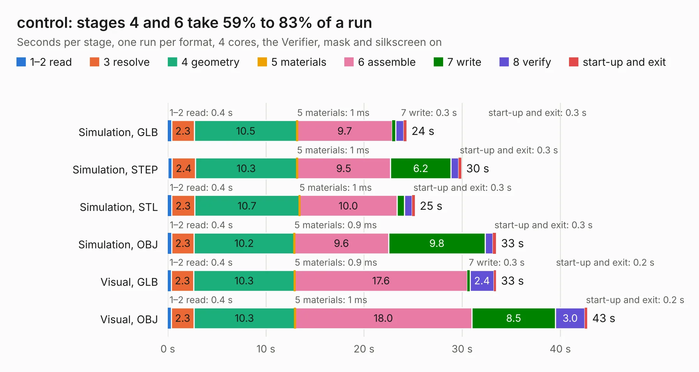

# 1236. control

Board 1,236 of the 3,132 of [Corpus Testing](../Corpus-Testing.md), on [Corpus Page 12](../CorpusTestingPages/Corpus-Testing-12.md#1236-control).

| Mode and format | 1–2 read | 3 resolve | 4 geometry | 5 materials | 6 assemble | 7 write | 8 verify | start-up and exit | Total |
|---|---:|---:|---:|---:|---:|---:|---:|---:|---:|
| Simulation, GLB | 0.4 | 2.3 | 10.5 | 1&nbsp;ms | 9.7 | 0.3 | 0.8 | 0.3 | 24.3 |
| Simulation, STEP | 0.4 | 2.4 | 10.3 | 1&nbsp;ms | 9.5 | 6.2 | 0.8 | 0.3 | 29.9 |
| Simulation, STL | 0.4 | 2.3 | 10.7 | 1&nbsp;ms | 10.0 | 0.7 | 0.8 | 0.3 | 25.2 |
| Simulation, OBJ | 0.4 | 2.3 | 10.2 | 0.9&nbsp;ms | 9.6 | 9.8 | 0.8 | 0.3 | 33.5 |
| Visual, GLB | 0.4 | 2.3 | 10.3 | 0.9&nbsp;ms | 17.6 | 0.3 | 2.4 | 0.2 | 33.5 |
| Visual, OBJ | 0.4 | 2.3 | 10.3 | 1&nbsp;ms | 18.0 | 8.5 | 3.0 | 0.2 | 42.7 |

<table align="center"><tr><td valign="top">

| Board | Repo: [imihajlow/ccpu](https://github.com/imihajlow/ccpu) Board: `control.kicad_pcb` |
|---|---|
| Folder | boards / control |
| Complexity | 250&nbsp;/&nbsp;1000 (size&nbsp;195, features&nbsp;55) |
| KESE&nbsp;features | through vias, rounded, trapezoid or chamfered pads, filled zones, copper text |
| Tested | 9th November 2026 |
| Copper&nbsp;layers | 2 |
| File&nbsp;format | KiCad 5 (20171130) |
| Parts,&nbsp;tracks,&nbsp;vias | 89, 1,430, 408 |
| Triangles,&nbsp;simulation | 1,991,990 in 129 parts |
| Verifier | PASS in all six runs |

</td><td valign="top">

<table>
<tr><th>File type</th><th>File size</th><th>Peak memory used</th></tr>
<tr><th colspan="3" align="left">Simulation</th></tr>
<tr><td>GLB</td><td align="right">69&nbsp;MB</td><td align="right">733&nbsp;MB</td></tr>
<tr><td>STEP</td><td align="right">343&nbsp;MB</td><td align="right">942&nbsp;MB</td></tr>
<tr><td>STL</td><td align="right">100&nbsp;MB</td><td align="right">747&nbsp;MB</td></tr>
<tr><td>OBJ</td><td align="right">209&nbsp;MB</td><td align="right">1.3&nbsp;GB</td></tr>
<tr><th colspan="3" align="left">Visual</th></tr>
<tr><td>GLB</td><td align="right">57&nbsp;MB</td><td align="right">1.1&nbsp;GB</td></tr>
<tr><td>OBJ</td><td align="right">176&nbsp;MB</td><td align="right">1.2&nbsp;GB</td></tr>
</table>

</td></tr></table>

| Previous | Next |
|:---|---:|
| [1235. alu](b1235b_ccpu_alu.md) | [1237. eth](b1237b_ccpu_eth.md) |
