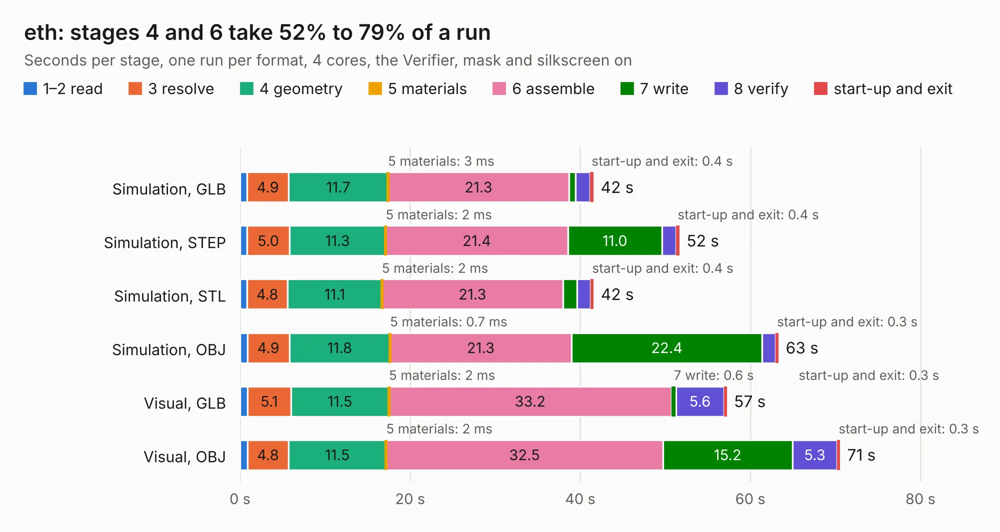

# 1236. eth

Board 1,236 of the 3,127 of [Corpus Testing](../Corpus-Testing.md), on [Corpus Page 12](../CorpusTestingPages/Corpus-Testing-12.md#1236-eth).

| Mode and format | 1–2 read | 3 resolve | 4 geometry | 5 materials | 6 assemble | 7 write | 8 verify | start-up and exit | Total |
|---|---:|---:|---:|---:|---:|---:|---:|---:|---:|
| Simulation, GLB | 0.8 | 4.9 | 11.7 | 3&nbsp;ms | 21.3 | 0.7 | 1.7 | 0.4 | 41.6 |
| Simulation, STEP | 0.8 | 5.0 | 11.3 | 2&nbsp;ms | 21.4 | 11.0 | 1.6 | 0.4 | 51.7 |
| Simulation, STL | 0.8 | 4.8 | 11.1 | 2&nbsp;ms | 21.3 | 1.7 | 1.6 | 0.4 | 41.6 |
| Simulation, OBJ | 0.9 | 4.9 | 11.8 | 0.7&nbsp;ms | 21.3 | 22.4 | 1.6 | 0.3 | 63.3 |
| Visual, GLB | 0.9 | 5.1 | 11.5 | 2&nbsp;ms | 33.2 | 0.6 | 5.6 | 0.3 | 57.2 |
| Visual, OBJ | 0.9 | 4.8 | 11.5 | 2&nbsp;ms | 32.5 | 15.2 | 5.3 | 0.3 | 70.5 |

<table align="center"><tr><td valign="top">

| Board | Repo: [imihajlow/ccpu](https://github.com/imihajlow/ccpu) Board: `eth.kicad_pcb` |
|---|---|
| Folder | boards / eth |
| Complexity | 323&nbsp;/&nbsp;1000 (size&nbsp;223, features&nbsp;100) |
| KESE&nbsp;features | through vias, rounded, trapezoid or chamfered pads, filled zones, copper text, stack-up, dielectric εr and tanδ, copper finish |
| Tested | 9th November 2026 |
| Copper&nbsp;layers | 4 |
| File&nbsp;format | KiCad 7 (20221018) |
| Parts,&nbsp;tracks,&nbsp;vias | 92, 2,811, 853 |
| Triangles,&nbsp;simulation | 4,559,284 in 229 parts |
| Verifier | PASS in all six runs |

</td><td valign="top">

<table>
<tr><th>File type</th><th>File size</th><th>Peak memory used</th></tr>
<tr><th colspan="3" align="left">Simulation</th></tr>
<tr><td>GLB</td><td align="right">151&nbsp;MB</td><td align="right">1.4&nbsp;GB</td></tr>
<tr><td>STEP</td><td align="right">514&nbsp;MB</td><td align="right">1.7&nbsp;GB</td></tr>
<tr><td>STL</td><td align="right">228&nbsp;MB</td><td align="right">1.4&nbsp;GB</td></tr>
<tr><td>OBJ</td><td align="right">494&nbsp;MB</td><td align="right">2.9&nbsp;GB</td></tr>
<tr><th colspan="3" align="left">Visual</th></tr>
<tr><td>GLB</td><td align="right">98&nbsp;MB</td><td align="right">1.6&nbsp;GB</td></tr>
<tr><td>OBJ</td><td align="right">323&nbsp;MB</td><td align="right">2.1&nbsp;GB</td></tr>
</table>

</td></tr></table>

| Previous | Next |
|:---|---:|
| [1235. control](b1235b_ccpu_control.md) | [1237. io](b1237b_ccpu_io.md) |
