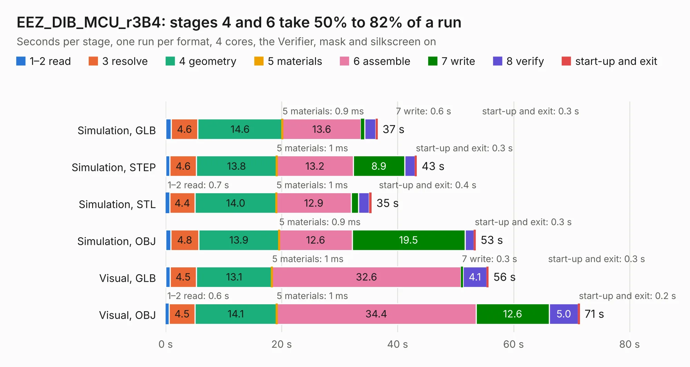

# 1238. EEZ_DIB_MCU_r3B4

Board 1,238 of the 3,108 of [Corpus Testing](../Corpus-Testing.md), on [Corpus Page 12](../CorpusTestingPages/Corpus-Testing-12.md#1238-eez_dib_mcu_r3b4).

| Mode and format | 1–2 read | 3 resolve | 4 geometry | 5 materials | 6 assemble | 7 write | 8 verify | start-up and exit | Total |
|---|---:|---:|---:|---:|---:|---:|---:|---:|---:|
| Simulation, GLB | 0.9 | 4.6 | 14.6 | 0.9&nbsp;ms | 13.6 | 0.6 | 1.9 | 0.3 | 36.6 |
| Simulation, STEP | 0.7 | 4.6 | 13.8 | 1&nbsp;ms | 13.2 | 8.9 | 1.8 | 0.3 | 43.3 |
| Simulation, STL | 0.7 | 4.4 | 14.0 | 1&nbsp;ms | 12.9 | 1.3 | 1.8 | 0.4 | 35.5 |
| Simulation, OBJ | 0.9 | 4.8 | 13.9 | 0.9&nbsp;ms | 12.6 | 19.5 | 1.6 | 0.3 | 53.5 |
| Visual, GLB | 0.8 | 4.5 | 13.1 | 1&nbsp;ms | 32.6 | 0.3 | 4.1 | 0.3 | 55.7 |
| Visual, OBJ | 0.6 | 4.5 | 14.1 | 1&nbsp;ms | 34.4 | 12.6 | 5.0 | 0.2 | 71.4 |

<table align="center"><tr><td valign="top">

| Board | Repo: [intergalaktik/bb3-cm4](https://github.com/intergalaktik/bb3-cm4) Board: `EEZ_DIB_MCU_r3B4.kicad_pcb` |
|---|---|
| Folder | EEZ_DIB_MCU_r3B4 |
| Complexity | 359&nbsp;/&nbsp;1000 (size&nbsp;264, features&nbsp;95) |
| KESE&nbsp;features | through vias, rounded, trapezoid or chamfered pads, filled zones, copper text, curved board outline, stack-up, dielectric εr and tanδ |
| Tested | 9th November 2026 |
| Copper&nbsp;layers | 4 |
| File&nbsp;format | KiCad 7 (20221018) |
| Parts,&nbsp;tracks,&nbsp;vias | 118, 2,912, 638 |
| Triangles,&nbsp;simulation | 3,889,020 in 275 parts |
| Verifier | PASS in all six runs |

</td><td valign="top">

<table>
<tr><th>File type</th><th>File size</th><th>Peak memory used</th></tr>
<tr><th colspan="3" align="left">Simulation</th></tr>
<tr><td>GLB</td><td align="right">131&nbsp;MB</td><td align="right">1.1&nbsp;GB</td></tr>
<tr><td>STEP</td><td align="right">509&nbsp;MB</td><td align="right">1.6&nbsp;GB</td></tr>
<tr><td>STL</td><td align="right">194&nbsp;MB</td><td align="right">1.2&nbsp;GB</td></tr>
<tr><td>OBJ</td><td align="right">414&nbsp;MB</td><td align="right">2.6&nbsp;GB</td></tr>
<tr><th colspan="3" align="left">Visual</th></tr>
<tr><td>GLB</td><td align="right">86&nbsp;MB</td><td align="right">1.4&nbsp;GB</td></tr>
<tr><td>OBJ</td><td align="right">274&nbsp;MB</td><td align="right">1.8&nbsp;GB</td></tr>
</table>

</td></tr></table>

| Previous | Next |
|:---|---:|
| [1237. EEZ_DIB_BP3C_r3B3](b1237b_bb3-cm4_EEZ-DIB-BP3C-R3B3_EEZ-DIB-BP3C-r3B3.md) | [1239. Intergalaktik_proto](b1239b_business-card-smd-proto_Intergalaktik-proto.md) |
