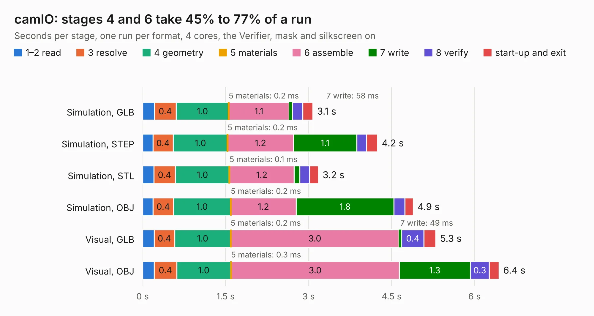

# 1241. camIO

Board 1,241 of the 3,105 of [Corpus Testing](../Corpus-Testing.md), on [Corpus Page 12](../CorpusTestingPages/Corpus-Testing-12.md#1241-camio).

| Mode and format | 1–2 read | 3 resolve | 4 geometry | 5 materials | 6 assemble | 7 write | 8 verify | start-up and exit | Total |
|---|---:|---:|---:|---:|---:|---:|---:|---:|---:|
| Simulation, GLB | 0.2 | 0.4 | 1.0 | 0.2&nbsp;ms | 1.1 | 58&nbsp;ms | 0.2 | 0.2 | 3.1 |
| Simulation, STEP | 0.2 | 0.4 | 1.0 | 0.2&nbsp;ms | 1.2 | 1.1 | 0.2 | 0.2 | 4.2 |
| Simulation, STL | 0.2 | 0.4 | 1.0 | 0.1&nbsp;ms | 1.2 | 0.1 | 0.2 | 0.2 | 3.2 |
| Simulation, OBJ | 0.2 | 0.4 | 1.0 | 0.2&nbsp;ms | 1.2 | 1.8 | 0.2 | 0.2 | 4.9 |
| Visual, GLB | 0.2 | 0.4 | 1.0 | 0.2&nbsp;ms | 3.0 | 49&nbsp;ms | 0.4 | 0.2 | 5.3 |
| Visual, OBJ | 0.2 | 0.4 | 1.0 | 0.3&nbsp;ms | 3.0 | 1.3 | 0.3 | 0.2 | 6.4 |

<table align="center"><tr><td valign="top">

| Board | Repo: [intergalaktik/Extension_Boards_for_Olimex_GateMate](https://github.com/intergalaktik/Extension_Boards_for_Olimex_GateMate) Board: `camIO.kicad_pcb` |
|---|---|
| Folder | camIO |
| Complexity | 286&nbsp;/&nbsp;1000 (size&nbsp;171, features&nbsp;115) |
| KESE&nbsp;features | through vias, rounded, trapezoid or chamfered pads, filled zones, curved board outline, knockout text, stack-up, dielectric εr and tanδ, copper finish |
| Tested | 9th November 2026 |
| Copper&nbsp;layers | 4 |
| File&nbsp;format | KiCad 8 (20240108) |
| Parts,&nbsp;tracks,&nbsp;vias | 25, 296, 76 |
| Triangles,&nbsp;simulation | 422,226 in 40 parts |
| Verifier | PASS in all six runs |

</td><td valign="top">

<table>
<tr><th>File type</th><th>File size</th><th>Peak memory used</th></tr>
<tr><th colspan="3" align="left">Simulation</th></tr>
<tr><td>GLB</td><td align="right">15&nbsp;MB</td><td align="right">290&nbsp;MB</td></tr>
<tr><td>STEP</td><td align="right">66&nbsp;MB</td><td align="right">323&nbsp;MB</td></tr>
<tr><td>STL</td><td align="right">21&nbsp;MB</td><td align="right">303&nbsp;MB</td></tr>
<tr><td>OBJ</td><td align="right">43&nbsp;MB</td><td align="right">337&nbsp;MB</td></tr>
<tr><th colspan="3" align="left">Visual</th></tr>
<tr><td>GLB</td><td align="right">12&nbsp;MB</td><td align="right">321&nbsp;MB</td></tr>
<tr><td>OBJ</td><td align="right">34&nbsp;MB</td><td align="right">315&nbsp;MB</td></tr>
</table>

</td></tr></table>

| Previous | Next |
|:---|---:|
| [1240. adcIO](b1240b_Extension-Boards-for-Olimex-GateMate_adcIO.md) | [1242. dualTranslation](b1242b_Extension-Boards-for-Olimex-GateMate_dualTranslation.md) |
