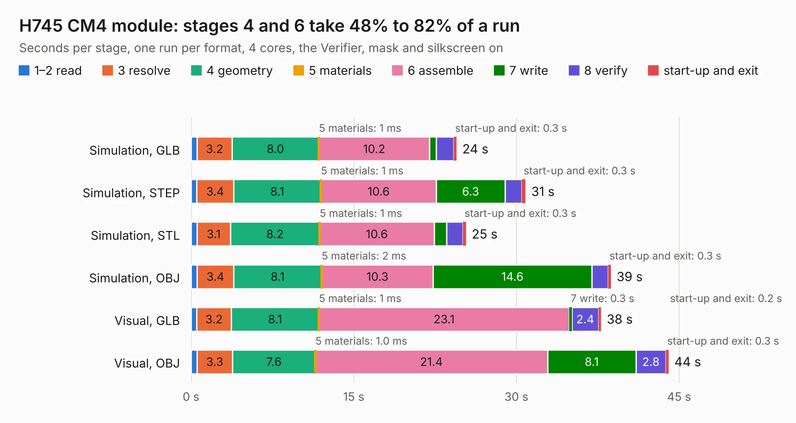

# 1241. H745 CM4 module

Board 1,241 of the 3,119 of [Corpus Testing](../Corpus-Testing.md), on [Corpus Page 12](../CorpusTestingPages/Corpus-Testing-12.md#1241-h745-cm4-module).

| Mode and format | 1–2 read | 3 resolve | 4 geometry | 5 materials | 6 assemble | 7 write | 8 verify | start-up and exit | Total |
|---|---:|---:|---:|---:|---:|---:|---:|---:|---:|
| Simulation, GLB | 0.6 | 3.2 | 8.0 | 1&nbsp;ms | 10.2 | 0.6 | 1.6 | 0.3 | 24.5 |
| Simulation, STEP | 0.5 | 3.4 | 8.1 | 1&nbsp;ms | 10.6 | 6.3 | 1.6 | 0.3 | 30.8 |
| Simulation, STL | 0.5 | 3.1 | 8.2 | 1&nbsp;ms | 10.6 | 1.2 | 1.5 | 0.3 | 25.4 |
| Simulation, OBJ | 0.6 | 3.4 | 8.1 | 2&nbsp;ms | 10.3 | 14.6 | 1.5 | 0.3 | 38.7 |
| Visual, GLB | 0.5 | 3.2 | 8.1 | 1&nbsp;ms | 23.1 | 0.3 | 2.4 | 0.2 | 37.8 |
| Visual, OBJ | 0.5 | 3.3 | 7.6 | 1.0&nbsp;ms | 21.4 | 8.1 | 2.8 | 0.3 | 44.0 |

<table align="center"><tr><td valign="top">

| Board | Repo: [intergalaktik/bb3-cm4](https://github.com/intergalaktik/bb3-cm4) Board: `H745 CM4 module.kicad_pcb` |
|---|---|
| Folder | EEZ_BB3_CM4_H7 |
| Complexity | 356&nbsp;/&nbsp;1000 (size&nbsp;271, features&nbsp;85) |
| KESE&nbsp;features | through vias, rounded, trapezoid or chamfered pads, filled zones, curved board outline, stack-up, dielectric εr and tanδ |
| Tested | 9th November 2026 |
| Copper&nbsp;layers | 6 |
| File&nbsp;format | KiCad 7 (20221018) |
| Parts,&nbsp;tracks,&nbsp;vias | 110, 2,859, 483 |
| Triangles,&nbsp;simulation | 3,491,940 in 292 parts |
| Verifier | PASS in all six runs |

</td><td valign="top">

<table>
<tr><th>File type</th><th>File size</th><th>Peak memory used</th></tr>
<tr><th colspan="3" align="left">Simulation</th></tr>
<tr><td>GLB</td><td align="right">119&nbsp;MB</td><td align="right">1.1&nbsp;GB</td></tr>
<tr><td>STEP</td><td align="right">439&nbsp;MB</td><td align="right">1.3&nbsp;GB</td></tr>
<tr><td>STL</td><td align="right">175&nbsp;MB</td><td align="right">1.0&nbsp;GB</td></tr>
<tr><td>OBJ</td><td align="right">375&nbsp;MB</td><td align="right">2.3&nbsp;GB</td></tr>
<tr><th colspan="3" align="left">Visual</th></tr>
<tr><td>GLB</td><td align="right">65&nbsp;MB</td><td align="right">1.2&nbsp;GB</td></tr>
<tr><td>OBJ</td><td align="right">213&nbsp;MB</td><td align="right">1.5&nbsp;GB</td></tr>
</table>

</td></tr></table>

| Previous | Next |
|:---|---:|
| [1240. 4in1](b1240b_openesc-30x30_4in1.md) | [1242. EEZ_BB3_CM4_R1B0](b1242b_bb3-cm4_EEZ-BB3-CM4-R1B0.md) |
