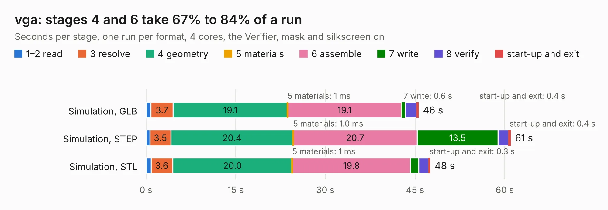

# 1241. vga

Board 1,241 of the 3,127 of [Corpus Testing](../Corpus-Testing.md), on [Corpus Page 12](../CorpusTestingPages/Corpus-Testing-12.md#1241-vga).

| Mode and format | 1–2 read | 3 resolve | 4 geometry | 5 materials | 6 assemble | 7 write | 8 verify | start-up and exit | Total |
|---|---:|---:|---:|---:|---:|---:|---:|---:|---:|
| Simulation, GLB | 0.8 | 3.7 | 19.1 | 1&nbsp;ms | 19.1 | 0.6 | 1.9 | 0.4 | 45.6 |
| Simulation, STEP | 0.6 | 3.5 | 20.4 | 1.0&nbsp;ms | 20.7 | 13.5 | 1.8 | 0.4 | 61.0 |
| Simulation, STL | 0.8 | 3.6 | 20.0 | 1&nbsp;ms | 19.8 | 1.4 | 1.6 | 0.3 | 47.5 |
| Simulation, OBJ | 0.7 | 3.4 | 19.6 | 0.6&nbsp;ms | 19.7 | 22.3 | 1.6 | 0.3 | 67.7 |
| Visual, GLB | 0.6 | 3.4 | 19.6 | 3&nbsp;ms | 39.9 | 0.5 | 4.7 | 0.4 | 69.0 |
| Visual, OBJ | 0.7 | 3.3 | 21.7 | 1&nbsp;ms | 39.0 | 16.9 | 4.6 | 0.3 | 86.5 |

<table align="center"><tr><td valign="top">

| Board | Repo: [imihajlow/ccpu](https://github.com/imihajlow/ccpu) Board: `vga.kicad_pcb` |
|---|---|
| Folder | boards / vga |
| Complexity | 300&nbsp;/&nbsp;1000 (size&nbsp;245, features&nbsp;55) |
| KESE&nbsp;features | through vias, rounded, trapezoid or chamfered pads, filled zones, copper text |
| Tested | 9th November 2026 |
| Copper&nbsp;layers | 2 |
| File&nbsp;format | KiCad 5 (20171130) |
| Parts,&nbsp;tracks,&nbsp;vias | 80, 3,075, 715 |
| Triangles,&nbsp;simulation | 3,380,028 in 171 parts |
| Verifier | PASS in all six runs |

</td><td valign="top">

<table>
<tr><th>File type</th><th>File size</th><th>Peak memory used</th></tr>
<tr><th colspan="3" align="left">Simulation</th></tr>
<tr><td>GLB</td><td align="right">116&nbsp;MB</td><td align="right">1.2&nbsp;GB</td></tr>
<tr><td>STEP</td><td align="right">593&nbsp;MB</td><td align="right">1.5&nbsp;GB</td></tr>
<tr><td>STL</td><td align="right">169&nbsp;MB</td><td align="right">1.1&nbsp;GB</td></tr>
<tr><td>OBJ</td><td align="right">358&nbsp;MB</td><td align="right">2.2&nbsp;GB</td></tr>
<tr><th colspan="3" align="left">Visual</th></tr>
<tr><td>GLB</td><td align="right">95&nbsp;MB</td><td align="right">1.6&nbsp;GB</td></tr>
<tr><td>OBJ</td><td align="right">302&nbsp;MB</td><td align="right">2.0&nbsp;GB</td></tr>
</table>

</td></tr></table>

| Previous | Next |
|:---|---:|
| [1240. vario](b1240b_ccpu_vario.md) | [1242. 4in1-panel](b1242b_openesc-30x30_4in1-panel.md) |
